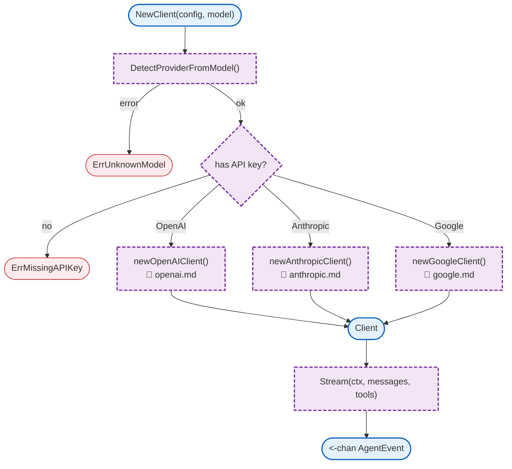

# LLM Client

Unified LLM client factory supporting OpenAI, Anthropic, and Google providers.

## Overview



## Constants

### Provider

| Constant | Type | Value | Description |
|----------|------|-------|-------------|
| `ProviderOpenAI` | `Provider` | `"openai"` | OpenAI provider |
| `ProviderAnthropic` | `Provider` | `"anthropic"` | Anthropic provider |
| `ProviderGoogle` | `Provider` | `"google"` | Google provider |

### Default

| Constant | Type | Value | Description |
|----------|------|-------|-------------|
| `DefaultTimeout` | `time.Duration` | `120s` | Default request timeout |

## Structs

### Client

| Struct | Field | Type | Description |
|--------|-------|------|-------------|
| `Client` | `provider` | `Provider` | Active provider |
| | `openai` | `*openaiClient` | OpenAI client |
| | `anthropic` | `*anthropicClient` | Anthropic client |
| | `google` | `*googleClient` | Google client |
| | `model` | `agent.Model` | Model configuration |

### Config

| Struct | Field | Type | Description |
|--------|-------|------|-------------|
| `Config` | `OpenAIAPIKey` | `string` | OpenAI API key |
| | `AnthropicAPIKey` | `string` | Anthropic API key |
| | `GoogleAPIKey` | `string` | Google API key |
| | `OpenAIBaseURL` | `string` | OpenAI base URL (optional) |
| | `AnthropicBaseURL` | `string` | Anthropic base URL (optional) |
| | `GoogleBaseURL` | `string` | Google base URL (optional) |
| | `Timeout` | `time.Duration` | Request timeout |

## Functions

| Function | Signature | Description |
|----------|-----------|-------------|
| `ProviderFromString` | `(s string) (Provider, error)` | Parses provider string |
| `DetectProviderFromModel` | `(model string) (Provider, error)` | Detects provider from model name |
| `NewClient` | `(config Config, model agent.Model) (*Client, error)` | Creates unified client |
| `Stream` | `(ctx context.Context, messages []agent.AgentMessage, tools []agent.Tool) (<-chan agent.AgentEvent, error)` | Streams from LLM |
| `GetProvider` | `() Provider` | Returns active provider |
| `GetModel` | `() agent.Model` | Returns model config |

## Model Provider Mapping

| Pattern | Provider |
|---------|----------|
| `gpt-4`, `gpt-3.5`, `gpt-4o`, `gpt-4-turbo`, `o1-` | OpenAI |
| `claude-` | Anthropic |
| `gemini-` | Google |

## Error Handling

| Error Type | Handler | Behavior |
|------------|---------|----------|
| `ErrMissingAPIKey` | Returns error | No API key for provider |
| `ErrUnknownProvider` | Returns error | Invalid provider string |
| `ErrUnknownModel` | Returns error | Cannot detect provider from model |

## Design Notes

### Auto-Detection from Model Name

**Q: Why auto-detect provider from model name?**

| Aspect | Description |
|--------|-------------|
| Context | Provider configuration |
| Options considered | Explicit provider, auto-detect, hybrid |
| Rationale | Most models have unique prefixes |

**Current approach is recommended because:**
- Less configuration needed
- Prevents provider/model mismatches
- Falls back to explicit provider if set
- Clear error if model is unknown

### Unified Client Interface

**Q: Why wrap all providers in one Client type?**

| Aspect | Description |
|--------|-------------|
| Context | Provider abstraction |
| Options considered | Separate clients, interface-based, unified |
| Rationale | Single type implements agent.LLMClient |

**Current approach is recommended because:**
- Agent doesn't need provider knowledge
- Easy to switch providers
- Consistent event format
- Single Stream() method

## Test Coverage

### Unit Tests

| Test Suite | Coverage |
|------------|----------|
| `TestProviderFromString` | Provider parsing |
| `TestDetectProviderFromModel` | Model detection |
| `TestNewClient` | Client creation |
| `TestNewClient_MissingAPIKey` | API key validation |
| `TestConfig_ApplyDefaults` | Default values |

**Running:**
```bash
make test ./internal/llm
```

## Dependencies and Location

| Package | Purpose |
|---------|---------|
| `github.com/openai/openai-go` | OpenAI SDK |
| `internal/agent` | Agent types |

**File Locations:**
- [`internal/llm/factory.go`](../../internal/llm/factory.go) - Client factory
- [`internal/llm/types.go`](../../internal/llm/types.go) - Types and config
- [`internal/llm/openai.go`](../../internal/llm/openai.go) - OpenAI client
- [`internal/llm/anthropic.go`](../../internal/llm/anthropic.go) - Anthropic client
- [`internal/llm/google.go`](../../internal/llm/google.go) - Google client
- [`internal/llm/tools.go`](../../internal/llm/tools.go) - Tool conversion

## Related

- [LLM Proxy](../llm-proxy/README.md) - Uses LLM client
- [Agent](../agent/README.md) - Consumes LLM events
- [Config Models](../../config/models.md) - Model configuration
