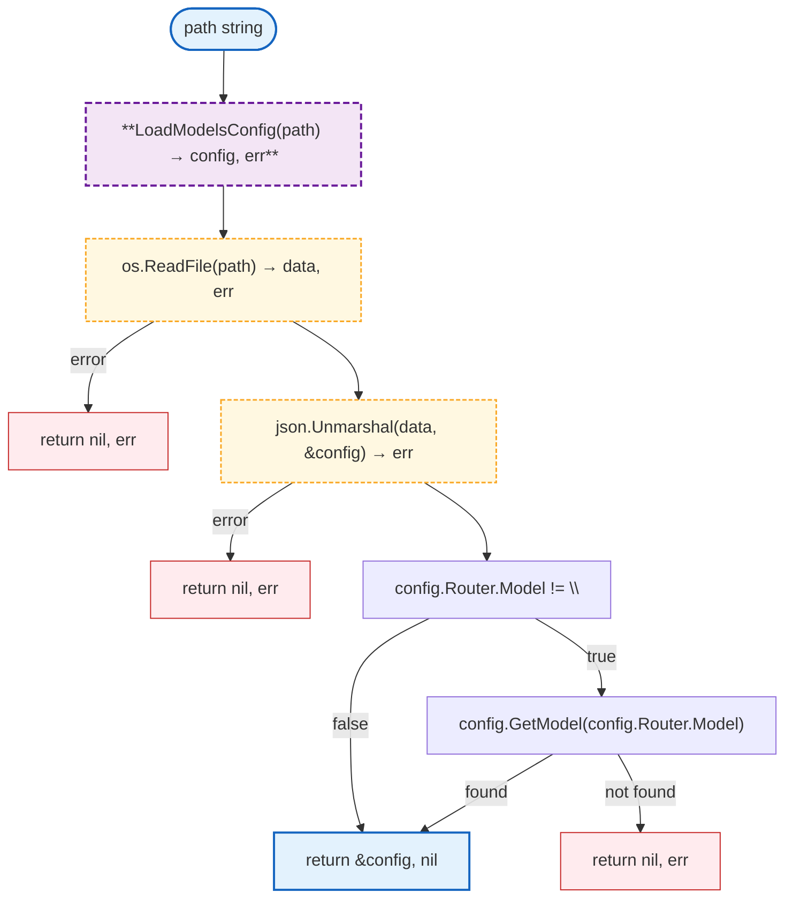
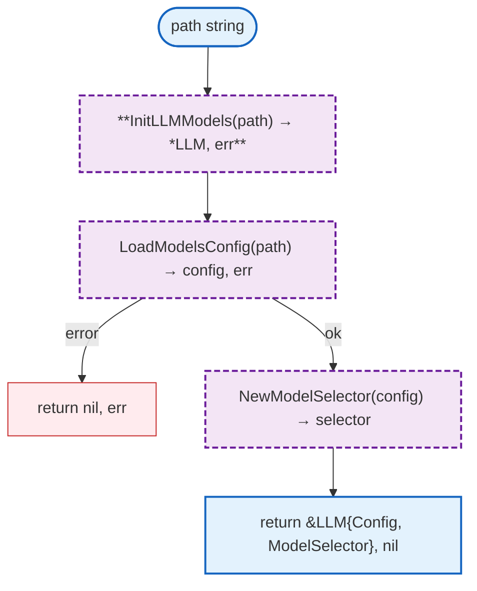
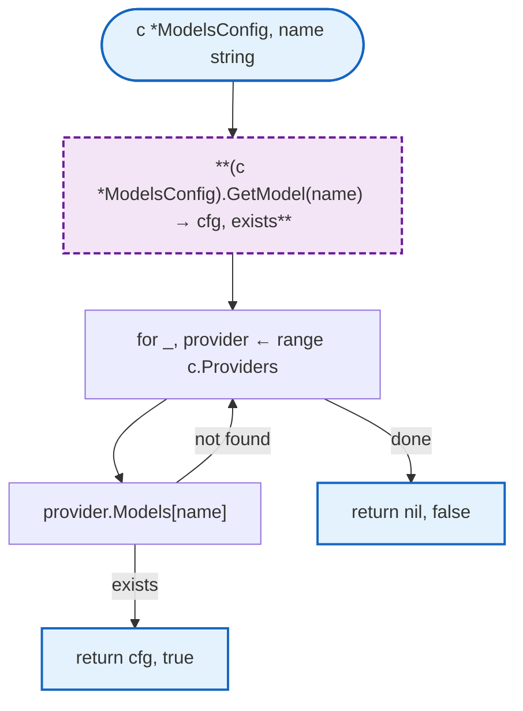
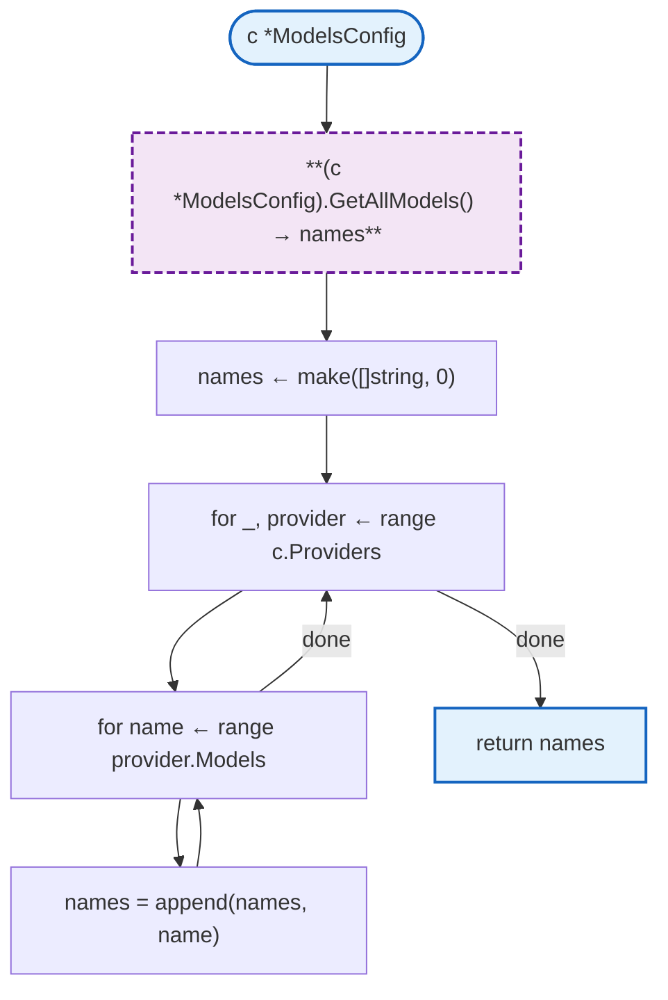
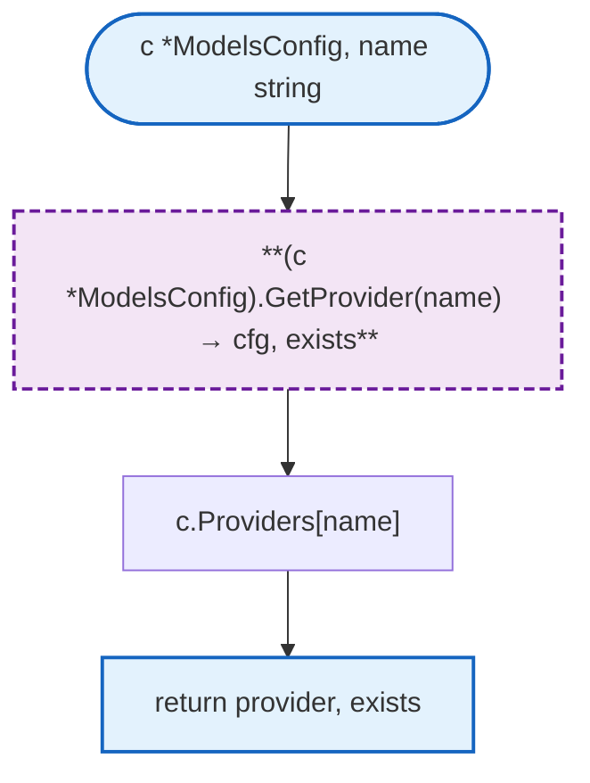
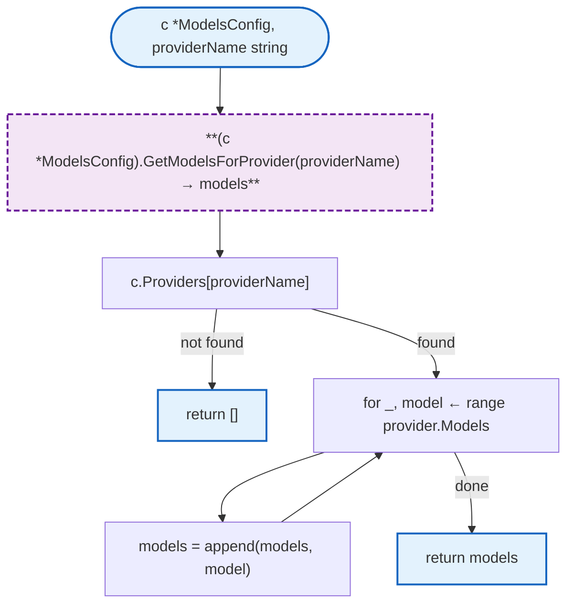
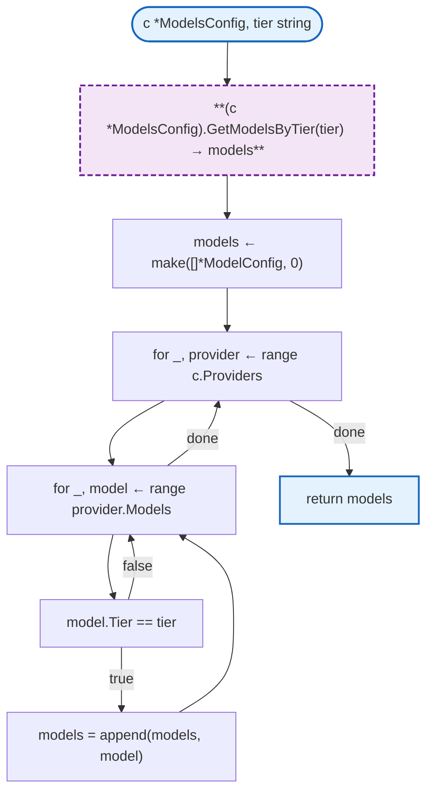
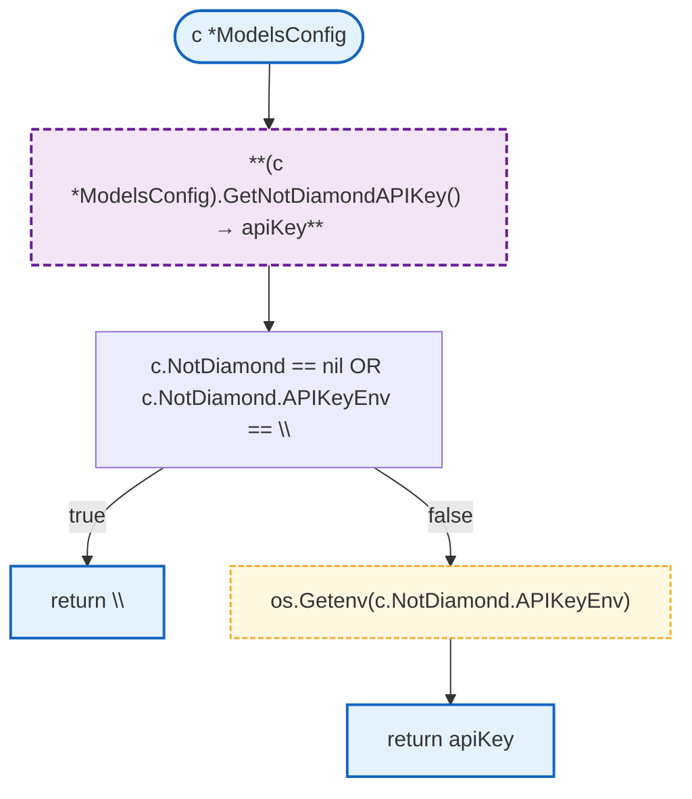
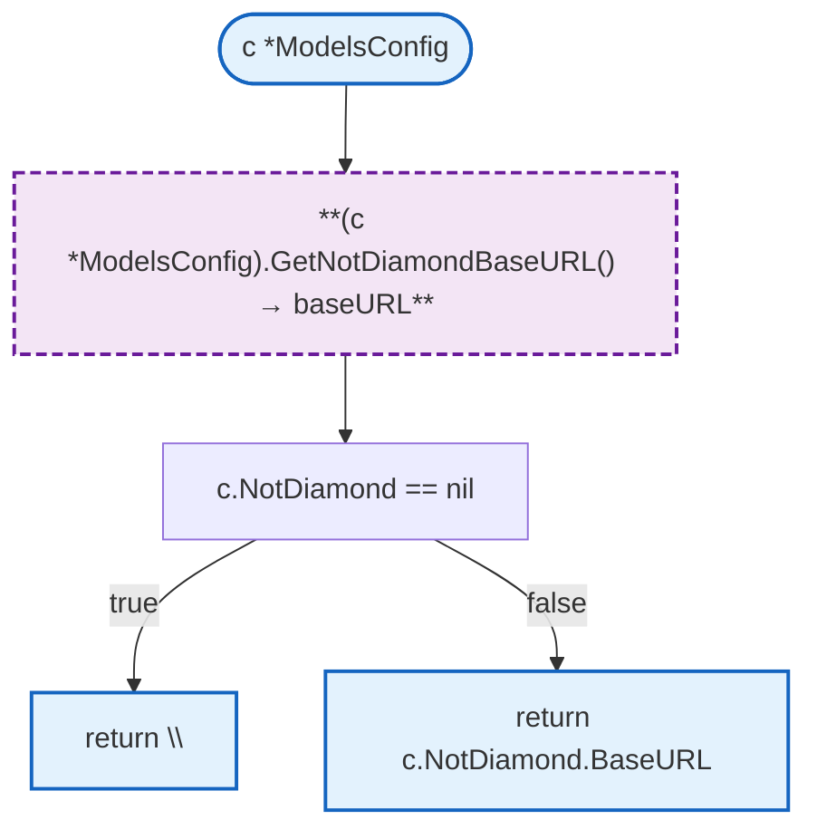

# Models Configuration

JSON-based LLM model and provider configuration. Defines model costs, provider settings, and NotDiamond router integration.

**Package:** `github.com/nevaria-ai/gateway/internal/llm`

## Overview

## Structs

### ModelsConfig

| Struct | Field | Type | Description |
|--------|-------|------|-------------|
| `ModelsConfig` | `Providers` | `map[string]*ProviderConfig` | Provider name to config mapping |
| | `NotDiamond` | `*NotDiamondConfig` | NotDiamond router settings |
| | `Router` | `RouterConfig` | Default router configuration |

### ProviderConfig

| Struct | Field | Type | Description |
|--------|-------|------|-------------|
| `ProviderConfig` | `APIKeyEnv` | `string` | Environment variable name for API key |
| | `BaseURL` | `string` | Provider API base URL |
| | `Models` | `map[string]*ModelConfig` | Model name to config mapping |

### ModelConfig

| Struct | Field | Type | Description |
|--------|-------|------|-------------|
| `ModelConfig` | `InputCostPerMillion` | `float64` | Input token cost per million |
| | `OutputCostPerMillion` | `float64` | Output token cost per million |
| | `MaxTokens` | `int` | Maximum context tokens |
| | `Tier` | `string` | Pricing tier (economy, standard, premium) |

### NotDiamondConfig

| Struct | Field | Type | Description |
|--------|-------|------|-------------|
| `NotDiamondConfig` | `APIKeyEnv` | `string` | Environment variable name for API key |
| | `BaseURL` | `string` | NotDiamond API base URL |

### RouterConfig

| Struct | Field | Type | Description |
|--------|-------|------|-------------|
| `RouterConfig` | `Model` | `string` | Model for routing decisions |
| | `Timeout` | `string` | Router request timeout |
| | `MaxRetries` | `int` | Maximum retry attempts |

## Functions

### LoadModelsConfig



### InitLLMModels

Entry point for LLM initialization. Returns `*LLM` with both config and model selector.



### LLM

| Struct | Field | Type | Description |
|--------|-------|------|-------------|
| `LLM` | `Config` | `*ModelsConfig` | Loaded models configuration |
| | `ModelSelector` | `*ModelSelector` | NotDiamond model router |

### GetModel



### GetAllModels



### GetProvider



### GetModelsForProvider



### GetModelsByTier



### GetNotDiamondAPIKey



### GetNotDiamondBaseURL



## Design Notes

### JSON-Based Configuration

**Q: Why use JSON for model configuration?**

| Aspect | Description |
|--------|-------------|
| Context | Model costs and providers change frequently |
| Options considered | Code constants, JSON, YAML, Database |
| Rationale | JSON is simple, widely supported, and easy to parse |

**Current approach is recommended because:**
- Easy to add new models without code changes
- Cost updates don't require deployment
- Version controlled alongside code
- Native Go encoding/json support

### Env-Based API Keys

**Q: Why store API key env var names instead of keys directly?**

| Aspect | Description |
|--------|-------------|
| Context | API keys are sensitive secrets |
| Options considered | Store keys in config, env var names, separate secrets file |
| Rationale | Keeps secrets out of version control while allowing config flexibility |

**Current approach is recommended because:**
- Config file can be committed to git safely
- Keys injected at runtime via environment
- Standard 12-factor app pattern
- Easy to rotate keys without config changes

## Test Coverage

### Unit Tests

| Test Suite | Coverage |
|------------|----------|
| `TestLoadModelsConfig` | Valid JSON loading |
| `TestGetModel` | Model retrieval across providers |
| `TestGetAllModels` | All models list |
| `TestGetProviderConfig` | Provider retrieval |
| `TestGetModelsForProvider` | Provider filtering |
| `TestGetModelsByTier` | Tier filtering |

**Running:**
```bash
make test-unit
```

## Dependencies and Location

| Package | Purpose |
|---------|---------|
| `encoding/json` | JSON parsing |
| `os` | Environment variable access |

**File Location:** [`internal/llm/models_config.go`](https://github.com/nevaria-ai/gateway/blob/main/internal/llm/models_config.go)

## Related

- [Config README](README.md) - Main configuration
- [Plans](plans.md) - Subscription plan definitions
