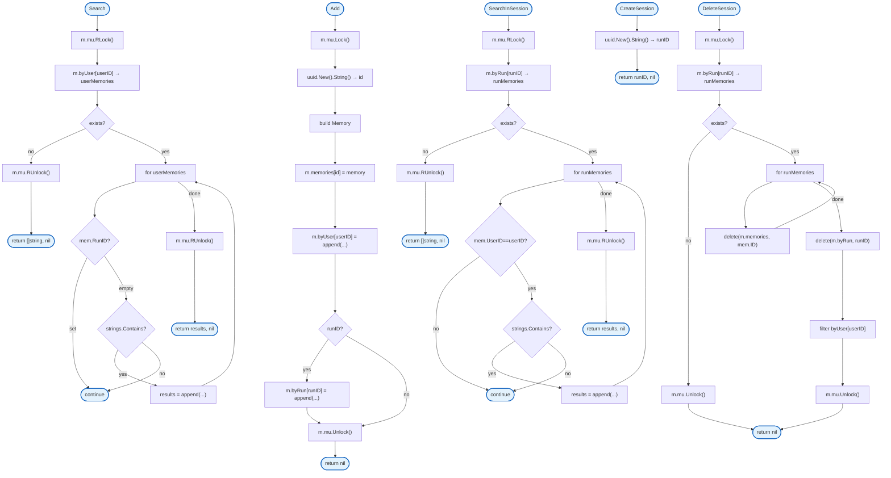

# Mem0

Mem0 API client for long-term memory storage and retrieval.

## Overview



## Structs

### Memory

| Struct | Field | Type | Description |
|--------|-------|------|-------------|
| `Memory` | `ID` | `string` | Memory identifier |
| | `UserID` | `string` | User identifier |
| | `RunID` | `string` | Session identifier (optional) |
| | `Content` | `string` | Memory content |

### MockClient

| Struct | Field | Type | Description |
|--------|-------|------|-------------|
| `MockClient` | `mu` | `sync.RWMutex` | Thread-safe lock |
| | `memories` | `map[string]*Memory` | Memory storage |
| | `byUser` | `map[string][]*Memory` | User index |
| | `byRun` | `map[string][]*Memory` | Session index |

### APIClient

| Struct | Field | Type | Description |
|--------|-------|------|-------------|
| `APIClient` | `baseURL` | `string` | API base URL |
| | `apiKey` | `string` | API key |

## Interfaces

### Client

```go
type Client interface {
    Add(ctx context.Context, userID, content, runID string) error
    Search(ctx context.Context, userID, query string) ([]string, error)
    SearchInSession(ctx context.Context, userID, runID, query string) ([]string, error)
    CreateSession(ctx context.Context, userID string) (string, error)
    DeleteSession(ctx context.Context, userID, runID string) error
}
```

## Functions

| Function | Signature | Description |
|----------|-----------|-------------|
| `NewMockClient` | `() *MockClient` | Creates mock client |
| `NewAPIClient` | `(baseURL, apiKey string) *APIClient` | Creates API client |
| `Add` | `(ctx, userID, content, runID) error` | Stores memory |
| `Search` | `(ctx, userID, query) ([]string, error)` | Searches long-term memory |
| `SearchInSession` | `(ctx, userID, runID, query) ([]string, error)` | Searches session memory |
| `CreateSession` | `(ctx, userID) (string, error)` | Creates session |
| `DeleteSession` | `(ctx, userID, runID) error` | Deletes session memories |

## Design Notes

### Long-term vs Session Memory

**Q: What's the difference between runID="" and runID set?**

| Aspect | Description |
|--------|-------------|
| Context | Memory scoping |
| Options considered | Separate methods, runID flag, namespaces |
| Rationale | runID="" for long-term, runID set for session |

**Current approach is recommended because:**
- Simple API with one storage method
- Empty runID clearly indicates long-term
- Session-scoped memories auto-cleanup
- Search can filter by scope

### Mock Client for Testing

**Q: Why have mock client instead of real API for tests?**

| Aspect | Description |
|--------|-------------|
| Context | Test isolation |
| Options considered | Real API, mock, interface stub |
| Rationale | No external dependencies in unit tests |

**Current approach is recommended because:**
- Tests run without Mem0 service
- Deterministic behavior
- Fast execution
- Full control over test data

## Test Coverage

### Unit Tests

| Test Suite | Coverage |
|------------|----------|
| `TestMockClient_Add` | Memory storage |
| `TestMockClient_Search` | Long-term search |
| `TestMockClient_SearchInSession` | Session search |
| `TestMockClient_CreateSession` | Session creation |
| `TestMockClient_DeleteSession` | Session deletion |

**Running:**
```bash
make test ./internal/mem0
```

## Dependencies and Location

| Package | Purpose |
|---------|---------|
| `github.com/google/uuid` | UUID generation |

**File Location:** [`internal/mem0/client.go`](https://github.com/nevaria-ai/gateway/blob/main/internal/mem0/client.go)

## Related

- [Agent Tools](../agent/tools.md) - Mem0 tools use client
- [Session](../session/README.md) - Session ID for runID
