# Node

Distributed node execution for running tools on remote devices and managed servers.

## Overview

```mermaid
flowchart TB
    subgraph SGRegister ["Register Connection"]
        HRegStart["**RegisterConnection(ctx, conn, nodeID, userID, platform, toolSpecs) → err**"]
        HRegStart --> HConvert["toolNames ← []string from toolSpecs"]
        HConvert --> HRegNode["registry.RegisterNode(ctx, userID, nodeID, platform, toolNames, conn) → err"]
        HRegNode -->|error| EReg["return err"]
        HRegNode --> HCreateConn["nodeConn ← &NodeConnection"]
        HCreateConn --> HRegConn["registry.RegisterConnection(nodeConn)"]
        HRegConn --> HNodeInfo["nodeInfo ← &NodeInfo"]
        HNodeInfo --> GetAgent["agentProvider.GetAgentForUser(userID) → agent, err"]
        GetAgent -->|error| EGetAgent["return err"]
        GetAgent --> HCreateTools["agentTools ← createNodeToolsFromSpecs(nodeInfo, toolSpecs)"]
        HCreateTools --> AddTools["agent.AddTools(agentTools...)"]
        AddTools --> Listen["executor.listenForResults(ctx, nodeConn)"]
        Listen --> RegOK["return nil"]
    end

    subgraph SGExecute ["Execute Tool"]
        HExecStart["**ExecuteOnNode(ctx, nodeID, toolName, args) → result, err**"]
        HExecStart --> HGetConn["registry.GetConnection(nodeID) → node, exists"]
        HGetConn -->|!exists| EOffline["return nil, ErrNodeOffline"]
        HGetConn --> HGenID["callID ← generateCallID()"]
        HGenID --> HCreateCh["resultCh, errCh ← make channels"]
        HCreateCh --> HRegExec["registerPendingExecution(execKey, resultCh, errCh)"]
        HRegExec --> HCreateMsg["execMsg ← &ExecuteMessage"]
        HCreateMsg --> Marshal["json.Marshal(execMsg) → msgData"]
        Marshal -->|error| EMarshal["return nil, err"]
        Marshal --> WriteMsg["node.Conn.WriteMessage(TextMessage, msgData) → err"]
        WriteMsg -->|error| EWrite["return nil, err"]
        WriteMsg --> HTimeout["ctx, cancel ← context.WithTimeout(ctx, timeout)"]
        HTimeout --> Select["select resultCh, errCh, ctx.Done()"]
        Select -->|result| OKResult["return result, nil"]
        Select -->|error| EExec["return nil, err"]
        Select -->|timeout| ETimeout["return nil, ctx.Err()"]
    end

    subgraph SGLoop ["Result Listener"]
        HLoop["**listenForResultsLoop(ctx, node) → **"]
        HLoop --> CheckCtx["←ctx.Done()?"]
        CheckCtx -->|done| LoopReturn["return"]
        CheckCtx -->|continue| ReadMsg["node.Conn.ReadMessage() → msgType, data, err"]
        ReadMsg -->|error| Continue["continue"]
        ReadMsg -->|!TextMessage| Continue
        ReadMsg --> Unmarshal["json.Unmarshal(data, &resultMsg) → err"]
        Unmarshal -->|error| Continue
        Unmarshal --> HDeliver["execKey ← fmt.Sprintf('%s:%s', nodeID, callID)"]
        HDeliver --> Deliver["deliverResult(execKey, &resultMsg)"]
        Deliver --> CheckCtx
    end

    click GetAgent href "../agent/README.md"

    classDef mainFn fill:#e3f2fd,stroke:#1565c0,stroke-width:2px
    classDef internalFn fill:#f3e5f5,stroke:#6a1b9a,stroke-width:2px,stroke-dasharray:6 3
    classDef localPkgs fill:#fff8e1,stroke:#f9a825,stroke-width:1.5px,stroke-dasharray:4 2
    classDef errorFlow fill:#ffebee,stroke:#c62828,stroke-width:1px

    class HRegStart,HExecStart,HLoop internalFn
    class GetAgent localPkgs
    class EReg,EGetAgent,EOffline,EMarshal,EWrite,EExec,ETimeout,LoopReturn errorFlow
```



## Constants

### MessageType

| Constant | Type | Value | Description |
|----------|------|-------|-------------|
| `MessageTypeRegister` | `MessageType` | `"register"` | Node registration |
| `MessageTypeHealthResponse` | `MessageType` | `"health_response"` | Health check response |
| `MessageTypeExecute` | `MessageType` | `"execute"` | Tool execution request |
| `MessageTypeToolResult` | `MessageType` | `"tool_result"` | Tool execution result |
| `MessageTypeError` | `MessageType` | `"error"` | Protocol error |

### NodeStatus

| Constant | Type | Value | Description |
|----------|------|-------|-------------|
| `NodeStatusOnline` | `NodeStatus` | `"online"` | Node is online |
| `NodeStatusBusy` | `NodeStatus` | `"busy"` | Node is busy |
| `NodeStatusHealthy` | `NodeStatus` | `"healthy"` | Node is healthy |
| `NodeStatusDegraded` | `NodeStatus` | `"degraded"` | Node is degraded |
| `NodeStatusUnhealthy` | `NodeStatus` | `"unhealthy"` | Node is unhealthy |
| `NodeStatusOffline` | `NodeStatus` | `"offline"` | Node is offline |

## Structs

### Service

| Struct | Field | Type | Description |
|--------|-------|------|-------------|
| `Service` | `registry` | `*Registry` | Node registry |
| | `executor` | `*Executor` | Tool executor |
| | `agentProvider` | `AgentProvider` | Agent provider |
| | `logger` | `*zerolog.Logger` | Logger |

### NodeInfo

| Struct | Field | Type | Description |
|--------|-------|------|-------------|
| `NodeInfo` | `NodeID` | `string` | Node identifier |
| | `Platform` | `string` | Platform (mac, windows, etc.) |
| | `UserID` | `string` | User identifier |
| | `ConnectedAt` | `time.Time` | Connection time |
| | `LastSeenAt` | `time.Time` | Last activity |
| | `Tools` | `[]string` | Available tools |
| | `Status` | `NodeStatus` | Node status |

### NodeConnection

| Struct | Field | Type | Description |
|--------|-------|------|-------------|
| `NodeConnection` | `NodeUUID` | `string` | Node identifier |
| | `Conn` | `WebSocketConn` | WebSocket connection |
| | `SendCh` | `chan []byte` | Send channel |

### ToolSpec

| Struct | Field | Type | Description |
|--------|-------|------|-------------|
| `ToolSpec` | `Name` | `string` | Tool name |
| | `Isolation` | `[]string` | Isolation modes (docker, host) |

### RegisterMessage

| Struct | Field | Type | Description |
|--------|-------|------|-------------|
| `RegisterMessage` | `NodeID` | `string` | Node identifier |
| | `Platform` | `string` | Platform name |
| | `Tools` | `[]ToolSpec` | Tool specifications |

### ExecuteMessage

| Struct | Field | Type | Description |
|--------|-------|------|-------------|
| `ExecuteMessage` | `ToolName` | `string` | Tool to execute |
| | `Arguments` | `map[string]interface{}` | Tool arguments |
| | `CallID` | `string` | Call identifier |
| | `Isolation` | `string` | Isolation mode |

### ToolResultMessage

| Struct | Field | Type | Description |
|--------|-------|------|-------------|
| `ToolResultMessage` | `CallID` | `string` | Call identifier |
| | `Result` | `*agent.ToolResult` | Execution result |
| | `Error` | `*string` | Error message |

## Functions

### Service

| Function | Signature | Description |
|----------|-----------|-------------|
| `NewService` | `(logger *zerolog.Logger, agentProvider AgentProvider) *Service` | Creates service |
| `RegisterConnection` | `(ctx context.Context, conn WebSocketConn, nodeID, userID, platform string, toolSpecs []ToolSpec) error` | Registers node |
| `UnregisterConnection` | `(ctx context.Context, nodeID, userID string) error` | Unregisters node |
| `ExecuteOnNode` | `(ctx context.Context, nodeID, toolName string, args map[string]any) (*agent.ToolResult, error)` | Executes tool |

### Tool Naming

| Function | Signature | Description |
|----------|-----------|-------------|
| `GenerateToolName` | `(platform, nodeID, toolName string, isOnHost bool) string` | Generates full tool name |
| `ToolIdentifier` | `(toolName string) (platform, nodeID, baseTool string, isOnHost bool)` | Parses tool name |
| `IsNodeTool` | `(toolName string) bool` | Checks if node tool |

## Design Notes

### Tool Name Convention

**Q: Why use {platform}_{nodeID}_{toolName} format?**

| Aspect | Description |
|--------|-------------|
| Context | Tool identification |
| Options considered | UUID, hierarchical, prefix-based |
| Rationale | Human-readable with clear ownership |

**Current approach is recommended because:**
- LLM can understand tool source
- Clear platform differentiation
- Node ID prevents collisions
- Optional _onhost variant for isolation

### Docker vs Host Isolation

**Q: Why support both docker and host execution?**

| Aspect | Description |
|--------|-------------|
| Context | Tool isolation modes |
| Options considered | Docker only, host only, both |
| Rationale | Security default, flexibility when needed |

**Current approach is recommended because:**
- Docker provides safe sandboxing
- Host access for trusted operations
- LLM can choose based on user request
- Clear security boundaries

## Test Coverage

### Unit Tests

| Test Suite | Coverage |
|------------|----------|
| `TestService_RegisterConnection` | Node registration |
| `TestService_UnregisterConnection` | Node removal |
| `TestService_ExecuteOnNode` | Tool execution |
| `TestToolIdentifier` | Name parsing |
| `TestGenerateToolName` | Name generation |

**Running:**
```bash
make test ./internal/node
```

## Dependencies and Location

| Package | Purpose |
|---------|---------|
| `github.com/rs/zerolog` | Logging |
| `internal/agent` | Agent and Tool types |

**File Locations:**
- [`internal/node/service.go`](https://github.com/nevaria-ai/gateway/blob/main/internal/node/service.go) - Node service
- [`internal/node/types.go`](https://github.com/nevaria-ai/gateway/blob/main/internal/node/types.go) - Types and messages
- [`internal/node/registry.go`](https://github.com/nevaria-ai/gateway/blob/main/internal/node/registry.go) - Node registry
- [`internal/node/executor.go`](https://github.com/nevaria-ai/gateway/blob/main/internal/node/executor.go) - Tool executor
- [`internal/node/handler.go`](https://github.com/nevaria-ai/gateway/blob/main/internal/node/handler.go) - WebSocket handler
- [`internal/node/adapter.go`](https://github.com/nevaria-ai/gateway/blob/main/internal/node/adapter.go) - Agent adapter
- [`internal/node/cache.go`](https://github.com/nevaria-ai/gateway/blob/main/internal/node/cache.go) - Response cache

## Related

- [Agent Tools](../agent/tools.md) - Node tool integration
- [WebSocket](../websocket.md) - Connection handling
