# Node

Distributed node execution for running tools on remote devices and managed servers.

## Overview

<!-- Overview replaced by individual function flowcharts below -->

## Constants

### MessageType

| Constant | Type | Value | Description |
|----------|------|-------|-------------|
| `MessageTypeRegister` | `MessageType` | `"register"` | Node registration |
| `MessageTypeHealthResponse` | `MessageType` | `"health_response"` | Health check response |
| `MessageTypeExecute` | `MessageType` | `"execute"` | Tool execution request |
| `MessageTypeToolResult` | `MessageType` | `"tool_result"` | Tool execution result |
| `MessageTypeError` | `MessageType` | `"error"` | Protocol error |

### NodeStatus

| Constant | Type | Value | Description |
|----------|------|-------|-------------|
| `NodeStatusOnline` | `NodeStatus` | `"online"` | Node is online |
| `NodeStatusBusy` | `NodeStatus` | `"busy"` | Node is busy |
| `NodeStatusHealthy` | `NodeStatus` | `"healthy"` | Node is healthy |
| `NodeStatusDegraded` | `NodeStatus` | `"degraded"` | Node is degraded |
| `NodeStatusUnhealthy` | `NodeStatus` | `"unhealthy"` | Node is unhealthy |
| `NodeStatusOffline` | `NodeStatus` | `"offline"` | Node is offline |

## Structs

### Service

| Struct | Field | Type | Description |
|--------|-------|------|-------------|
| `Service` | `registry` | `*Registry` | Node registry |
| | `executor` | `*Executor` | Tool executor |
| | `agentProvider` | `AgentProvider` | Agent provider |
| | `logger` | `*zerolog.Logger` | Logger |

### NodeInfo

| Struct | Field | Type | Description |
|--------|-------|------|-------------|
| `NodeInfo` | `NodeID` | `string` | Node identifier |
| | `Platform` | `string` | Platform (mac, windows, etc.) |
| | `UserID` | `string` | User identifier |
| | `ConnectedAt` | `time.Time` | Connection time |
| | `LastSeenAt` | `time.Time` | Last activity |
| | `Tools` | `[]string` | Available tools |
| | `Status` | `NodeStatus` | Node status |

### NodeConnection

| Struct | Field | Type | Description |
|--------|-------|------|-------------|
| `NodeConnection` | `NodeUUID` | `string` | Node identifier |
| | `Conn` | `WebSocketConn` | WebSocket connection |
| | `SendCh` | `chan []byte` | Send channel |

### ToolSpec

| Struct | Field | Type | Description |
|--------|-------|------|-------------|
| `ToolSpec` | `Name` | `string` | Tool name |
| | `Isolation` | `[]string` | Isolation modes (docker, host) |

### RegisterMessage

| Struct | Field | Type | Description |
|--------|-------|------|-------------|
| `RegisterMessage` | `NodeID` | `string` | Node identifier |
| | `Platform` | `string` | Platform name |
| | `Tools` | `[]ToolSpec` | Tool specifications |

### ExecuteMessage

| Struct | Field | Type | Description |
|--------|-------|------|-------------|
| `ExecuteMessage` | `ToolName` | `string` | Tool to execute |
| | `Arguments` | `map[string]interface{}` | Tool arguments |
| | `CallID` | `string` | Call identifier |
| | `Isolation` | `string` | Isolation mode |

### ToolResultMessage

| Struct | Field | Type | Description |
|--------|-------|------|-------------|
| `ToolResultMessage` | `CallID` | `string` | Call identifier |
| | `Result` | `*agent.ToolResult` | Execution result |
| | `Error` | `*string` | Error message |

## Functions

### NewService

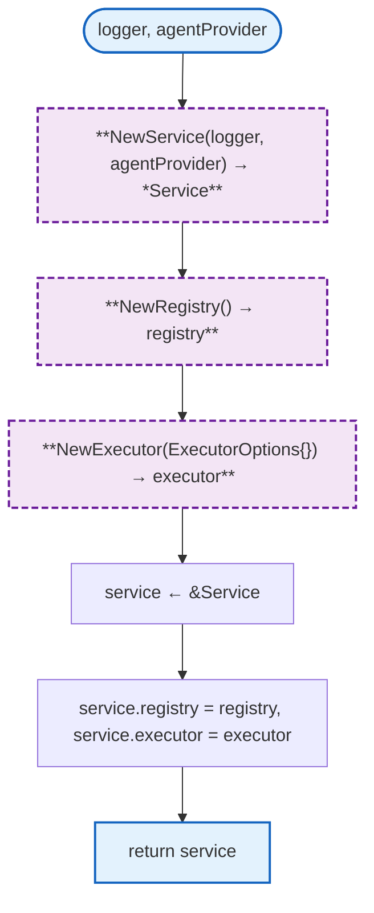

### RegisterConnection

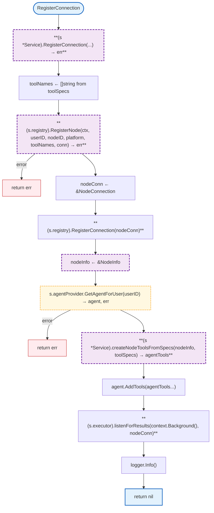

### UnregisterConnection

```mermaid
flowchart TB
    Start([UnregisterConnection]) --> HUnregConn["**(s *Service).UnregisterConnection(...) → err**"]
    HUnregConn --> HGetNode["**(s.registry).GetNode(nodeID) → nodeInfo**"]
    HGetNode --> CheckNil["nodeInfo == nil"]
    CheckNil -->|true| ReturnNil["return nil"]
    CheckNil -->|false| GetAgent["s.agentProvider.GetAgentForUser(userID) → agent, err"]
    GetAgent --> HCreatePrefix["prefix ← fmt.Sprintf(\"%s_%s_\", nodeInfo.Platform, nodeID.NodeID)"]
    HCreatePrefix --> RemoveTools["agent.RemoveTools(prefix)"]
    RemoveTools --> HUnregNode["**(s.registry).UnregisterNode(ctx, nodeID) → err**"]
    HUnregNode -->|error| EUnreg["return err"]
    HUnregNode --> LogInfo["logger.Info()"]
    LogInfo --> Return["return nil"]

    click GetAgent href "../agent/README.md"

    classDef mainFn fill:#e3f2fd,stroke:#1565c0,stroke-width:2px
    classDef internalFn fill:#f3e5f5,stroke:#6a1b9a,stroke-width:2px,stroke-dasharray:6 3
    classDef localPkgs fill:#fff8e1,stroke:#f9a825,stroke-width:1.5px,stroke-dasharray:4 2
    classDef errorFlow fill:#ffebee,stroke:#c62828,stroke-width:1px

    class Start,ReturnNil,Return mainFn
    class HUnregConn,HGetNode,HCreatePrefix internalFn
    class GetAgent localPkgs
    class EUnreg errorFlow
```

### UpdateNodeHealth

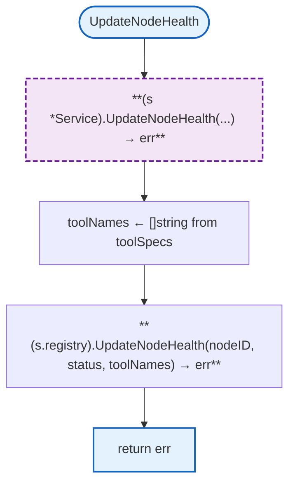

### ExecuteOnNode

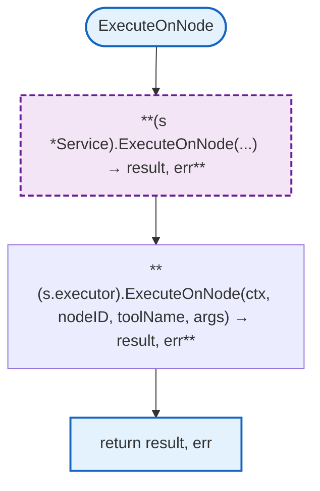

### NewRegistry

```mermaid
flowchart TB
    Start([]) --> HNewRegistry["**NewRegistry() → *Registry**"]
    HNewRegistry --> CreateRegistry["registry ← &Registry"]
    CreateRegistry --> InitMaps["registry.nodes ← map, registry.connections ← map"]
    InitMaps --> InitMore["registry.nodeConnections ← map, registry.userNodes ← map"]
    InitMore --> SetTimeout["registry.staleTimeout ← 5*time.Minute"]
    SetTimeout --> Return["return registry"]

    classDef mainFn fill:#e3f2fd,stroke:#1565c0,stroke-width:2px
    classDef internalFn fill:#f3e5f5,stroke:#6a1b9a,stroke-width:2px,stroke-dasharray:6 3

    class Start,Return mainFn
    class HNewRegistry internalFn
```

### RegisterNode

```mermaid
flowchart TB
    Start([RegisterNode]) --> HRegNode["**(r *Registry).RegisterNode(...) → err**"]
    HRegNode --> Lock["r.mu.Lock()"]
    Lock --> CheckExists["r.nodes[nodeID]"]
    CheckExists -->|exists| UnlockErr["r.mu.Unlock()"]
    UnlockErr --> EAlready["return fmt.Errorf(\"node already registered\")"]
    CheckExists -->|!exists| Now["time.Now()"]
    Now --> CreateNodeInfo["nodeInfo ← &NodeInfo"]
    CreateNodeInfo --> SetNodeInfo["Set NodeID, Platform, UserID, ConnectedAt, LastSeenAt, Tools, Status"]
    SetNodeInfo --> StoreNode["r.nodes[nodeID] ← nodeInfo"]
    StoreNode --> StoreConn["r.connections[nodeID] ← conn"]
    StoreConn --> StoreUserNode["r.userNodes[userID] = append(r.userNodes[userID], nodeID)"]
    StoreUserNode --> Unlock["r.mu.Unlock()"]
    Unlock --> Return["return nil"]

    classDef mainFn fill:#e3f2fd,stroke:#1565c0,stroke-width:2px
    classDef internalFn fill:#f3e5f5,stroke:#6a1b9a,stroke-width:2px,stroke-dasharray:6 3
    classDef errorFlow fill:#ffebee,stroke:#c62828,stroke-width:1px

    class Start,Return mainFn
    class HRegNode internalFn
    class EAlready errorFlow
```

### UnregisterNode

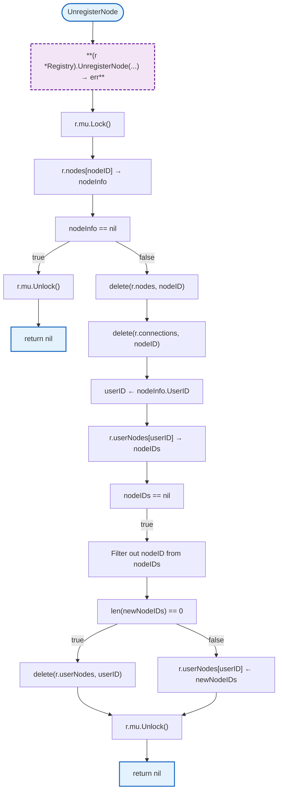

### GetNode

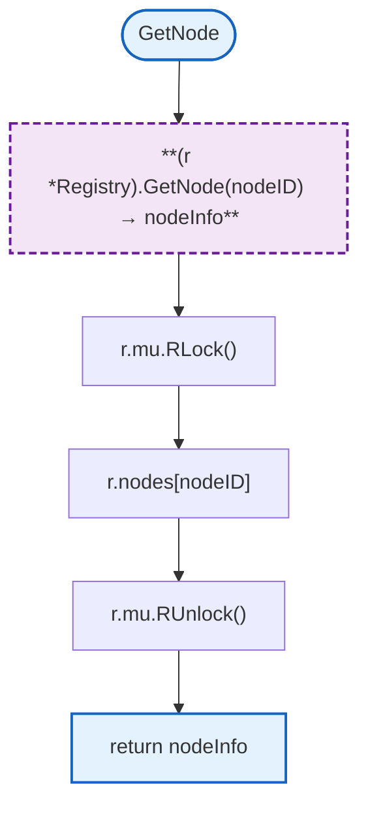

### GetNodeInfo

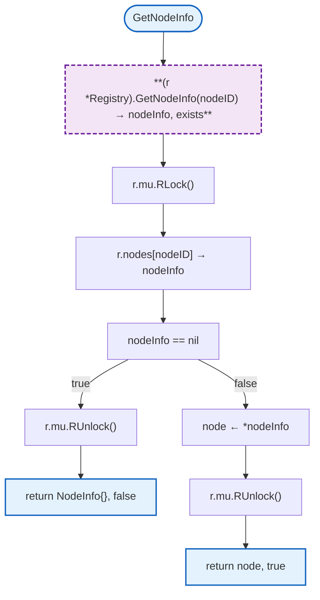

### GetUserNodes

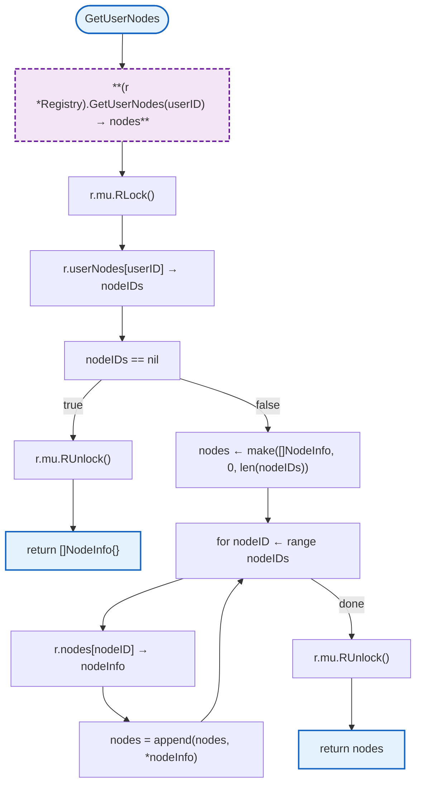

### GetNodeConnection

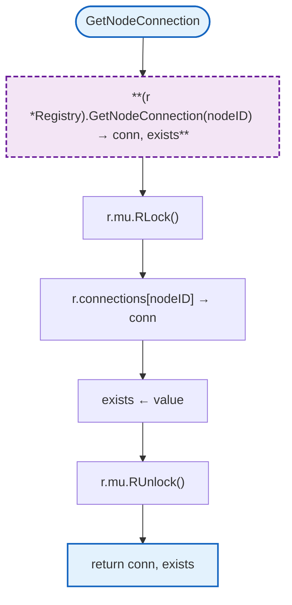

### UpdateNodeHealth

```mermaid
flowchart TB
    Start([UpdateNodeHealth]) --> HUpdateHealth["**(r *Registry).UpdateNodeHealth(...) → err**"]
    HUpdateHealth --> Lock["r.mu.Lock()"]
    Lock --> GetNodeInfo["r.nodes[nodeID] → nodeInfo"]
    GetNodeInfo --> CheckExists["nodeInfo == nil"]
    CheckExists -->|true| UnlockErr["r.mu.Unlock()"]
    UnlockErr --> ENotFound["return fmt.Errorf(\"node not found\")"]
    CheckExists -->|false| UpdateFields["nodeInfo.Status ← status, nodeInfo.Tools ← tools"]
    UpdateFields --> Now["now ← time.Now()"]
    Now --> SetTime["nodeInfo.LastSeenAt ← now, nodeInfo.LastSeen ← now"]
    SetTime --> Unlock["r.mu.Unlock()"]
    Unlock --> Return["return nil"]

    classDef mainFn fill:#e3f2fd,stroke:#1565c0,stroke-width:2px
    classDef internalFn fill:#f3e5f5,stroke:#6a1b9a,stroke-width:2px,stroke-dasharray:6 3
    classDef errorFlow fill:#ffebee,stroke:#c62828,stroke-width:1px

    class Start,Return mainFn
    class HUpdateHealth internalFn
    class ENotFound errorFlow
```

### IsNodeOnline

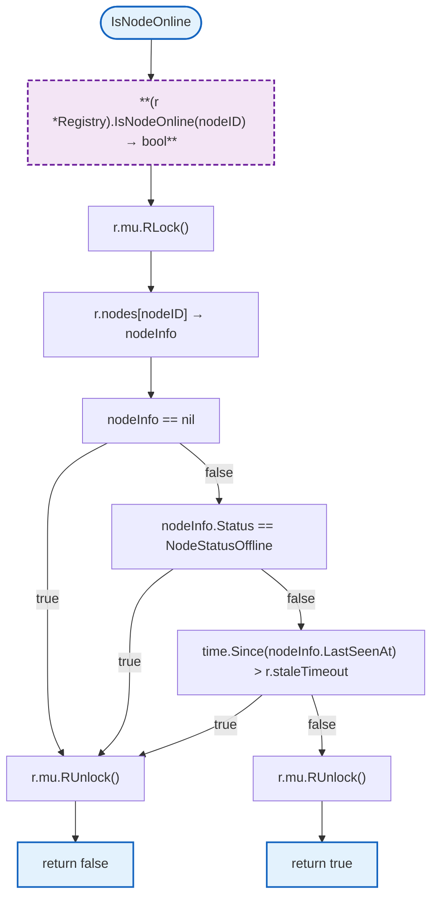

### GetNodesByTool

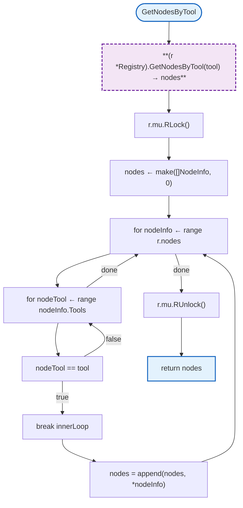

### GetAllNodes

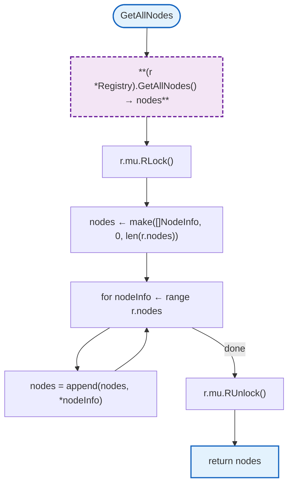

### RegisterConnection

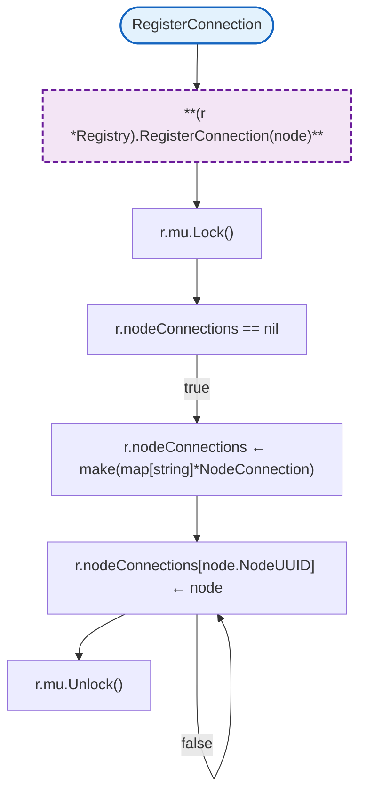

### GetConnection

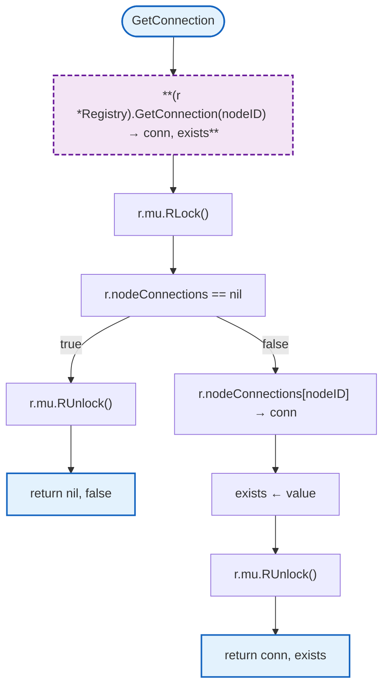

### NewExecutor

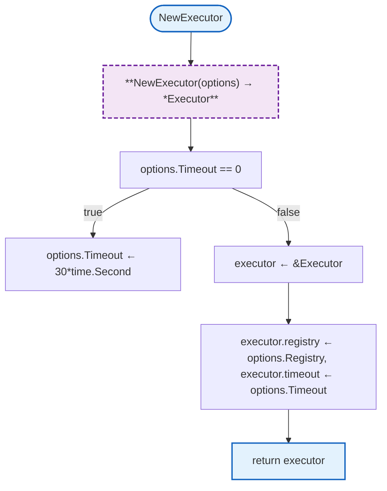

### ExecuteOnNode

```mermaid
flowchart TB
    Start([ExecuteOnNode]) --> HExec["**(e *Executor).ExecuteOnNode(...) → result, err**"]
    HExec --> GetConn["e.registry.GetConnection(nodeID) → node, exists"]
    GetConn -->|!exists| EOffline["return nil, ErrNodeOffline"]
    GetConn --> StripSuffix["actualToolName ← strings.TrimSuffix(toolName, \"_onhost\")"]
    StripSuffix --> GenID["callID ← e.generateCallID()"]
    GenID --> MakeCh["resultCh ← make(chan *agent.ToolResult, 1), errCh ← make(chan error, 1)"]
    MakeCh --> Register["registerPendingExecution(execKey, resultCh, errCh)"]
    Register --> HCreateMsg["execMsg ← &ExecuteMessage"]
    HCreateMsg --> SetFields["execMsg.ToolName ← actualToolName, execMsg.Arguments ← args"]
    SetFields --> SetMore["execMsg.CallID ← callID, execMsg.Isolation ← \"docker\""]
    SetMore --> Marshal["json.Marshal(execMsg) → msgData, err"]
    Marshal -->|error| EMarshal["return nil, err"]
    Marshal --> WriteMsg["node.Conn.WriteMessage(websocket.TextMessage, msgData) → err"]
    WriteMsg -->|error| EWrite["return nil, err"]
    WriteMsg --> HTimeout["ctx, cancel ← context.WithTimeout(ctx, e.timeout)"]
    HTimeout --> Select["select resultCh, errCh, ctx.Done()"]
    Select -->|result| ReturnResult["return result, nil"]
    Select -->|error| ReturnErr["return nil, err"]
    Select -->|timeout| ReturnTimeout["return nil, ctx.Err()"]

    click GetConn href "#GetConnection"
    click Register href "#registerPendingExecution"

    classDef mainFn fill:#e3f2fd,stroke:#1565c0,stroke-width:2px
    classDef internalFn fill:#f3e5f5,stroke:#6a1b9a,stroke-width:2px,stroke-dasharray:6 3
    classDef localPkgs fill:#fff8e1,stroke:#f9a825,stroke-width:1.5px,stroke-dasharray:4 2
    classDef errorFlow fill:#ffebee,stroke:#c62828,stroke-width:1px

    class Start,ReturnResult,ReturnErr,ReturnTimeout mainFn
    class HExec,HCreateMsg internalFn
    class GetConn localPkgs
    class EOffline,EMarshal,EWrite errorFlow
```

### ExecuteOnNodeWithoutIsolation

```mermaid
flowchart TB
    Start([ExecuteOnNodeWithoutIsolation]) --> HExecNoIsol["**(e *Executor).ExecuteOnNodeWithoutIsolation(...) → result, err**"]
    HExecNoIsol --> GetConn["e.registry.GetConnection(nodeID) → node, exists"]
    GetConn -->|!exists| EOffline["return nil, ErrNodeOffline"]
    GetConn --> StripSuffix["actualToolName ← strings.TrimSuffix(toolName, \"_onhost\")"]
    StripSuffix --> GenID["callID ← e.generateCallID()"]
    GenID --> MakeCh["resultCh ← make(chan *agent.ToolResult, 1), errCh ← make(chan error, 1)"]
    MakeCh --> Register["registerPendingExecution(execKey, resultCh, errCh)"]
    Register --> HCreateMsg["execMsg ← &ExecuteMessage"]
    HCreateMsg --> SetFields["execMsg.ToolName ← actualToolName, execMsg.Arguments ← args"]
    SetFields --> SetMore["execMsg.CallID ← callID, execMsg.Isolation ← \"host\""]
    SetMore --> Marshal["json.Marshal(execMsg) → msgData, err"]
    Marshal -->|error| EMarshal["return nil, err"]
    Marshal --> WriteMsg["node.Conn.WriteMessage(websocket.TextMessage, msgData) → err"]
    WriteMsg -->|error| EWrite["return nil, err"]
    WriteMsg --> HTimeout["ctx, cancel ← context.WithTimeout(ctx, e.timeout)"]
    HTimeout --> Select["select resultCh, errCh, ctx.Done()"]
    Select -->|result| ReturnResult["return result, nil"]
    Select -->|error| ReturnErr["return nil, err"]
    Select -->|timeout| ReturnTimeout["return nil, ctx.Err()"]

    click GetConn href "#GetConnection"
    click Register href "#registerPendingExecution"

    classDef mainFn fill:#e3f2fd,stroke:#1565c0,stroke-width:2px
    classDef internalFn fill:#f3e5f5,stroke:#6a1b9a,stroke-width:2px,stroke-dasharray:6 3
    classDef localPkgs fill:#fff8e1,stroke:#f9a825,stroke-width:1.5px,stroke-dasharray:4 2
    classDef errorFlow fill:#ffebee,stroke:#c62828,stroke-width:1px

    class Start,ReturnResult,ReturnErr,ReturnTimeout mainFn
    class HExecNoIsol,HCreateMsg internalFn
    class GetConn localPkgs
    class EOffline,EMarshal,EWrite errorFlow
```

### StartResultListener

```mermaid
flowchart TB
    Start([StartResultListener]) --> HStartListener["**(e *Executor).StartResultListener(ctx, node)**"]
    HStartListener --> HListen["**(e *Executor).listenForResults(ctx, node)**"]

    classDef mainFn fill:#e3f2fd,stroke:#1565c0,stroke-width:2px
    classDef internalFn fill:#f3e5f5,stroke:#6a1b9a,stroke-width:2px,stroke-dasharray:6 3

    class Start mainFn
    class HStartListener,HListen internalFn
```

### ToolIdentifier

```mermaid
flowchart TB
    Start([ToolIdentifier]) --> HToolID["**ToolIdentifier(toolName) → platform, nodeID, baseTool, isOnHost**"]
    HToolID --> HContainsPrefix["**containsUnderscorePrefix(toolName) → bool**"]
    HContainsPrefix -->|false| ReturnEmpty["return \"\", \"\", toolName, false"]
    HContainsPrefix -->|true| HSplit["**splitToolName(toolName) → parts**"]
    HSplit --> CheckLen["len(parts) < 3"]
    CheckLen -->|true| ReturnEmpty2["return \"\", \"\", toolName, false"]
    CheckLen -->|false| Assign["platform ← parts[0], nodeID ← parts[1], baseTool ← parts[2]"]
    Assign --> CheckOnHost["len(parts) > 3 && parts[3] == \"onhost\""]
    CheckOnHost -->|true| IsOnHost["isOnHost ← true"]
    CheckOnHost -->|false| IsNotHost["isOnHost ← false"]
    IsOnHost --> Return["return platform, nodeID, baseTool, isOnHost"]
    IsNotHost --> Return

    classDef mainFn fill:#e3f2fd,stroke:#1565c0,stroke-width:2px
    classDef internalFn fill:#f3e5f5,stroke:#6a1b9a,stroke-width:2px,stroke-dasharray:6 3

    class Start,ReturnEmpty,ReturnEmpty2,Return mainFn
    class HToolID,HContainsPrefix,HSplit internalFn
```

### IsNodeTool

```mermaid
flowchart TB
    Start([IsNodeTool]) --> HIsNodeTool["**IsNodeTool(toolName) → bool**"]
    HIsNodeTool --> HToolID["**ToolIdentifier(toolName) → platform, _, _, _**"]
    HToolID --> Return["return platform != \"\""]

    classDef mainFn fill:#e3f2fd,stroke:#1565c0,stroke-width:2px
    classDef internalFn fill:#f3e5f5,stroke:#6a1b9a,stroke-width:2px,stroke-dasharray:6 3

    class Start,Return mainFn
    class HIsNodeTool,HToolID internalFn
```

### GenerateToolName

```mermaid
flowchart TB
    Start([GenerateToolName]) --> HGenName["**GenerateToolName(...) → name**"]
    HGenName --> Concat["name ← platform + \"_\" + nodeID + \"_\" + toolName"]
    Concat --> CheckOnHost["isOnHost"]
    CheckOnHost -->|true| Append["name ← name + \"_onhost\""]
    CheckOnHost -->|false| Return
    Append --> Return["return name"]

    classDef mainFn fill:#e3f2fd,stroke:#1565c0,stroke-width:2px
    classDef internalFn fill:#f3e5f5,stroke:#6a1b9a,stroke-width:2px,stroke-dasharray:6 3

    class Start,Return mainFn
    class HGenName internalFn
```

## Design Notes

### Tool Name Convention

**Q: Why use {platform}_{nodeID}_{toolName} format?**

| Aspect | Description |
|--------|-------------|
| Context | Tool identification |
| Options considered | UUID, hierarchical, prefix-based |
| Rationale | Human-readable with clear ownership |

**Current approach is recommended because:**
- LLM can understand tool source
- Clear platform differentiation
- Node ID prevents collisions
- Optional _onhost variant for isolation

### Docker vs Host Isolation

**Q: Why support both docker and host execution?**

| Aspect | Description |
|--------|-------------|
| Context | Tool isolation modes |
| Options considered | Docker only, host only, both |
| Rationale | Security default, flexibility when needed |

**Current approach is recommended because:**
- Docker provides safe sandboxing
- Host access for trusted operations
- LLM can choose based on user request
- Clear security boundaries

## Test Coverage

### Unit Tests

| Test Suite | Coverage |
|------------|----------|
| `TestService_RegisterConnection` | Node registration |
| `TestService_UnregisterConnection` | Node removal |
| `TestService_ExecuteOnNode` | Tool execution |
| `TestToolIdentifier` | Name parsing |
| `TestGenerateToolName` | Name generation |

**Running:**
```bash
make test ./internal/node
```

## Dependencies and Location

| Package | Purpose |
|---------|---------|
| `github.com/rs/zerolog` | Logging |
| `internal/agent` | Agent and Tool types |

**File Locations:**
- [`internal/node/service.go`](https://github.com/nevaria-ai/gateway/blob/main/internal/node/service.go) - Node service
- [`internal/node/types.go`](https://github.com/nevaria-ai/gateway/blob/main/internal/node/types.go) - Types and messages
- [`internal/node/registry.go`](https://github.com/nevaria-ai/gateway/blob/main/internal/node/registry.go) - Node registry
- [`internal/node/executor.go`](https://github.com/nevaria-ai/gateway/blob/main/internal/node/executor.go) - Tool executor
- [`internal/node/handler.go`](https://github.com/nevaria-ai/gateway/blob/main/internal/node/handler.go) - WebSocket handler
- [`internal/node/adapter.go`](https://github.com/nevaria-ai/gateway/blob/main/internal/node/adapter.go) - Agent adapter
- [`internal/node/cache.go`](https://github.com/nevaria-ai/gateway/blob/main/internal/node/cache.go) - Response cache

## Related

- [Agent Tools](../agent/tools.md) - Node tool integration
- [WebSocket](../websocket.md) - Connection handling
