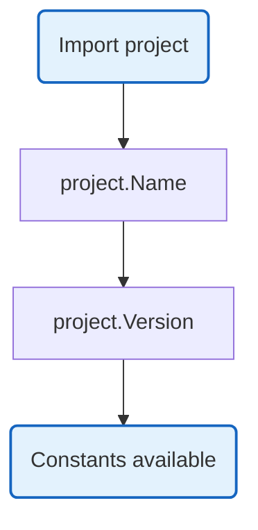

# Project

Project metadata and constants. Generated from project-details file.

## Overview

## Constants

| Constant | Type | Value | Description |
|----------|------|-------|-------------|
| `Name` | `string` | `"Nevaria"` | Project name |
| `Slug` | `string` | `"nevaria"` | URL-friendly version |
| `Description` | `string` | `"AI Agent Gateway"` | Project description |
| `ModulePath` | `string` | `"github.com/nevaria-ai/gateway"` | Go module path |
| `BinaryName` | `string` | `"nevaria-gateway"` | Output binary name |

## Variables

| Variable | Type | Default | Description |
|----------|------|---------|-------------|
| `Version` | `string` | `"dev"` | Build-time version |

## Design Notes

### Generated Code

**Q: Why generate this file instead of hardcoding?**

| Aspect | Description |
|--------|-------------|
| Context | Project metadata consistency |
| Options considered | Hardcode in each file, config file, generated |
| Rationale | Single source of truth, avoid duplication |

**Current approach is recommended because:**
- One place to update project details
- Generated code is type-safe
- Version injected at build time
- Consistent across all packages

### Build-Time Version

**Q: How is Version set at build time?**

| Aspect | Description |
|--------|-------------|
| Context | Version tracking in binaries |
| Options considered | Config file, environment, ldflags |
| Rationale | ldflags is standard Go pattern |

**Current approach is recommended because:**
- No config file needed
- Version baked into binary
- Standard Go build pattern
- Works with CI/CD pipelines

## Test Coverage

No unit tests. Constants are verified at compile time.

## Dependencies and Location

| Package | Purpose |
|---------|---------|
| (none) | Constants only |

**File Location:** [`internal/project/details.go`](https://github.com/nevaria-ai/gateway/blob/main/internal/project/details.go)
