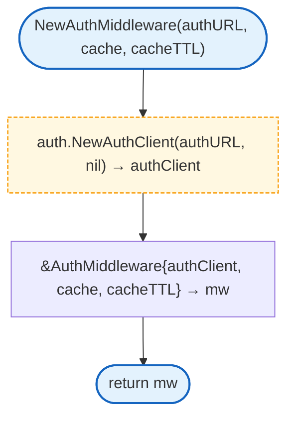
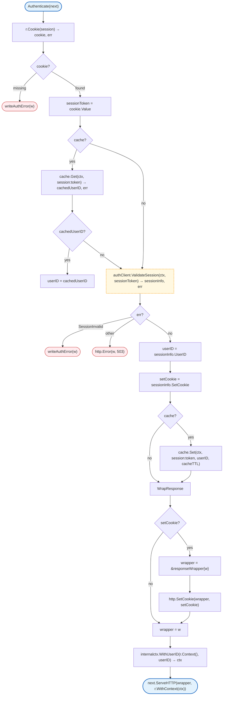
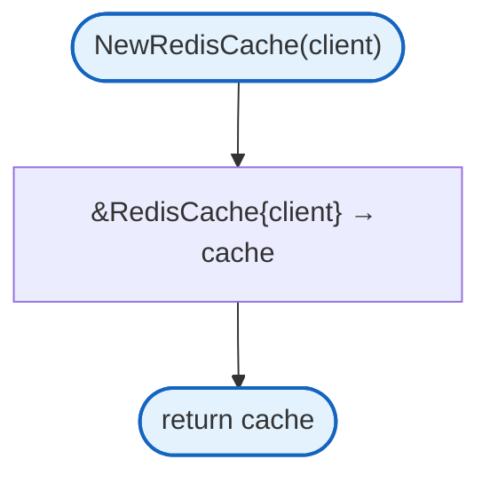
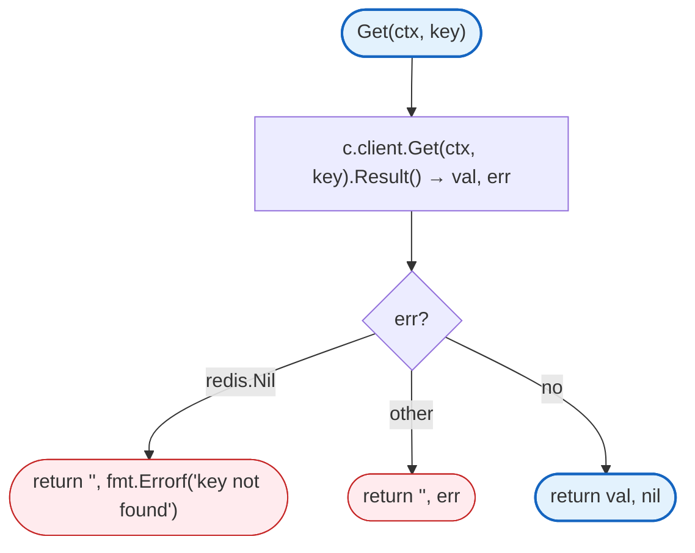
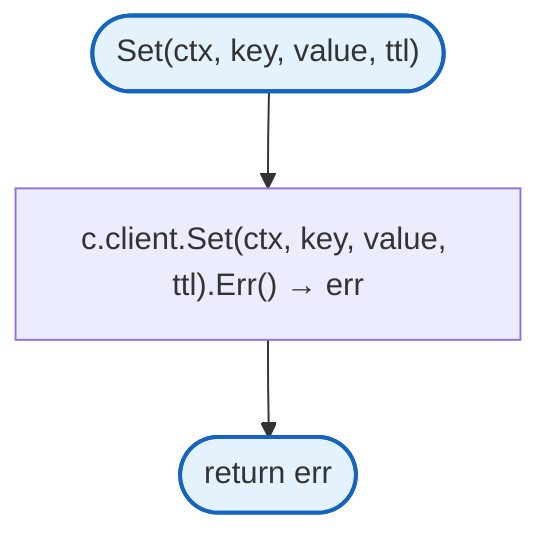
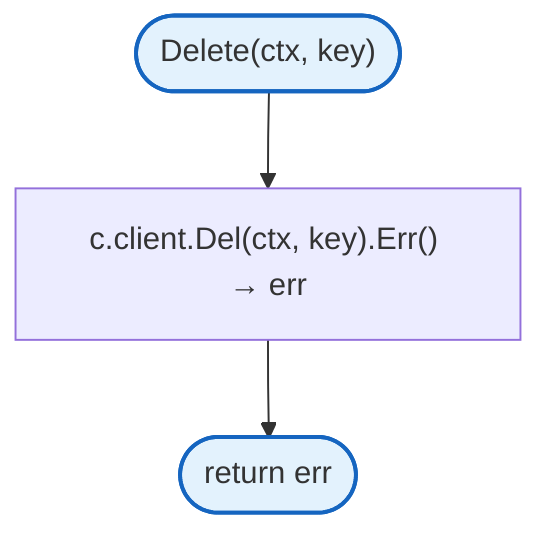
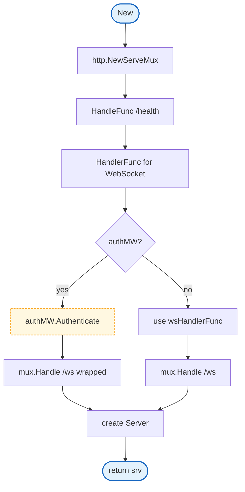
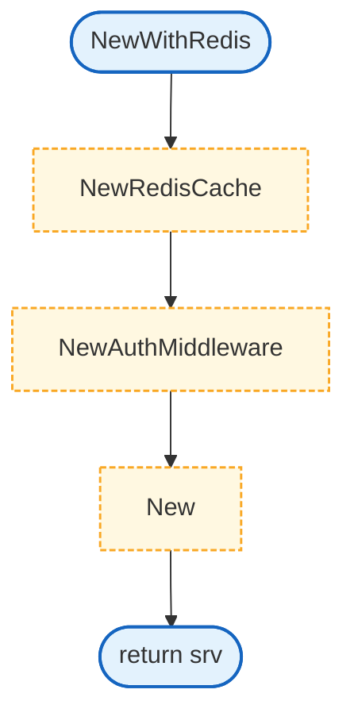
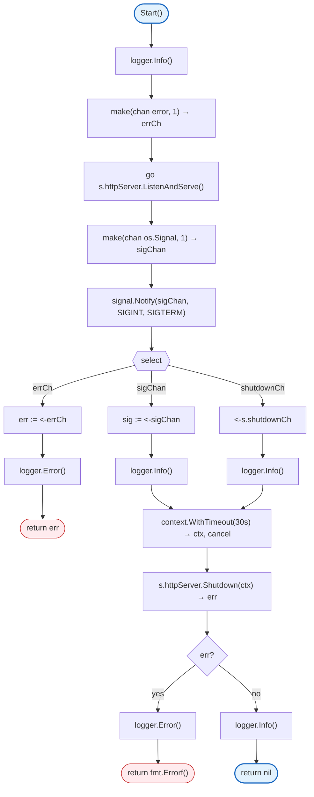
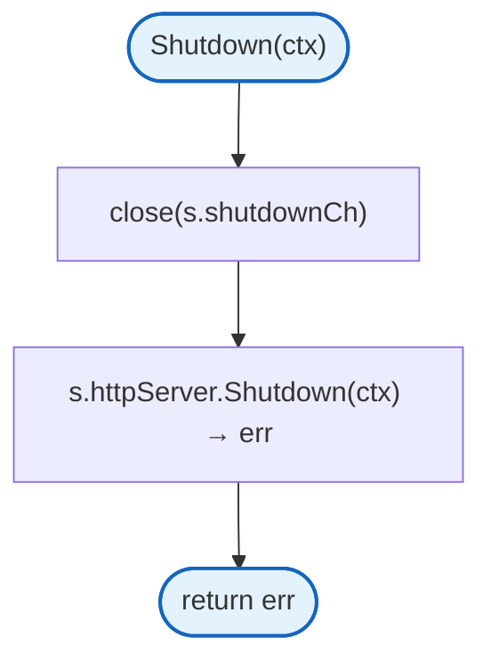

# Server

HTTP server, middleware, and routing for the gateway.

## Variables

| Variable | Type | Description |
|----------|------|-------------|
| `ErrSessionInvalid` | `error` | Session invalid error |
| `ErrSessionExpired` | `error` | Session expired error |
| `ErrZetidalUnavailable` | `error` | Zetidal API unavailable error |
| `ErrInvalidResponse` | `error` | Invalid response error |
| `ErrContextCanceled` | `error` | Context canceled error |
| `ErrCacheUnavailable` | `error` | Cache unavailable error |

## Interfaces

### AuthCache

```go
type AuthCache interface {
    Get(ctx context.Context, key string) (string, error)
    Set(ctx context.Context, key string, value string, ttl time.Duration) error
    Delete(ctx context.Context, key string) error
}
```

## Structs

### AuthMiddleware

| Struct | Field | Type | Description |
|--------|-------|------|-------------|
| `AuthMiddleware` | `authClient` | `*auth.Client` | Auth service client |
| | `cache` | `AuthCache` | Session cache (can be nil) |
| | `cacheTTL` | `time.Duration` | Cache TTL |

### RedisCache

| Struct | Field | Type | Description |
|--------|-------|------|-------------|
| `RedisCache` | `client` | `*redis.Client` | Redis client |

### SessionResponse

| Struct | Field | Type | Description |
|--------|-------|------|-------------|
| `SessionResponse` | `Authenticated` | `bool` | Whether session is valid |
| | `UserID` | `string` | User identifier |
| | `ExpiresAt` | `int64` | Session expiration timestamp |

### responseWrapper

Private struct that wraps ResponseWriter to capture Set-Cookie headers.

| Struct | Field | Type | Description |
|--------|-------|------|-------------|
| `responseWrapper` | `ResponseWriter` | `http.ResponseWriter` | Underlying writer |
| | `wroteHeader` | `bool` | Track if header written |

### Server

| Struct | Field | Type | Description |
|--------|-------|------|-------------|
| `Server` | `httpServer` | `*http.Server` | HTTP server |
| | `logger` | `zerolog.Logger` | Logger |
| | `wsHandler` | `*websocket.Handler` | WebSocket handler |
| | `authMW` | `*AuthMiddleware` | Auth middleware |
| | `shutdownCh` | `chan struct{}` | Shutdown signal |

### ServerConfig

| Struct | Field | Type | Description |
|--------|-------|------|-------------|
| `ServerConfig` | `Addr` | `string` | Server address |
| | `ZetidalURL` | `string` | Auth service URL |
| | `AuthCacheTTL` | `time.Duration` | Auth cache TTL |

## Simple Methods

| Method | Returns | Description |
|--------|---------|-------------|
| `HTTPServer()` | `*http.Server` | Returns underlying HTTP server (for testing) |
| `WSHandler()` | `*websocket.Handler` | Returns WebSocket handler (for testing) |

## NewAuthMiddleware

Creates a new authentication middleware with optional cache.



## Authenticate

Validates session cookie and adds user_id to context.



## NewRedisCache

Creates a new Redis-backed cache.



## RedisCache.Get

Retrieves a value from Redis.



## RedisCache.Set

Stores a value in Redis with TTL.



## RedisCache.Delete

Removes a value from Redis.



## New

Creates a new Server with optional auth middleware.



## NewWithRedis

Creates a Server with Redis-backed auth middleware (recommended for production).



## Start

Starts the HTTP server and handles graceful shutdown.



## Shutdown

Gracefully shuts down the HTTP server.



## Design Notes

### Response Wrapper for Hijack

**Q: Why wrap ResponseWriter for Set-Cookie?**

| Aspect | Description |
|--------|-------------|
| Context | Sliding session expiration |
| Options considered | Ignore cookie, wrap response, middleware chain |
| Rationale | Must forward Set-Cookie from auth API to browser |

**Current approach is recommended because:**
- Preserves WebSocket upgrade capability (Hijacker interface)
- Forwards sliding expiration cookies
- Transparent to downstream handlers
- Standard middleware pattern

### Graceful Shutdown

**Q: Why 30 second shutdown timeout?**

| Aspect | Description |
|--------|-------------|
| Context | Server shutdown |
| Options considered | 5s, 15s, 30s, 60s |
| Rationale | Balance between fast shutdown and draining connections |

**Current approach is recommended because:**
- Allows in-flight requests to complete
- WebSocket connections can close cleanly
- Not so long as to delay deployments
- Configurable via context in Shutdown()

### Optional Auth Middleware

**Q: Why allow nil authMW in New()?**

| Aspect | Description |
|--------|-------------|
| Context | Backward compatibility and testing |
| Options considered | Require auth, optional auth, separate constructors |
| Rationale | NewWithRedis for production, New for testing/flexibility |

**Current approach is recommended because:**
- Backward compatible with existing code
- Easy testing without auth
- NewWithRedis provides recommended production setup
- Clear separation of concerns

## Test Coverage

### Unit Tests

| Test Suite | Coverage |
|------------|----------|
| `TestNew` | Server creation |
| `TestHealthEndpoint` | Health check |
| `TestAuthMiddleware` | Authentication flow |
| `TestAuthMiddleware_CacheHit` | Cache usage |
| `TestInternalRouter` | Internal endpoints |
| `TestRedisCache` | Cache operations |

**Running:**
```bash
make test ./internal/server
```

## Dependencies and Location

| Package | Purpose |
|---------|---------|
| `github.com/rs/zerolog` | Logging |
| `github.com/redis/go-redis/v9` | Redis client |
| `github.com/gorilla/mux` | Internal router |
| `internal/auth` | Auth client |
| `internal/ctx` | Context utilities |
| `internal/websocket` | WebSocket handler |

**File Locations:**
- [`internal/server/server.go`](../internal/server/server.go) - HTTP server
- [`internal/server/middleware.go`](../internal/server/middleware.go) - Auth middleware
- [`internal/server/redis_cache.go`](../internal/server/redis_cache.go) - Redis cache
- [`internal/server/response.go`](../internal/server/response.go) - Response utilities

## Related

- [Auth Client](auth.md) - Auth service client
- [WebSocket Handler](websocket.md) - WebSocket handling
- [Config](../config/README.md) - Server configuration
