# Server

HTTP server with authentication middleware and WebSocket upgrade.

## Overview

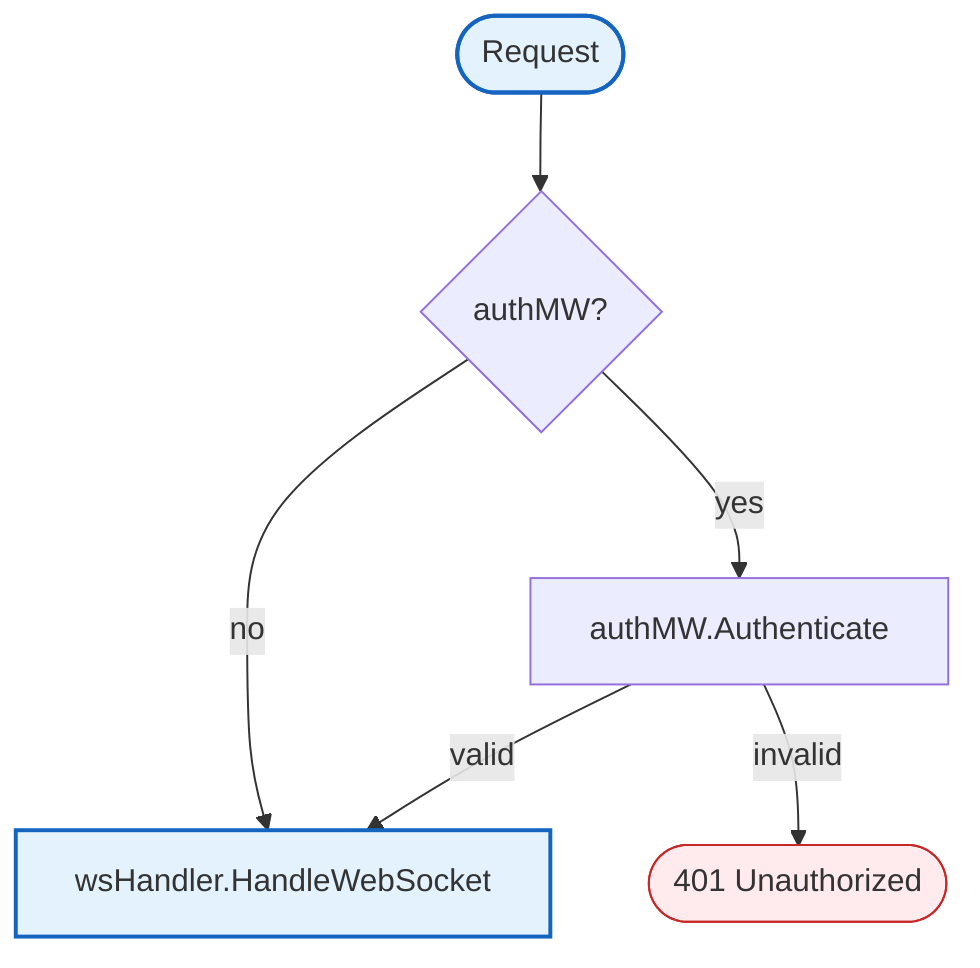

**Auth Flow:**
1. Extract session cookie from request
2. Check cache (if available) for session → userID
3. Validate with auth service (if cache miss)
4. Add user_id to context
5. Call next handler (WebSocket upgrade)

## Structs

### Server

| Struct | Field | Type | Description |
|--------|-------|------|-------------|
| `Server` | `httpServer` | `*http.Server` | HTTP server |
| | `logger` | `zerolog.Logger` | Logger |
| | `wsHandler` | `*websocket.Handler` | WebSocket handler |
| | `authMW` | `*AuthMiddleware` | Auth middleware |
| | `shutdownCh` | `chan struct{}` | Shutdown signal |

### ServerConfig

| Struct | Field | Type | Description |
|--------|-------|------|-------------|
| `ServerConfig` | `Addr` | `string` | Server address |
| | `AuthURL` | `string` | Auth service URL |
| | `AuthCacheTTL` | `time.Duration` | Auth cache TTL |

### AuthMiddleware

| Struct | Field | Type | Description |
|--------|-------|------|-------------|
| `AuthMiddleware` | `authClient` | `*AuthClient` | Auth service client |
| | `cache` | `AuthCache` | Session cache (can be nil) |
| | `cacheTTL` | `time.Duration` | Cache TTL |

### RedisCache

| Struct | Field | Type | Description |
|--------|-------|------|-------------|
| `RedisCache` | `client` | `*redis.Client` | Redis client |

## Interfaces

### AuthCache

```go
type AuthCache interface {
    Get(ctx context.Context, key string) (string, error)
    Set(ctx context.Context, key string, value string, ttl time.Duration) error
    Delete(ctx context.Context, key string) error
}
```

## Simple Methods

| Method | Returns | Description |
|--------|---------|-------------|
| `HTTPServer()` | `*http.Server` | Returns underlying HTTP server (for testing) |
| `WSHandler()` | `*websocket.Handler` | Returns WebSocket handler (for testing) |

## New

Creates a new Server with optional auth middleware.

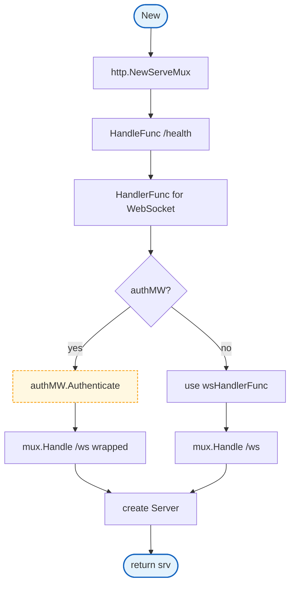

## NewWithRedis

Creates a Server with Redis-backed auth middleware (recommended for production).

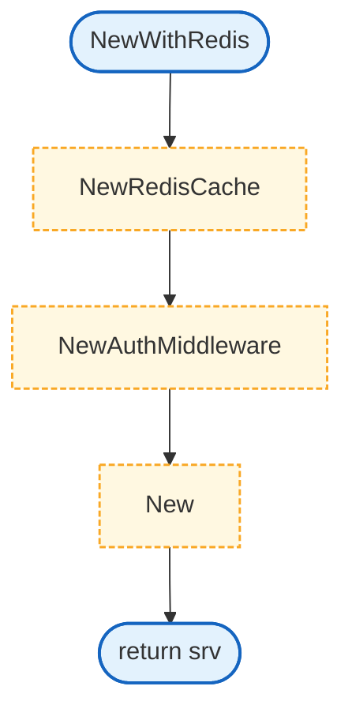

## NewAuthMiddleware

Creates a new authentication middleware with optional cache.

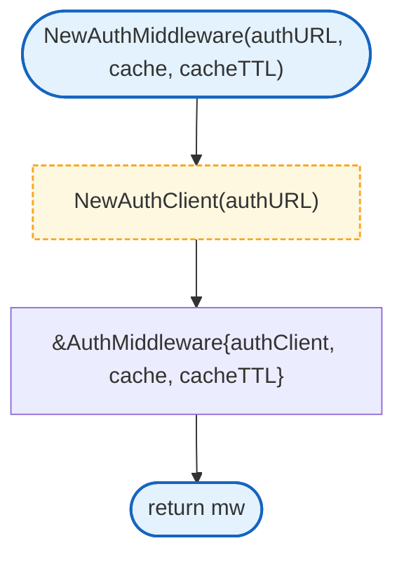

## Authenticate

Validates session cookie and adds user_id to context.

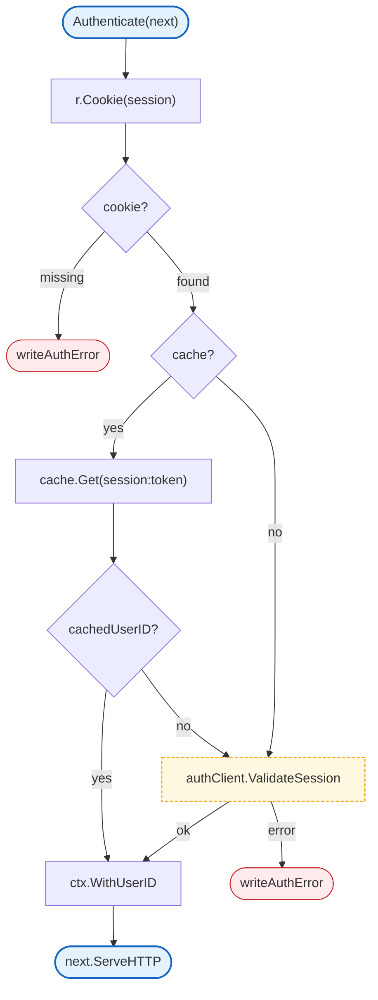

## NewRedisCache

Creates a new Redis-backed cache.

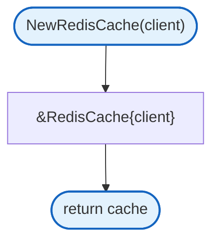

## RedisCache Methods

### Get

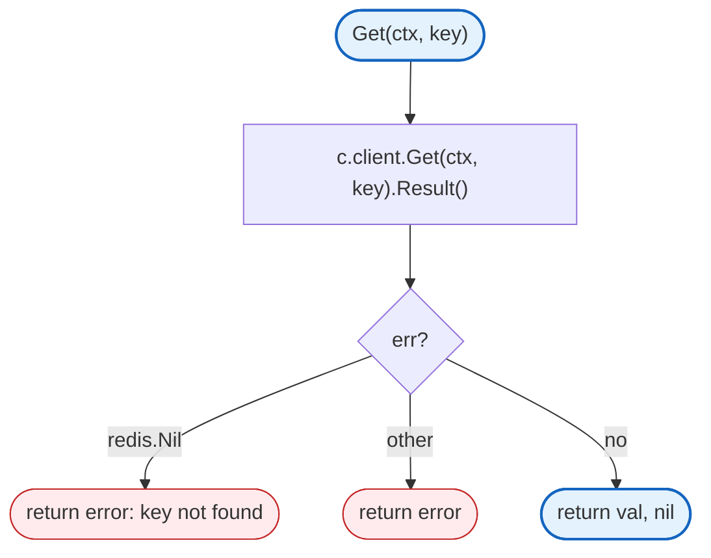

### Set

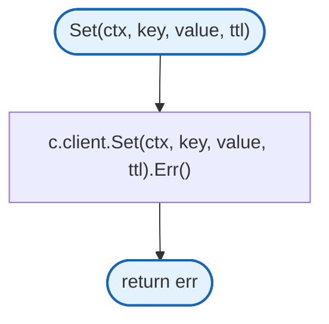

### Delete

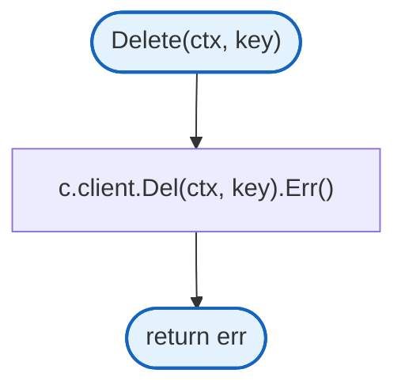

## Start

Starts the HTTP server and handles graceful shutdown.

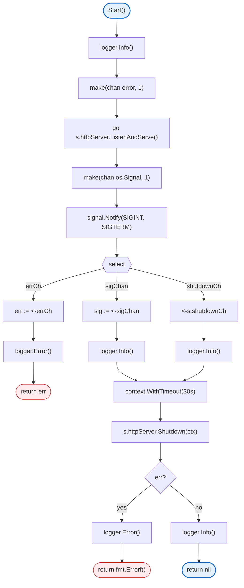

## Shutdown

Gracefully shuts down the HTTP server.

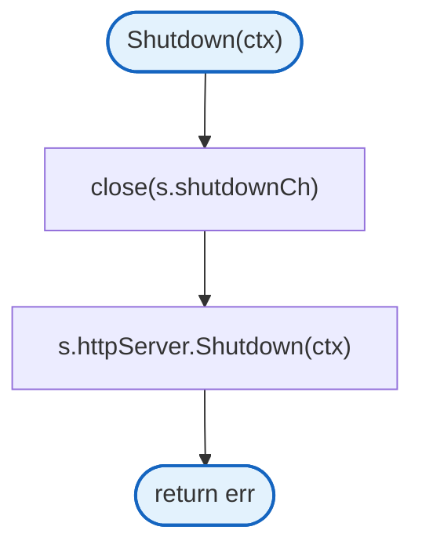

## Design Notes

### Simple Auth Flow

**Q: Why remove sliding sessions?**

| Aspect | Description |
|--------|-------------|
| Context | Client handles token refresh via refresh tokens |
| Options considered | Gateway-managed sessions, client-managed sessions |
| Rationale | Simpler gateway - only verify and upgrade to WS |

**Current approach is recommended because:**
- Gateway only validates session authenticity
- Client handles all token/cookie management
- No response wrapper needed
- Cleaner separation of concerns

### Optional Auth Cache

**Q: Why use optional caching?**

| Aspect | Description |
|--------|-------------|
| Context | Reduce auth service load |
| Options considered | No caching, Redis caching, in-memory caching |
| Rationale | Optional Redis caching for production, no cache for testing |

**Current approach is recommended because:**
- Cache is optional - works without Redis
- Reduces auth service load for repeated requests
- Configurable TTL via ServerConfig

### Graceful Shutdown

**Q: Why 30 second shutdown timeout?**

| Aspect | Description |
|--------|-------------|
| Context | Server shutdown |
| Options considered | 5s, 15s, 30s, 60s |
| Rationale | Balance between fast shutdown and draining connections |

**Current approach is recommended because:**
- Allows in-flight requests to complete
- WebSocket connections can close cleanly
- Not so long as to delay deployments

## Test Coverage

### Unit Tests

| Test Suite | Coverage |
|------------|----------|
| `TestNew` | Server creation |
| `TestHealthEndpoint` | Health check |
| `TestAuthMiddleware` | Authentication flow |
| `TestAuthMiddleware_CacheHit` | Cache usage |
| `TestRedisCache` | Cache operations |

**Running:**
```bash
make test ./internal/server
```

## Dependencies and Location

| Package | Purpose |
|---------|---------|
| `github.com/rs/zerolog` | Logging |
| `github.com/redis/go-redis/v9` | Redis client |
| `internal/ctx` | Context utilities |
| `internal/websocket` | WebSocket handler |

**File Locations:**
- [`internal/server/server.go`](../../internal/server/server.go) - HTTP server
- [`internal/server/middleware.go`](../../internal/server/middleware.go) - Auth middleware
- [`internal/server/auth.go`](../../internal/server/auth.go) - Auth client
- [`internal/server/redis_cache.go`](../../internal/server/redis_cache.go) - Redis cache

## Related

- [Auth Client](auth.md) - Detailed auth client documentation
- [WebSocket Handler](../websocket/README.md) - WebSocket handling
- [Config](../../config/README.md) - Server configuration
