# Server

HTTP server, middleware, and routing for the gateway.

## Overview

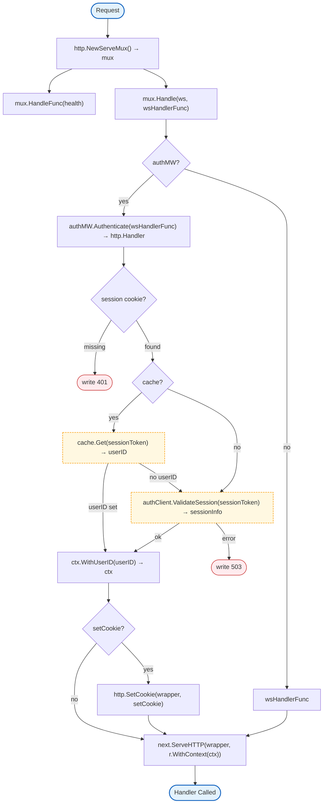

## Structs

### Server

| Struct | Field | Type | Description |
|--------|-------|------|-------------|
| `Server` | `httpServer` | `*http.Server` | HTTP server |
| | `logger` | `zerolog.Logger` | Logger |
| | `wsHandler` | `*websocket.Handler` | WebSocket handler |
| | `authMW` | `*AuthMiddleware` | Auth middleware |
| | `shutdownCh` | `chan struct{}` | Shutdown signal |

### AuthMiddleware

| Struct | Field | Type | Description |
|--------|-------|------|-------------|
| `AuthMiddleware` | `authClient` | `*auth.Client` | Auth service client |
| | `cache` | `Cache` | Session cache |
| | `cacheTTL` | `time.Duration` | Cache TTL |

### RedisCache

| Struct | Field | Type | Description |
|--------|-------|------|-------------|
| `RedisCache` | `client` | `*redis.Client` | Redis client |

## Interfaces

### Cache

```go
type Cache interface {
    Get(ctx context.Context, key string) (string, error)
    Set(ctx context.Context, key string, value string, ttl time.Duration) error
    Delete(ctx context.Context, key string) error
}
```

## Functions

### New

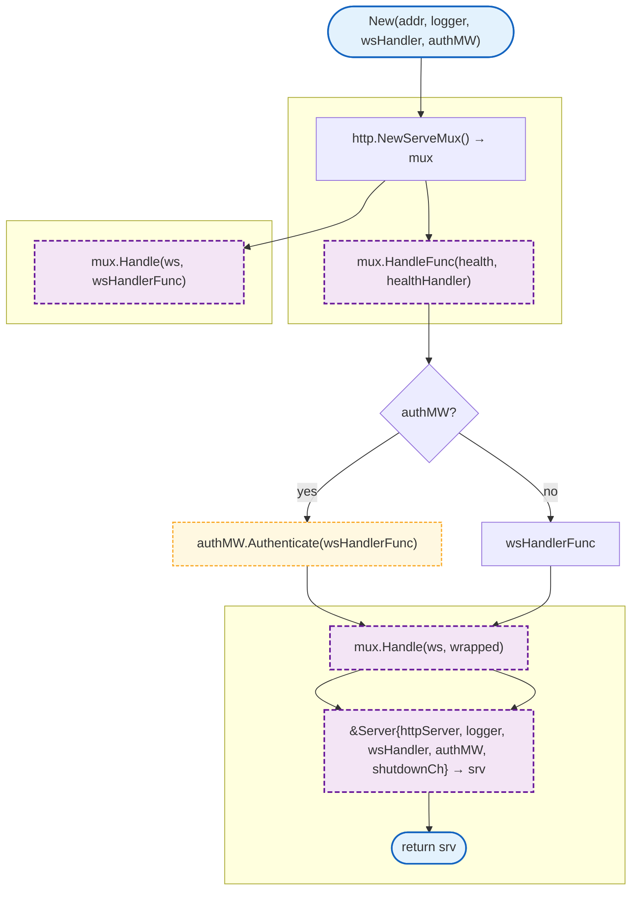

### Start

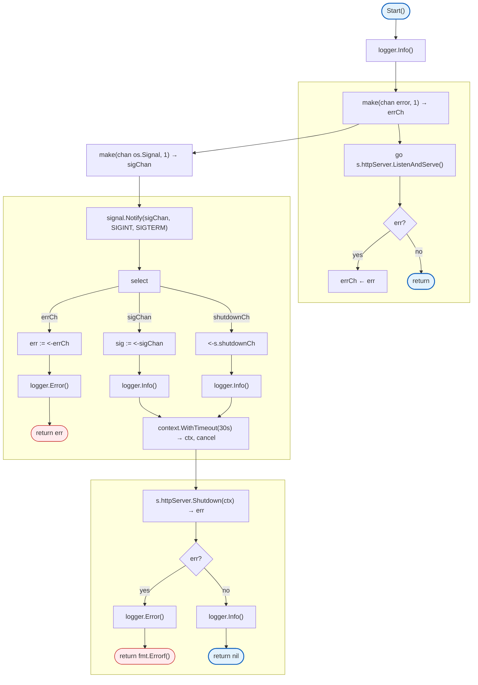

### Shutdown

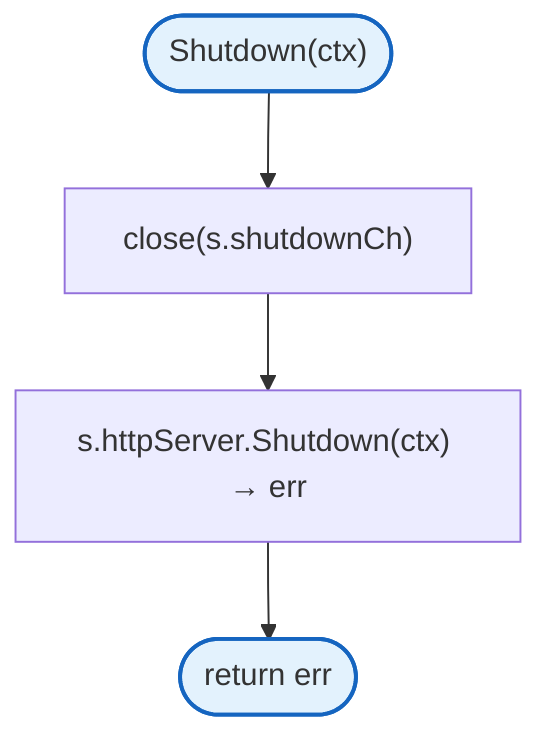

### HTTPServer

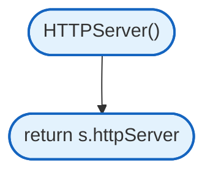

### WSHandler

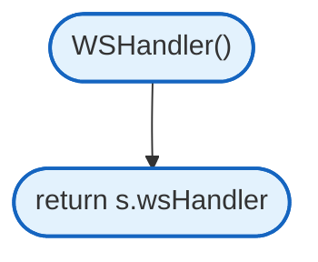

### NewAuthMiddleware

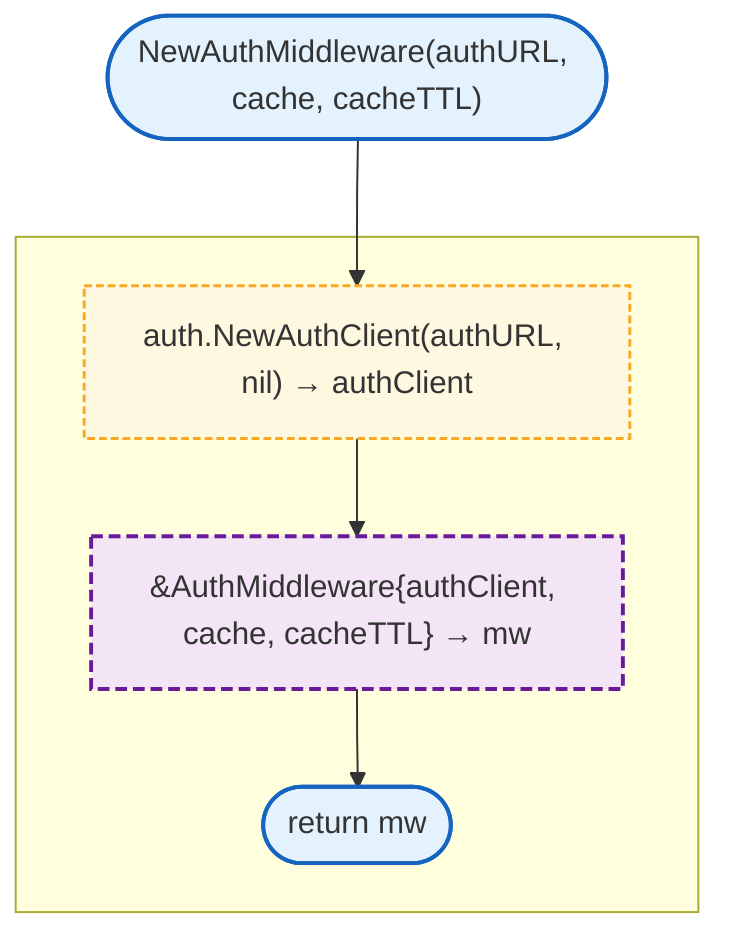

### Authenticate

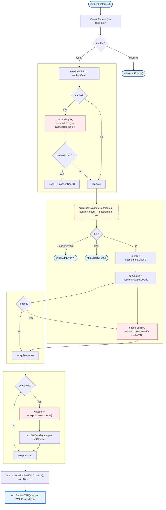

### NewRedisCache

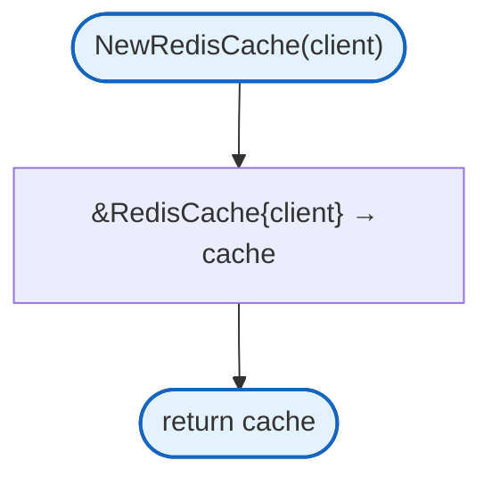

### Cache.Get

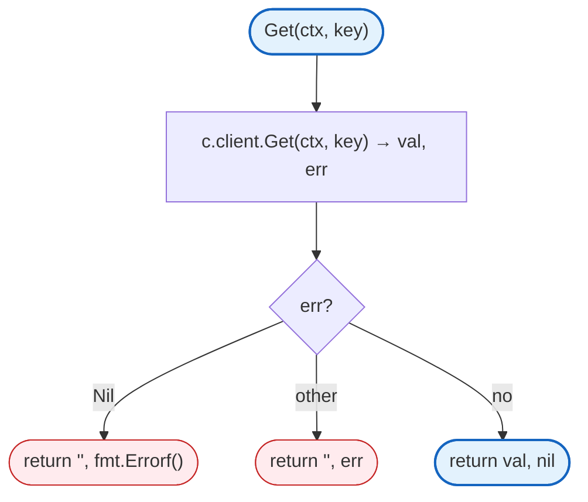

### Cache.Set

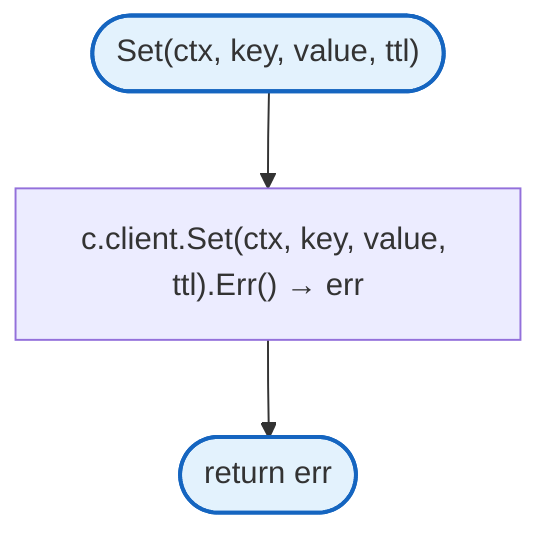

### Cache.Delete

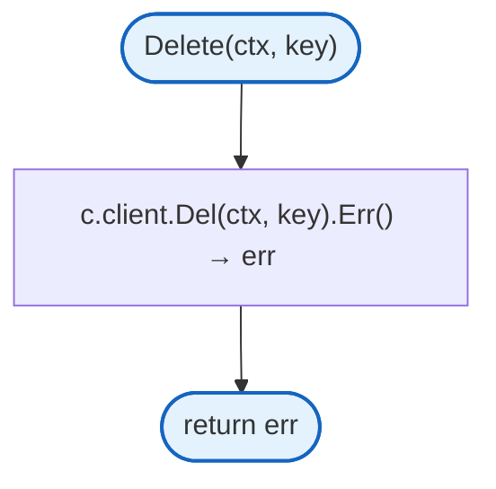

## Design Notes

### Response Wrapper for Hijack

**Q: Why wrap ResponseWriter for Set-Cookie?**

| Aspect | Description |
|--------|-------------|
| Context | Sliding session expiration |
| Options considered | Ignore cookie, wrap response, middleware chain |
| Rationale | Must forward Set-Cookie from zetidal API to browser |

**Current approach is recommended because:**
- Preserves WebSocket upgrade capability (Hijacker interface)
- Forwards sliding expiration cookies
- Transparent to downstream handlers
- Standard middleware pattern

### Graceful Shutdown

**Q: Why 30 second shutdown timeout?**

| Aspect | Description |
|--------|-------------|
| Context | Server shutdown |
| Options considered | 5s, 15s, 30s, 60s |
| Rationale | Balance between fast shutdown and draining connections |

**Current approach is recommended because:**
- Allows in-flight requests to complete
- WebSocket connections can close cleanly
- Not so long as to delay deployments
- Configurable via context in Shutdown()

## Test Coverage

### Unit Tests

| Test Suite | Coverage |
|------------|----------|
| `TestNew` | Server creation |
| `TestHealthEndpoint` | Health check |
| `TestAuthMiddleware` | Authentication flow |
| `TestAuthMiddleware_CacheHit` | Cache usage |
| `TestInternalRouter` | Internal endpoints |
| `TestRedisCache` | Cache operations |

**Running:**
```bash
make test ./internal/server
```

## Dependencies and Location

| Package | Purpose |
|---------|---------|
| `github.com/rs/zerolog` | Logging |
| `github.com/redis/go-redis/v9` | Redis client |
| `github.com/gorilla/mux` | Internal router |
| `internal/auth` | Auth client |
| `internal/ctx` | Context utilities |
| `internal/websocket` | WebSocket handler |

**File Locations:**
- [`internal/server/server.go`](https://github.com/nevaria-ai/gateway/blob/main/internal/server/server.go) - HTTP server
- [`internal/server/middleware.go`](https://github.com/nevaria-ai/gateway/blob/main/internal/server/middleware.go) - Auth middleware
- [`internal/server/internal.go`](https://github.com/nevaria-ai/gateway/blob/main/internal/server/internal.go) - Internal router
- [`internal/server/redis_cache.go`](https://github.com/nevaria-ai/gateway/blob/main/internal/server/redis_cache.go) - Redis cache
- [`internal/server/response.go`](https://github.com/nevaria-ai/gateway/blob/main/internal/server/response.go) - Response utilities

## Related

- [Auth Client](auth.md) - Auth service client
- [WebSocket Handler](websocket.md) - WebSocket handling
- [Config](../../config/README.md) - Server configuration
