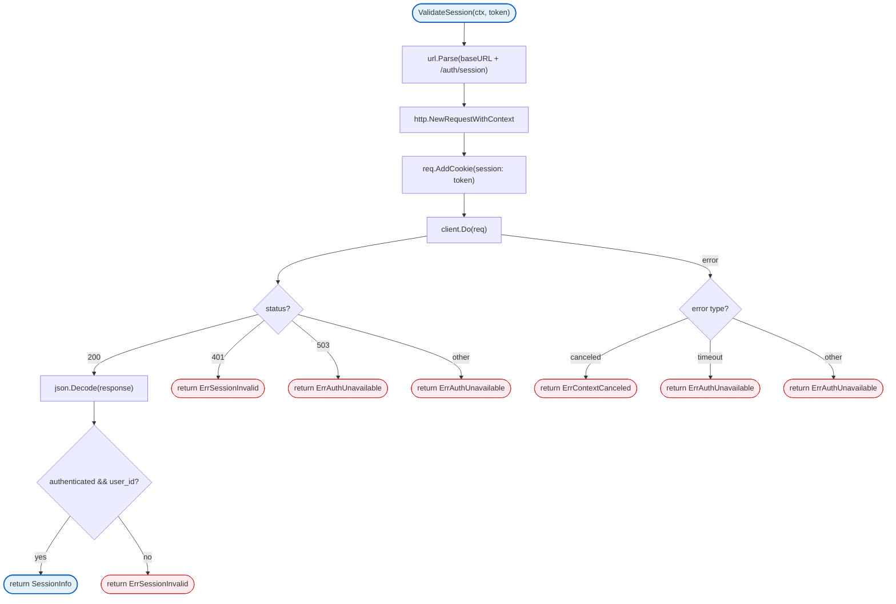
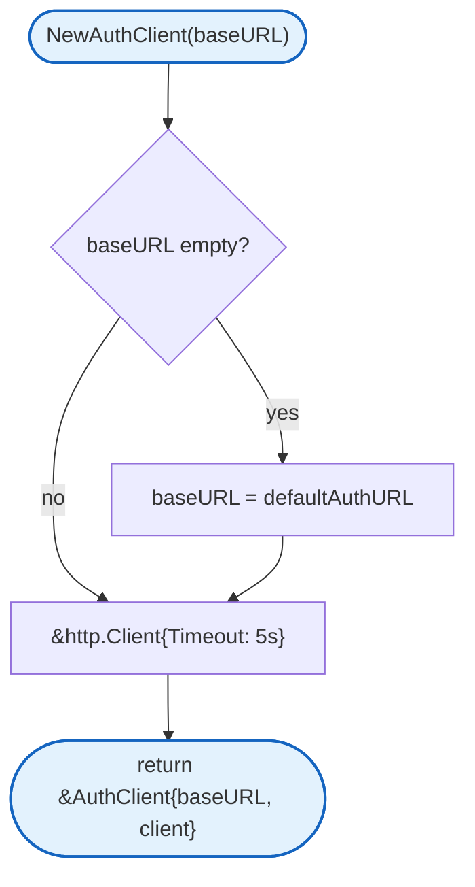

# Auth Client

HTTP client for session validation with the auth service (Zitadel).

## Overview



## Constants

| Constant | Type | Value | Description |
|----------|------|-------|-------------|
| `defaultAuthURL` | `string` | `"http://localhost:8081"` | Default auth service URL |
| `sessionCookieName` | `string` | `"session"` | Session cookie name |

## Structs

### SessionInfo

| Struct | Field | Type | Description |
|--------|-------|------|-------------|
| `SessionInfo` | `UserID` | `string` | Validated user ID |
| | `ExpiresAt` | `int64` | Unix timestamp, 0 if not provided |

### AuthClient

| Struct | Field | Type | Description |
|--------|-------|------|-------------|
| `AuthClient` | `baseURL` | `string` | Auth service base URL |
| | `client` | `*http.Client` | HTTP client with 5s timeout |

## Errors

| Error | Description |
|-------|-------------|
| `ErrSessionInvalid` | Session token is invalid or expired |
| `ErrSessionExpired` | Session has expired |
| `ErrAuthUnavailable` | Auth service is unavailable |
| `ErrInvalidAuthResponse` | Invalid response from auth service |
| `ErrContextCanceled` | Request context was canceled |

## NewAuthClient

Creates a new auth service client.



## ValidateSession

Validates a session token with the auth service.

**Request:**
- `GET {baseURL}/auth/session`
- Cookie: `session={token}`
- Content-Type: `application/json`

**Response (200 OK):**
```json
{
  "authenticated": true,
  "user_id": "user-123",
  "expires_at": 1709254800
}
```

**Response Codes:**
| Code | Meaning |
|------|---------|
| 200 | Session valid |
| 401 | Session invalid |
| 503 | Auth service unavailable |

## Design Notes

### Simplified Session Validation

**Q: Why no sliding sessions?**

| Aspect | Description |
|--------|-------------|
| Context | Client handles token refresh via refresh tokens |
| Options considered | Gateway-managed sessions, client-managed sessions |
| Rationale | Simpler gateway - only verify authenticity and upgrade to WS |

**Current approach is recommended because:**
- Gateway only validates session authenticity
- Client handles all token/cookie management
- No Set-Cookie forwarding needed
- Cleaner separation of concerns

### Unix Timestamp for ExpiresAt

**Q: Why use int64 instead of time.Time?**

| Aspect | Description |
|--------|-------------|
| Context | ExpiresAt from auth service is a Unix timestamp |
| Options considered | `time.Time`, `int64` |
| Rationale | Direct mapping from JSON, no timezone issues |

**Current approach is recommended because:**
- Direct JSON unmarshaling
- No timezone conversion issues
- Simple comparison with `time.Now().Unix()`

## Dependencies and Location

| Package | Purpose |
|---------|---------|
| `net/http` | HTTP client |
| `encoding/json` | JSON encoding/decoding |

**File Location:** [`internal/server/auth.go`](../../internal/server/auth.go)

## Related

- [Server README](README.md) - HTTP server documentation
- [Middleware](README.md#Authenticate) - Auth middleware usage
