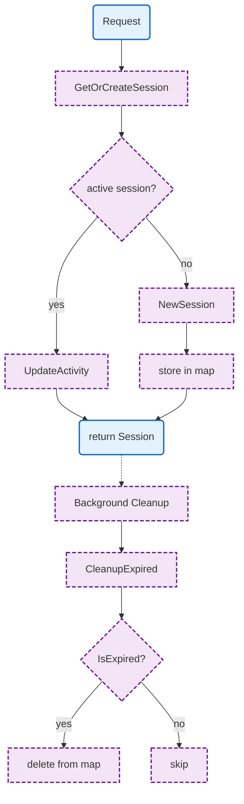

# Session

Session management with timeout support and activity tracking.

## Overview



## Structs

### Manager

| Struct | Field | Type | Description |
|--------|-------|------|-------------|
| `Manager` | `mu` | `sync.RWMutex` | Thread-safe lock |
| | `sessions` | `map[string]*Session` | Session storage |
| | `logger` | `zerolog.Logger` | Logger |
| | `timeout` | `time.Duration` | Session timeout |

### Session

| Struct | Field | Type | Description |
|--------|-------|------|-------------|
| `Session` | `sessionID` | `string` | Unique session ID |
| | `userID` | `string` | User identifier |
| | `agentID` | `string` | Agent identifier |
| | `mem0SessionID` | `string` | Mem0 session ID |
| | `messages` | `[]Message` | Message history |
| | `startedAt` | `time.Time` | Session start time |
| | `lastActivity` | `time.Time` | Last activity time |

### Message

| Struct | Field | Type | Description |
|--------|-------|------|-------------|
| `Message` | `Role` | `string` | Message role |
| | `Content` | `string` | Message content |
| | `Timestamp` | `int64` | Unix timestamp |

## Functions

### Manager

| Function | Signature | Description |
|----------|-----------|-------------|
| `NewManager` | `(logger zerolog.Logger, timeout time.Duration) *Manager` | Creates manager |
| `GetOrCreateSession` | `(ctx context.Context, userID, agentID string) *Session` | Gets or creates session |
| `RemoveSession` | `(sessionID string)` | Removes session |
| `CleanupExpired` | `() int` | Removes expired sessions |
| `StartCleanupLoop` | `(interval time.Duration)` | Starts cleanup goroutine |

### Session

| Function | Signature | Description |
|----------|-----------|-------------|
| `NewSession` | `(ctx context.Context, userID, agentID string) *Session` | Creates session |
| `SessionID` | `() string` | Returns session ID |
| `UserID` | `() string` | Returns user ID |
| `AgentID` | `() string` | Returns agent ID |
| `Mem0SessionID` | `() string` | Returns Mem0 session ID |
| `Messages` | `() []Message` | Returns message copy |
| `AddMessage` | `(msg Message)` | Adds message |
| `UpdateActivity` | `()` | Updates last activity |
| `IsExpired` | `(timeout time.Duration) bool` | Checks expiration |
| `MessageCount` | `() int` | Returns message count |
| `ClearMessages` | `()` | Clears messages |

## Design Notes

### In-Memory Sessions

**Q: Why store sessions in memory instead of Redis?**

| Aspect | Description |
|--------|-------------|
| Context | Session persistence |
| Options considered | In-memory, Redis, database |
| Rationale | Sessions are ephemeral, agents hold real state |

**Current approach is recommended because:**
- Fast access for active sessions
- Agents hold persistent state separately
- Session timeout handles cleanup
- Can add Redis backup later

### Separate Mem0 Session ID

**Q: Why have a separate mem0SessionID?**

| Aspect | Description |
|--------|-------------|
| Context | Memory service integration |
| Options considered | Reuse sessionID, separate ID |
| Rationale | Different namespaces, independent lifecycle |

**Current approach is recommended because:**
- Mem0 has its own session concept
- Gateway session may outlive Mem0 session
- Clear separation of concerns
- Easier debugging

## Test Coverage

### Unit Tests

| Test Suite | Coverage |
|------------|----------|
| `TestNewManager` | Manager creation |
| `TestGetOrCreateSession` | Session creation |
| `TestGetOrCreateSession_Existing` | Session reuse |
| `TestRemoveSession` | Session removal |
| `TestCleanupExpired` | Expiration cleanup |
| `TestSession_IsExpired` | Expiration check |
| `TestSession_AddMessage` | Message handling |

**Running:**
```bash
make test ./internal/session
```

## Dependencies and Location

| Package | Purpose |
|---------|---------|
| `github.com/google/uuid` | UUID generation |
| `github.com/rs/zerolog` | Logging |

**File Locations:**
- [`internal/session/manager.go`](https://github.com/nevaria-ai/gateway/blob/main/internal/session/manager.go) - Session manager
- [`internal/session/session.go`](https://github.com/nevaria-ai/gateway/blob/main/internal/session/session.go) - Session type

## Related

- [Agent](../agent/README.md) - Agent runtime
- [WebSocket](../websocket.md) - Connection handling
- [Mem0](../mem0/README.md) - Memory service
