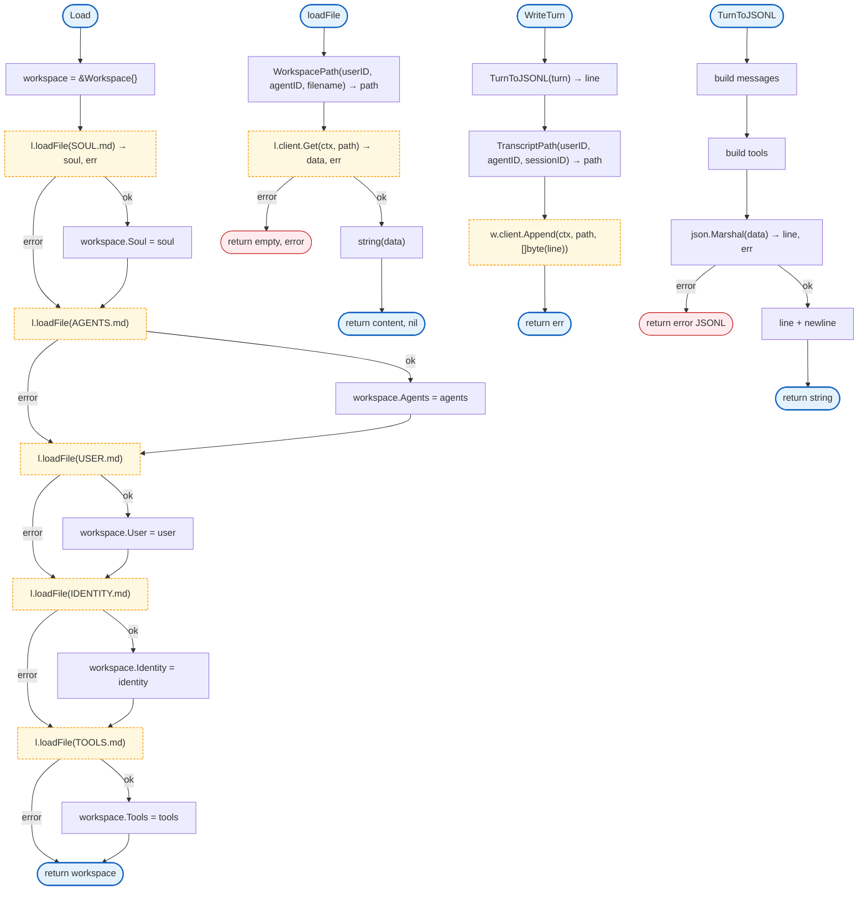

# Storage

S3-compatible storage for agent workspaces and conversation transcripts.

## Overview



## Structs

### Workspace

| Struct | Field | Type | Description |
|--------|-------|------|-------------|
| `Workspace` | `Soul` | `string` | Core agent personality |
| | `Agents` | `string` | Agent network config |
| | `User` | `string` | User-specific info |
| | `Identity` | `string` | Agent identity |
| | `Tools` | `string` | Tool guidance |
| | `Loaded` | `bool` | At least one file loaded |

### WorkspaceLoader

| Struct | Field | Type | Description |
|--------|-------|------|-------------|
| `WorkspaceLoader` | `client` | `Client` | S3 client |

### Turn

| Struct | Field | Type | Description |
|--------|-------|------|-------------|
| `Turn` | `SessionID` | `string` | Session identifier |
| | `UserID` | `string` | User identifier |
| | `AgentID` | `string` | Agent identifier |
| | `TurnNumber` | `int` | Turn sequence number |
| | `Messages` | `[]agent.AgentMessage` | Conversation messages |
| | `Tools` | `[]ToolCall` | Tool calls in turn |
| | `Timestamp` | `int64` | Unix timestamp |

### ToolCall

| Struct | Field | Type | Description |
|--------|-------|------|-------------|
| `ToolCall` | `ID` | `string` | Tool call ID |
| | `Name` | `string` | Tool name |
| | `Args` | `map[string]any` | Tool arguments |
| | `Result` | `any` | Tool result |
| | `IsError` | `bool` | Error flag |

### TranscriptWriter

| Struct | Field | Type | Description |
|--------|-------|------|-------------|
| `TranscriptWriter` | `client` | `Client` | S3 client |

## Interfaces

### Client

```go
type Client interface {
    Put(ctx context.Context, key string, data []byte) error
    Get(ctx context.Context, key string) ([]byte, error)
    Append(ctx context.Context, key string, data []byte) error
    Delete(ctx context.Context, key string) error
}
```

## Functions

### Path Helpers

| Function | Signature | Description |
|----------|-----------|-------------|
| `WorkspacePath` | `(userID, agentID, filename string) string` | S3 path for workspace file |
| `TranscriptPath` | `(userID, agentID, sessionID string) string` | S3 path for transcript |

### Workspace

| Function | Signature | Description |
|----------|-----------|-------------|
| `NewWorkspaceLoader` | `(client Client) *WorkspaceLoader` | Creates loader |
| `Load` | `(ctx context.Context, userID, agentID string) (*Workspace, error)` | Loads workspace files |
| `FormatSystemPrompt` | `() string` | Formats as system prompt |

### Transcript

| Function | Signature | Description |
|----------|-----------|-------------|
| `NewTranscriptWriter` | `(client Client) *TranscriptWriter` | Creates writer |
| `WriteTurn` | `(ctx context.Context, turn Turn) error` | Writes turn as JSONL |
| `TurnToJSONL` | `(turn Turn) string` | Converts to JSONL line |

## Design Notes

### Missing Files as Empty

**Q: Why treat missing workspace files as empty instead of error?**

| Aspect | Description |
|--------|-------------|
| Context | Workspace file loading |
| Options considered | Error on missing, empty string, skip |
| Rationale | Not all agents need all files |

**Current approach is recommended because:**
- Agents can have minimal configuration
- New agents start with empty workspace
- No required file structure
- `Loaded` flag indicates if any files exist

### JSONL for Transcripts

**Q: Why use JSONL instead of JSON array?**

| Aspect | Description |
|--------|-------------|
| Context | Transcript format |
| Options considered | JSON array, JSONL, database |
| Rationale | Append-friendly, streamable, line-delimited |

**Current approach is recommended because:**
- Append operation is simple
- Can process while writing
- Each line is independent
- Standard format for logs/events

## Test Coverage

### Unit Tests

| Test Suite | Coverage |
|------------|----------|
| `TestMockS3Client` | Mock client operations |
| `TestWorkspaceLoader` | File loading |
| `TestWorkspacePath` | Path generation |
| `TestTranscriptWriter` | Turn writing |
| `TestTurnToJSONL` | JSONL formatting |

**Running:**
```bash
make test ./internal/storage
```

## Dependencies and Location

| Package | Purpose |
|---------|---------|
| `internal/agent` | AgentMessage type |

**File Locations:**
- [`internal/storage/s3.go`](https://github.com/nevaria-ai/gateway/blob/main/internal/storage/s3.go) - S3 client interface
- [`internal/storage/workspace.go`](https://github.com/nevaria-ai/gateway/blob/main/internal/storage/workspace.go) - Workspace loader
- [`internal/storage/transcript.go`](https://github.com/nevaria-ai/gateway/blob/main/internal/storage/transcript.go) - Transcript writer

## Related

- [Agent Tools](../agent/tools.md) - File tools use storage
- [Session](../session/README.md) - Session transcript integration
