# WebSocket

WebSocket connection handler with multi-agent routing and connection management.

## Overview

```mermaid
flowchart TB
    Start([WebSocket Request]) --> CheckSem{connSem?}
    CheckSem -->|yes| Acquire["select h.connSem"]
    CheckSem -->|no| UpgradeConn
    Acquire -->|full| LimitErr(["write 503"])
    Acquire -->|slot| UpgradeConn["h.upgrader.Upgrade(w, r, nil) → conn, err"]
    UpgradeConn -->|error| UpgradeErr(["return"])
    UpgradeConn -->|ok| IncActive["atomic.AddInt32(&activeConns, 1)"]
    IncActive --> GetUserID["ctx.GetUserIDFromContext(r.Context()) → userID"]
    GetUserID --> CheckUser{userID?}
    CheckUser -->|yes| SetSession["sessionID = userID"]
    CheckUser -->|no| NewUUID["uuid.New().String() → sessionID"]
    SetSession --> NewUUID
    NewUUID --> CreateCtx["context.WithCancel() → ctx, cancel"]
    CreateCtx --> MakeWriteCh["make(chan *wsMessage, 8) → writeCh"]
    MakeWriteCh --> SendEvent["marshalEvent(connectedEvent) → msg"]
    SendEvent --> WriteCh["writeCh ← msg"]
    WriteCh --> MsgLoop{message loop}
    MsgLoop -->|text| HandleText["h.handleTextMessage(ctx, message, userID, writeCh)"]
    MsgLoop -->|close| Cancel(["cancel()"])
    HandleText --> Unmarshal["json.Unmarshal(data, &msg)"]
    Unmarshal --> CheckType{msg.Type?}
    CheckType -->|prompt| ValidatePrompt{agentID? text?}
    ValidatePrompt -->|missing| Skip(["return"])
    ValidatePrompt -->|valid| GetAgent["h.agentManager.GetOrCreateAgentForUser(userID, msg.AgentID) → agentInstance"]
    GetAgent --> Subscribe["agentInstance.Subscribe() → subID, eventCh"]
    Subscribe --> ForwardEvents["h.forwardAgentEvents(ctx, eventCh, writeCh, logger, msg.AgentID)"]
    ForwardEvents --> AgentPrompt["agentInstance.Prompt(ctx, msg.Text)"]
    AgentPrompt --> MsgLoop

    click GetUserID href "ctx.md"
    click GetAgent href "agent/README.md"
    click AgentPrompt href "agent/README.md"

    classDef mainFn fill:#e3f2fd,stroke:#1565c0,stroke-width:2px
    classDef localPkgs fill:#fff8e1,stroke:#f9a825,stroke-width:1.5px,stroke-dasharray:4 2
    classDef errorFlow fill:#ffebee,stroke:#c62828,stroke-width:1px

    class Start,Cancel,Skip mainFn
    class GetUserID,GetAgent,AgentPrompt localPkgs
    class LimitErr,UpgradeErr errorFlow
```

## Constants

| Constant | Type | Value | Description |
|----------|------|-------|-------------|
| `defaultBufferSize` | `int` | `8192` | 8KB read/write buffer |
| `MaxMessageSize` | `int` | `65536` | 64KB max message |
| `readTimeout` | `Duration` | `60s` | Read deadline |
| `writeTimeout` | `Duration` | `10s` | Write deadline |
| `pingInterval` | `Duration` | `30s` | Ping frequency |

## Structs

### Handler

| Struct | Field | Type | Description |
|--------|-------|------|-------------|
| `Handler` | `logger` | `zerolog.Logger` | Logger |
| | `upgrader` | `websocket.Upgrader` | WebSocket upgrader |
| | `connSem` | `chan struct{}` | Connection semaphore |
| | `maxConns` | `int` | Max connections (0=unlimited) |
| | `activeConns` | `int32` | Active connection count (atomic) |
| | `agentManager` | `*AgentManager` | Agent manager |

### wsMessage

| Struct | Field | Type | Description |
|--------|-------|------|-------------|
| `wsMessage` | `messageType` | `int` | WebSocket message type |
| | `data` | `[]byte` | Message data |

### wsEvent

| Struct | Field | Type | Description |
|--------|-------|------|-------------|
| `wsEvent` | `Type` | `string` | Event type |
| | `AgentID` | `string` | Agent identifier |
| | `Data` | `any` | Event payload |

### AgentKey

| Struct | Field | Type | Description |
|--------|-------|------|-------------|
| `AgentKey` | `UserID` | `string` | User identifier |
| | `AgentID` | `string` | Agent identifier |

### AgentManager

| Struct | Field | Type | Description |
|--------|-------|------|-------------|
| `AgentManager` | `mu` | `sync.RWMutex` | Thread-safe lock |
| | `agents` | `map[AgentKey]*agent.Agent` | Agent instances |
| | `logger` | `zerolog.Logger` | Logger |
| | `llmProxy` | `*proxy.Handler` | LLM proxy handler |

## Functions

### NewHandler

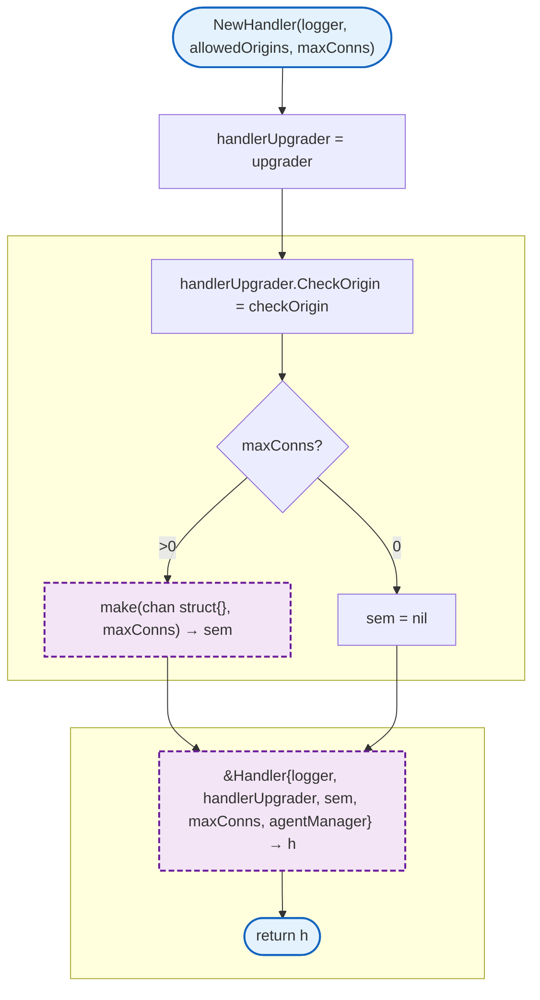

### checkOrigin

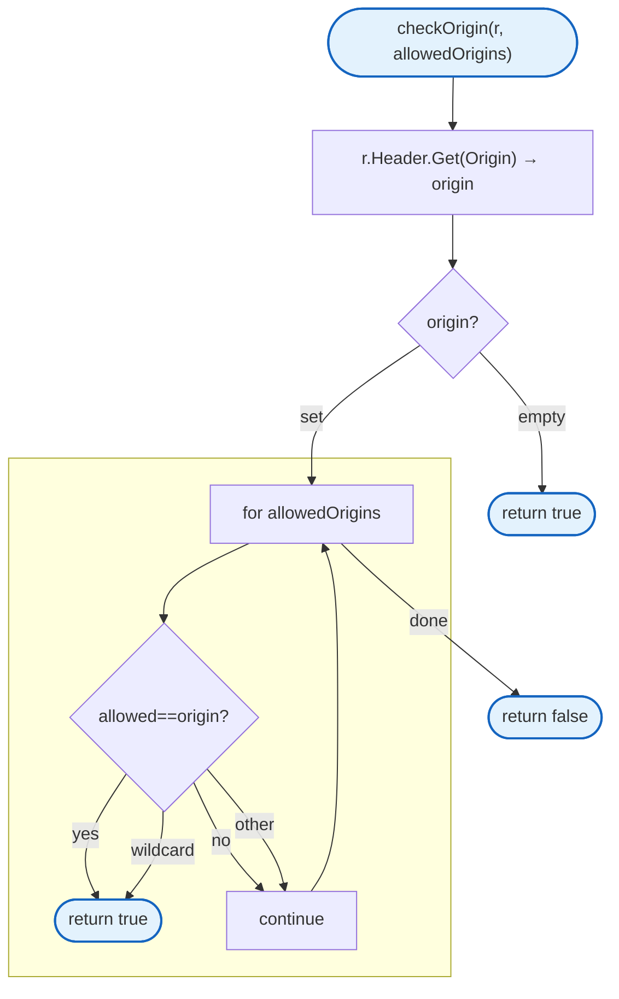

### HandleWebSocket

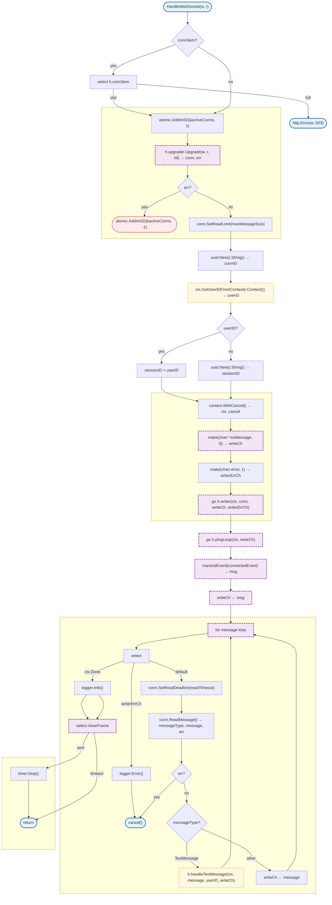

### writer

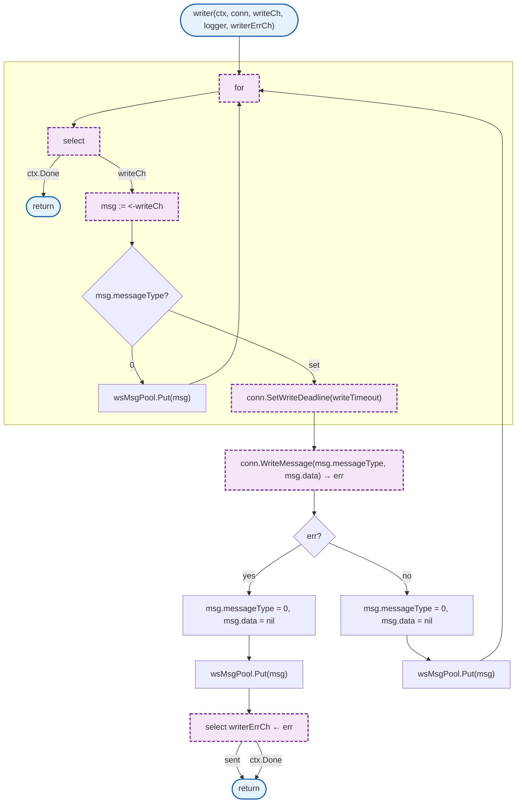

### pingLoop

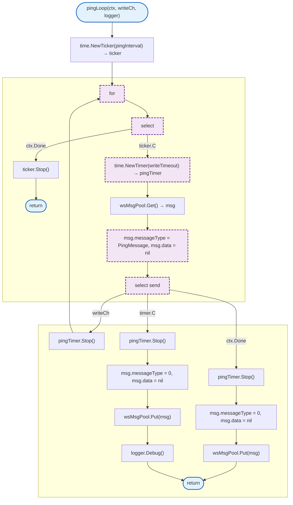

### handleTextMessage

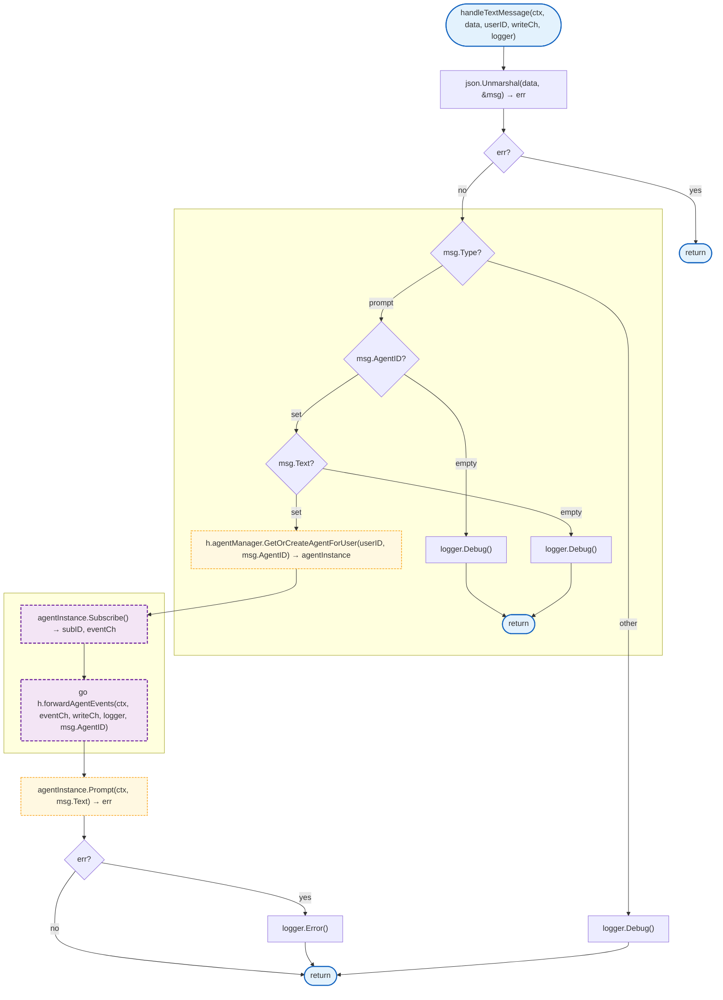

### forwardAgentEvents

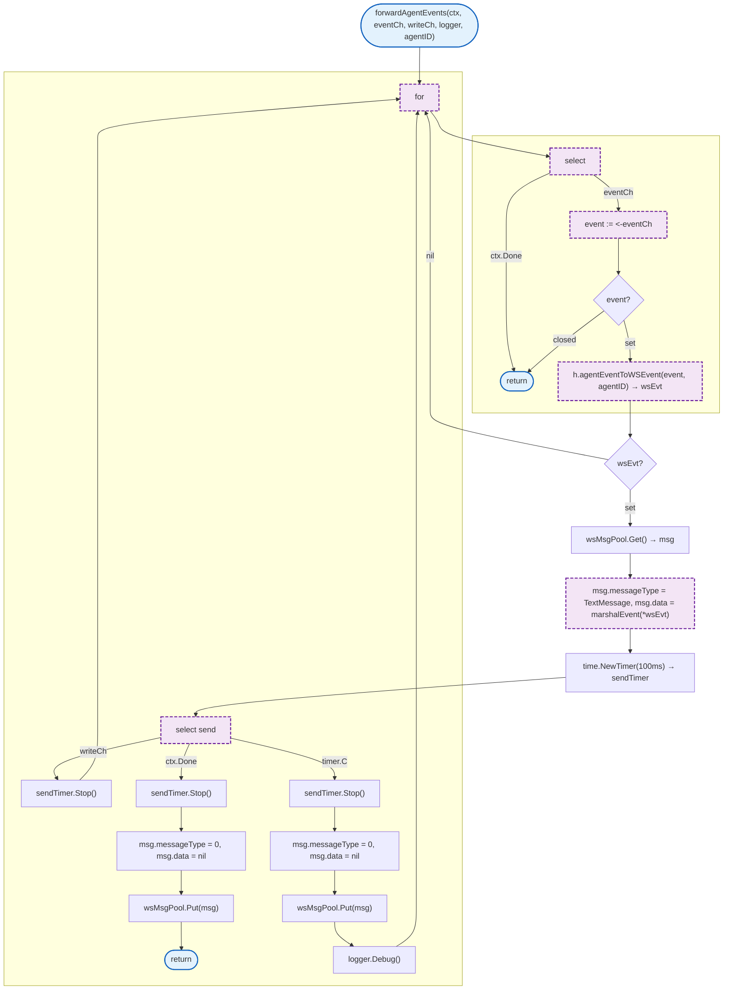

### ActiveConns

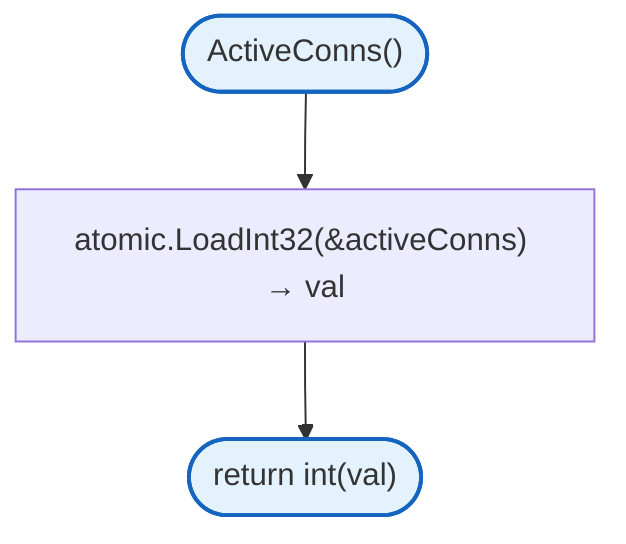

### NewAgentManager

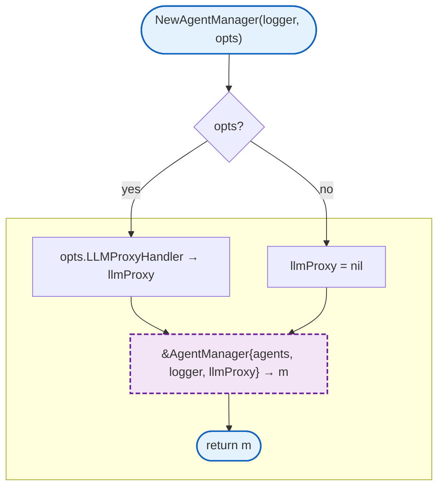

### GetOrCreateAgentForUser

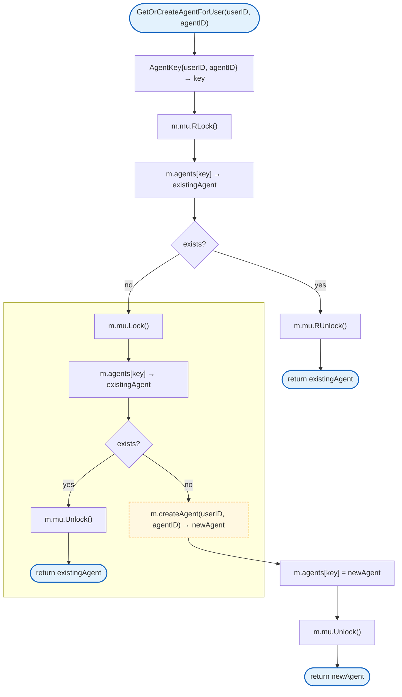

### createAgent

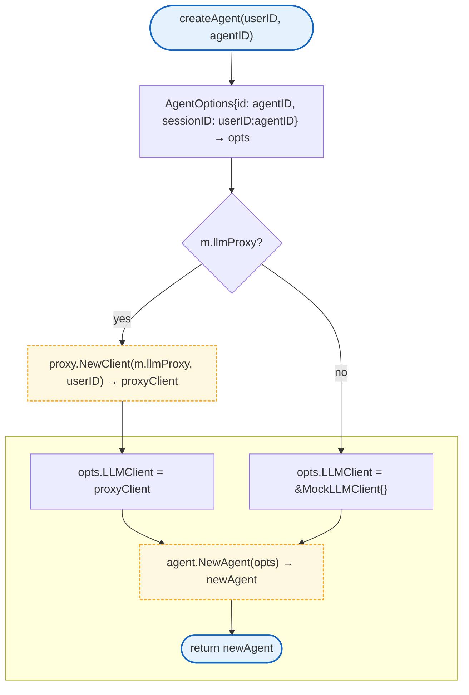

### RemoveAgentForUser

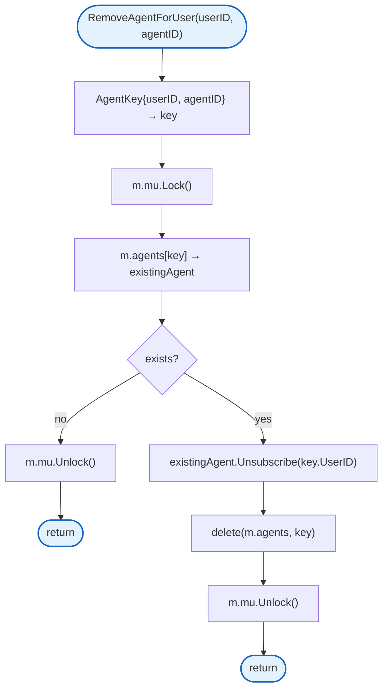

## Design Notes

### Single Writer Pattern

**Q: Why use a single writer goroutine?**

| Aspect | Description |
|--------|-------------|
| Context | WebSocket concurrent writes |
| Options considered | Mutex, channel serialization, lock-free |
| Rationale | WebSocket doesn't support concurrent writes |

**Current approach is recommended because:**
- gorilla/websocket is not thread-safe for writes
- Channel serialization is cleaner than mutex
- Naturally handles ping/pong interleaving
- Writer goroutine can manage deadlines

### sync.Pool for Messages

**Q: Why use sync.Pool for wsMessage?**

| Aspect | Description |
|--------|-------------|
| Context | High-frequency message allocation |
| Options considered | New allocation, sync.Pool, buffer reuse |
| Rationale | Reduces GC pressure in high-traffic scenarios |

**Current approach is recommended because:**
- Messages are short-lived
- Pool reuses memory across connections
- Standard Go pattern for high-throughput
- Automatic GC of unused items

### Agents Persist Beyond Connection

**Q: Why do agents persist after WebSocket disconnect?**

| Aspect | Description |
|--------|-------------|
| Context | Agent lifecycle management |
| Options considered | Destroy on disconnect, persist, timed cleanup |
| Rationale | User can reconnect and continue conversation |

**Current approach is recommended because:**
- Better UX - conversation continues
- State (workspace, memory) preserved
- Supports mobile app backgrounding
- Can add cleanup policy later

### Composite Key for Multi-Agent

**Q: Why use (userID, agentID) composite key?**

| Aspect | Description |
|--------|-------------|
| Context | Agent isolation |
| Options considered | Single key, composite key, hierarchical |
| Rationale | Users can have multiple agents |

**Current approach is recommended because:**
- Clear ownership boundaries
- Prevents agent ID collisions between users
- Efficient map lookup
- Natural multi-tenancy

## Test Coverage

### Unit Tests

| Test Suite | Coverage |
|------------|----------|
| `TestNewHandler` | Handler creation |
| `TestHandleWebSocket` | Connection handling |
| `TestCheckOrigin` | Origin validation |
| `TestAgentManager` | Agent lifecycle |
| `TestGetOrCreateAgentForUser` | Agent creation |
| `TestForwardAgentEvents` | Event forwarding |

**Running:**
```bash
make test ./internal/websocket
```

## Dependencies and Location

| Package | Purpose |
|---------|---------|
| `github.com/gorilla/websocket` | WebSocket protocol |
| `github.com/google/uuid` | UUID generation |
| `github.com/rs/zerolog` | Logging |
| `internal/agent` | Agent runtime |
| `internal/ctx` | Context utilities |
| `internal/llm-proxy` | LLM proxy client |

**File Locations:**
- [`internal/websocket/handler.go`](https://github.com/nevaria-ai/gateway/blob/main/internal/websocket/handler.go) - WebSocket handler
- [`internal/websocket/agent_manager.go`](https://github.com/nevaria-ai/gateway/blob/main/internal/websocket/agent_manager.go) - Agent manager

## Related

- [Agent](../agent/README.md) - Agent runtime
- [Server](../server/README.md) - HTTP server
- [LLM Proxy](../llm-proxy/README.md) - LLM integration
