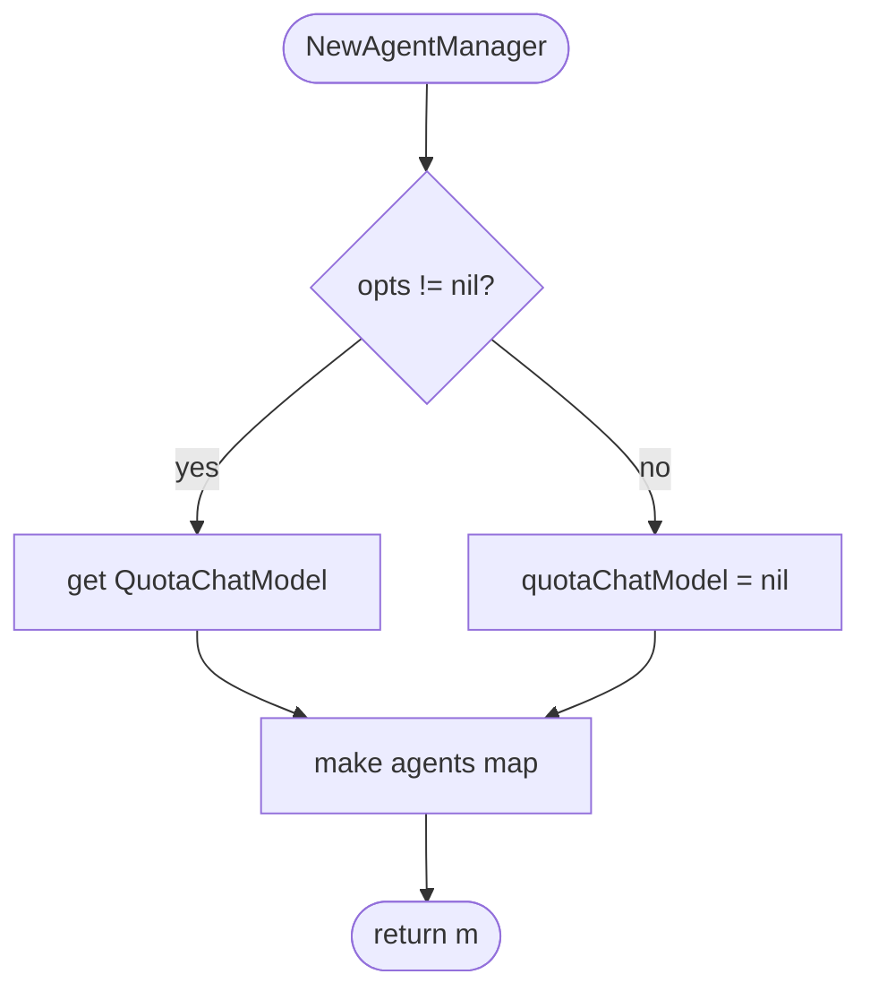
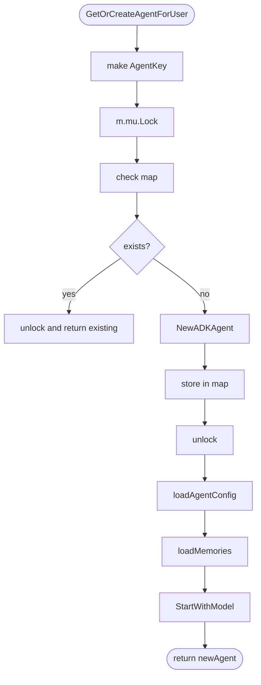
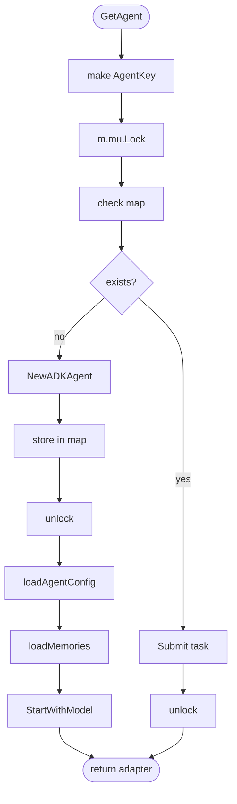
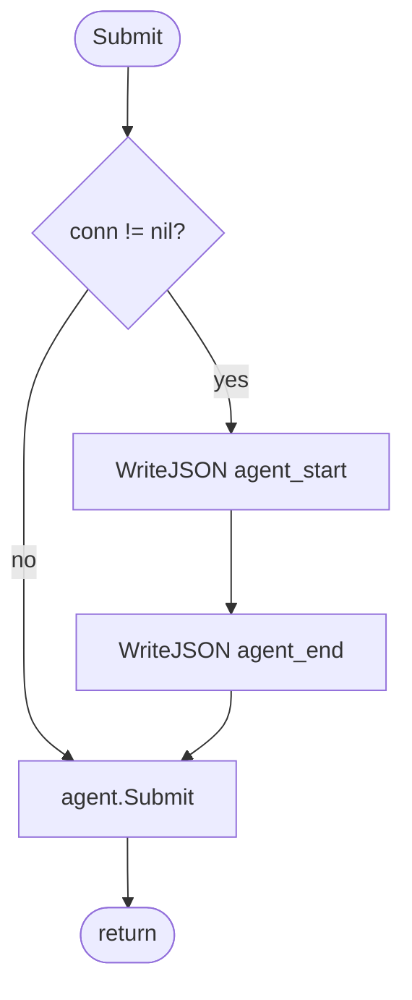
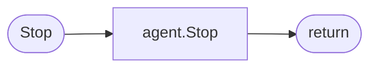
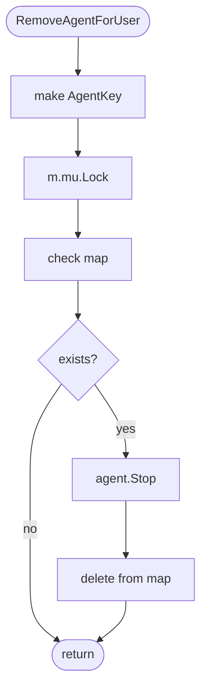
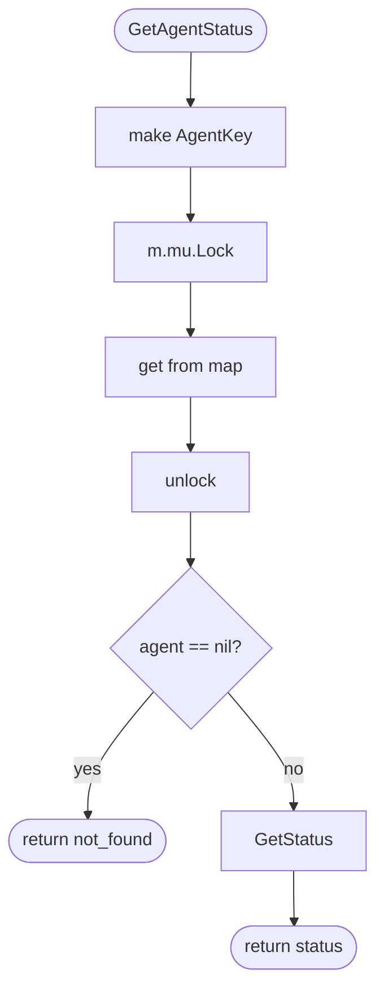
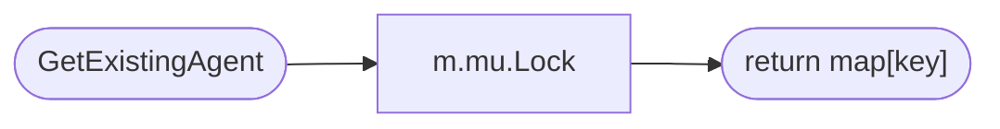
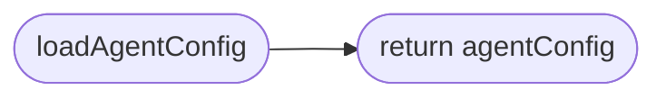
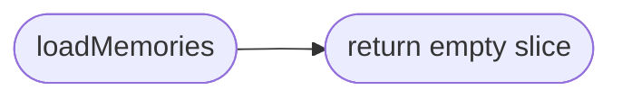

# Agent Manager

Agent lifecycle management with ADKAgent and thread-safe multi-user multi-agent support.

## Interfaces

### Agent

```go
type Agent interface {
    Submit(task agent.Task)
    Stop()
}
```

## Structs

### AgentKey

| Struct | Field | Type | Description |
|--------|-------|------|-------------|
| `AgentKey` | `UserID` | `string` | User identifier |
| `AgentKey` | `AgentID` | `string` | Agent identifier |

### AgentManagerOptions

| Struct | Field | Type | Description |
|--------|-------|------|-------------|
| `AgentManagerOptions` | `QuotaChatModel` | `agent.QuotaChatModelInterface` | Quota model for Eino initialization |

### AgentManager

| Struct | Field | Type | Description |
|--------|-------|------|-------------|
| `AgentManager` | `mu` | `sync.Mutex` | Lock for agents map |
| | `agents` | `map[AgentKey]*agent.ADKAgent` | Thread-safe agent storage |
| | `logger` | `zerolog.Logger` | Logger for operations |
| | `quotaChatModel` | `agent.QuotaChatModelInterface` | Quota model for Eino initialization |

### adkAgentAdapter

Private struct that wraps ADKAgent with WebSocket connection.

| Struct | Field | Type | Description |
|--------|-------|------|-------------|
| `adkAgentAdapter` | `agent` | `*agent.ADKAgent` | Wrapped ADKAgent |
| | `conn` | `*WSConnWrapper` | WebSocket for streaming |
| | `agentID` | `string` | Agent ID for events |

### agentConfig

Private struct for agent configuration.

| Struct | Field | Type | Description |
|--------|-------|------|-------------|
| `agentConfig` | `SystemPrompt` | `string` | System prompt for agent |

## NewAgentManager

Creates a new AgentManager.



## GetOrCreateAgentForUser

Returns an existing agent for (userID, agentID) pair or creates a new one.



## GetAgent

Returns an Agent interface for the given (userID, agentID) pair with connection wrapper.



## adkAgentAdapter.Submit

Submits a task to the wrapped agent with WebSocket event notifications.



## adkAgentAdapter.Stop

Stops the wrapped agent.



## RemoveAgentForUser

Removes agent for given (userID, agentID) pair.



## GetAgentStatus

Returns the status of an agent if it exists.



## GetExistingAgent

Returns an existing agent without creating a new one.



## loadAgentConfig

Private method - loads agent configuration (placeholder implementation).



## loadMemories

Private method - loads user memories (placeholder implementation).



## Design Notes

### Thread-Safe Agent Management

**Q: Why use Mutex instead of sync.Map?**

| Aspect | Description |
|--------|-------------|
| Context | Need to protect complex operations (get/create/remove) with consistency |
| Options considered | sync.Map, Mutex + map, RWMutex |
| Rationale | Standard mutex provides predictable locking behavior and easier reasoning |

**Q: Why check for existing agent under lock?**

| Aspect | Description |
|--------|-------------|
| Context | Prevent race condition between concurrent first messages for same agent |
| Options considered | Double-checked locking, LoadOrStore, Mutex lock |
| Rationale | Lock-then-check is simple and ensures only one goroutine creates agent |

**Current approach is recommended because:**
- Simple and clear locking semantics
- Easy to add additional coordination if needed
- Standard Go pattern familiar to most developers

### ADKAgent Adapter Pattern

**Q: Why use adkAgentAdapter instead of ADKAgent directly?**

| Aspect | Description |
|--------|-------------|
| Context | Need to add WebSocket streaming behavior to Agent without modifying ADKAgent |
| Options considered | Modify ADKAgent, Wrapper/adapter, Interface |
| Rationale | Adapter keeps ADKAgent pure while adding handler-specific behaviors |

**Current approach is recommended because:**
- Separation of concerns: ADKAgent doesn't know about WebSocket
- Testability: Can mock adapter in handler tests
- Single responsibility: ADKAgent handles Eino, adapter handles WebSocket

## Test Coverage

### Unit Tests

| Test Suite | Coverage |
|------------|----------|
| `TestAgentManagerCreation` | Validates AgentManager initialization |
| `TestGetOrCreateAgentForUser` | Tests agent creation on first message |
| `TestRemoveAgentForUser` | Tests agent removal from manager |
| `TestGetAgent` | Tests retrieving existing agent with adapter |
| `TestAgentKeyCompositeKey` | Validates composite key behavior |
| `TestGetAgentStatus` | Tests status retrieval for agents |

**Running:**
```bash
make test-unit TEST_PATH=./tests/unit/websocket/...
```

## Dependencies and Location

| Package | Purpose |
|---------|---------|
| `github.com/nevaria-ai/gateway/internal/agent` | ADKAgent implementation |
| `github.com/rs/zerolog` | Structured logging |

**File Location:** [`internal/websocket/agent_manager.go`](../../internal/websocket/agent_manager.go)
