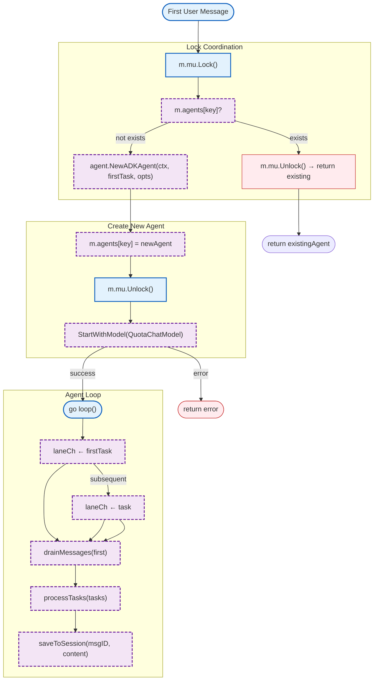

# websocket/agent_manager (internal/websocket)

Agent lifecycle management with ADKAgent and thread-safe multi-user multi-agent support.

## Overview



### Variables

| Variable | Type | Description |
|----------|------|-------------|
| N/A | - | No package-level variables. |

### Constants

| Constant | Type | Value | Description |
|----------|------|-------|-------------|
| N/A | - | No package-level constants. |

### Structs

| Struct | Field | Type | Description |
|--------|-------|------|-------------|
| `Agent` | `Submit(task)` | `func(task Task)` | Submit task to agent |
| `Agent` | `Stop()` | `func()` | Stop agent goroutine |
| `AgentManager` | `mu` | `sync.Mutex` | Lock for agents map |
| `AgentManager` | `agents` | `map[AgentKey]*agent.ADKAgent` | Thread-safe agent storage |
| `AgentManager` | `logger` | `zerolog.Logger` | Logger for operations |
| `AgentManager` | `quotaChatModel` | `agent.QuotaChatModelInterface` | Quota model for Eino initialization |
| `AgentKey` | `UserID` | `string` | User identifier |
| `AgentKey` | `AgentID` | `string` | Agent identifier |
| `adkAgentAdapter` | `agent` | `*agent.ADKAgent` | Wrapped ADKAgent |
| `adkAgentAdapter` | `conn` | `*WSConnWrapper` | WebSocket for streaming |
| `adkAgentAdapter` | `agentID` | `string` | Agent ID for events |

### Error Handling

| Error Type | Handler | Exit Code / Behavior |
|------------|---------|---------------------|
| Agent creation error | Return from `NewADKAgent` | Agent not created |
| Eino init error | Return from `StartWithModel` | Agent created but not started |
| Agent not found | Return `nil` | Caller must handle nil return |

### Embedded Files

| File | Variable | Description |
|------|----------|-------------|
| N/A | - | This package does not embed any files. |

### Environment Variables

| Variable | Required | Default | Description |
|----------|----------|---------|-------------|
| N/A | - | - | This package does not use environment variables directly. |

## Test Coverage

### Unit Tests (`*_test.go`)

| Test Suite | Coverage |
|------------|----------|
| `TestAgentManagerCreation` | Validates AgentManager initialization |
| `TestGetOrCreateAgentForUser` | Tests agent creation on first message |
| `TestRemoveAgentForUser` | Tests agent removal from manager |
| `TestGetAgent` | Tests retrieving existing agent with adapter |
| `TestAgentKeyCompositeKey` | Validates composite key behavior |
| `TestGetAgentStatus` | Tests status retrieval for agents |

**Running:**
```bash
make test-unit TEST_PATH=./tests/unit/websocket/...
```

### Integration Tests

| Test Suite | Coverage |
|------------|----------|
| N/A | No integration tests for agent_manager directly |

**Running:**
```bash
make test-integration TEST_PATH=./tests/integration/websocket/...
```

### Dependencies and Location

| Package | Version | Purpose |
|---------|---------|---------|
| `github.com/nevaria-ai/gateway/internal/agent` | latest | ADKAgent implementation |
| `github.com/rs/zerolog` | latest | Structured logging |

**File Location:** [`internal/websocket/agent_manager.go`](../internal/websocket/agent_manager.go)

## Design Notes

### [Design Topic Name] Thread-Safe Agent Management

**Q: Why use Mutex instead of sync.Map?**

| Aspect | Description |
|--------|-------------|
| Context | Need to protect complex operations (get/create/remove) with consistency |
| Options considered | 1. sync.Map, 2. Mutex + map, 3. RWMutex |
| Rationale | Standard mutex provides predictable locking behavior and easier reasoning |

**Q: Why check for existing agent under lock?**

| Aspect | Description |
|--------|-------------|
| Context | Prevent race condition between concurrent first messages for same agent |
| Options considered | 1. Double-checked locking, 2. LoadOrStore, 3. Mutex lock |
| Rationale | Lock-then-check is simple and ensures only one goroutine creates agent |

**Alternative approaches:**
```go
// Alternative: sync.Map (not recommended)
type AgentManager struct {
    agents sync.Map
}

func (m *AgentManager) GetOrCreateAgent(...) {
    if val, ok := m.agents.LoadOrStore(key, newAgent); ok {
        return val
    }
    return newAgent
}
```

**Current approach is recommended because:**
- Simple and clear locking semantics
- Easy to add additional coordination if needed
- Standard Go pattern familiar to most developers

### [Design Topic Name] ADKAgent Adapter Pattern

**Q: Why use adkAgentAdapter instead of ADKAgent directly?**

| Aspect | Description |
|--------|-------------|
| Context | Need to add WebSocket streaming behavior to Agent without modifying ADKAgent |
| Options considered | 1. Modify ADKAgent, 2. Wrapper/adapter, 3. Interface |
| Rationale | Adapter keeps ADKAgent pure while adding handler-specific behaviors |

**Alternative approaches:**
```go
// Alternative: Modify ADKAgent directly (not recommended)
type ADKAgent struct {
    wsConn *websocket.Conn  // Add direct connection
}

func (a *ADKAgent) SubmitWithStream(task Task) {
    // Write WebSocket events
}
```

**Current approach is recommended because:**
- Separation of concerns: ADKAgent doesn't know about WebSocket
- Testability: Can mock adapter in handler tests
- Single responsibility: ADKAgent handles Eino, adapter handles WebSocket
