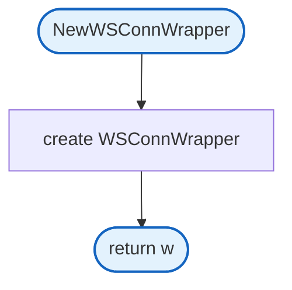
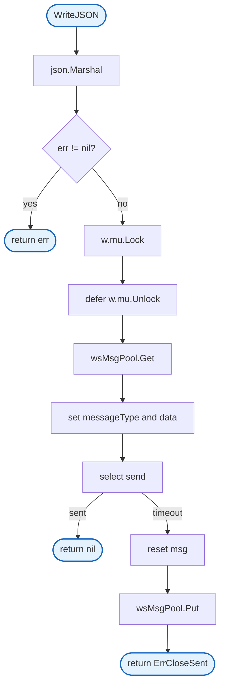

# Conn Wrapper

WebSocket connection wrapper for agent streaming with thread-safe writes.

## Structs

### WSConnWrapper

| Struct | Field | Type | Description |
|--------|-------|------|-------------|
| `WSConnWrapper` | `writeCh` | `chan<- *wsMessage` | Channel for serialized writes |
| | `mu` | `sync.Mutex` | Mutex for thread-safety |
| | `writeTimeout` | `time.Duration` | Write timeout (100ms) |

## NewWSConnWrapper

Creates a new WebSocket connection wrapper.

## WriteJSON

Writes JSON data to the WebSocket connection with thread-safety and timeout.

## Design Notes

### Why Wrap the Write Channel?

**Q: Why use WSConnWrapper instead of passing writeCh directly?**

| Aspect | Description |
|--------|-------------|
| Context | Agents need to write events without knowing WebSocket details |
| Options considered | Pass channel directly, interface, wrapper struct |
| Rationale | Wrapper provides type-safe WriteJSON method with timeout |

**Current approach is recommended because:**
- Clean separation: agents don't know about wsMessage internals
- Thread-safe: mutex protects concurrent agent writes
- Timeout: prevents agents from blocking on stuck connections
- Pool integration: reuses message structs efficiently

### Write Timeout

**Q: Why 100ms write timeout?**

| Aspect | Description |
|--------|-------------|
| Context | Agent events should not block on slow WebSocket writes |
| Options considered | No timeout, short (10ms), medium (100ms), long (1s) |
| Rationale | Fast enough to detect stuck writer, slow enough for normal operation |

**Current approach is recommended because:**
- 100ms is generous for in-memory channel send
- Detects stuck writer goroutine quickly
- Agent continues even if client is slow
- Matches connected event timeout in handler

### Mutex Protection

**Q: Why mutex if channel is already serialized?**

| Aspect | Description |
|--------|-------------|
| Context | Multiple goroutines may call WriteJSON concurrently |
| Options considered | No mutex (race), mutex, atomic pointer swap |
| Rationale | sync.Pool Get/Put and message setup must be atomic with send |

**Current approach is recommended because:**
- Get from pool + set fields + send must be atomic
- Prevents message corruption between goroutines
- Low contention: agents typically write sequentially
- Simple and correct

## Dependencies and Location

| Package | Purpose |
|---------|---------|
| `github.com/gorilla/websocket` | WebSocket constants and errors |
| `encoding/json` | JSON marshaling |

**File Location:** [`internal/websocket/conn_wrapper.go`](../../internal/websocket/conn_wrapper.go)
