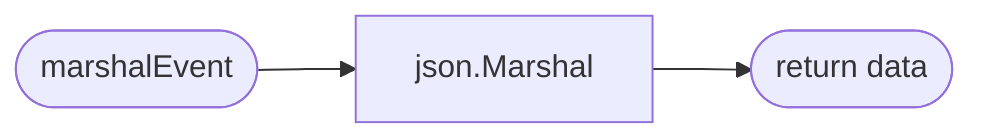
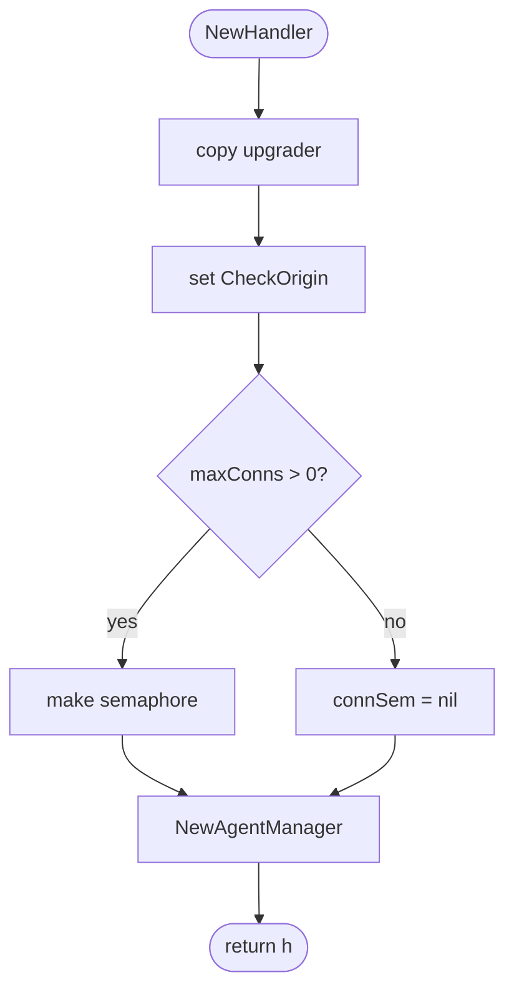
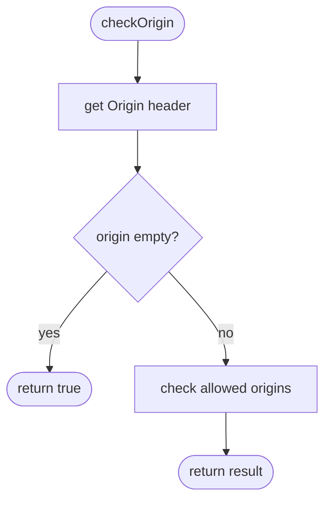
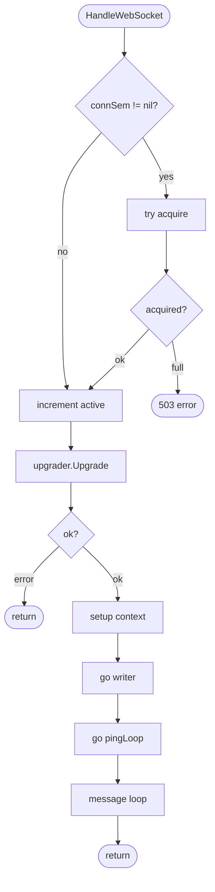
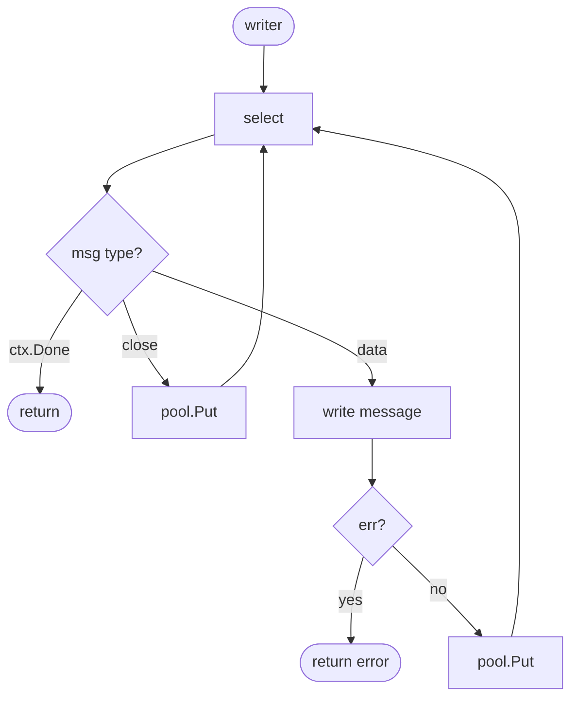
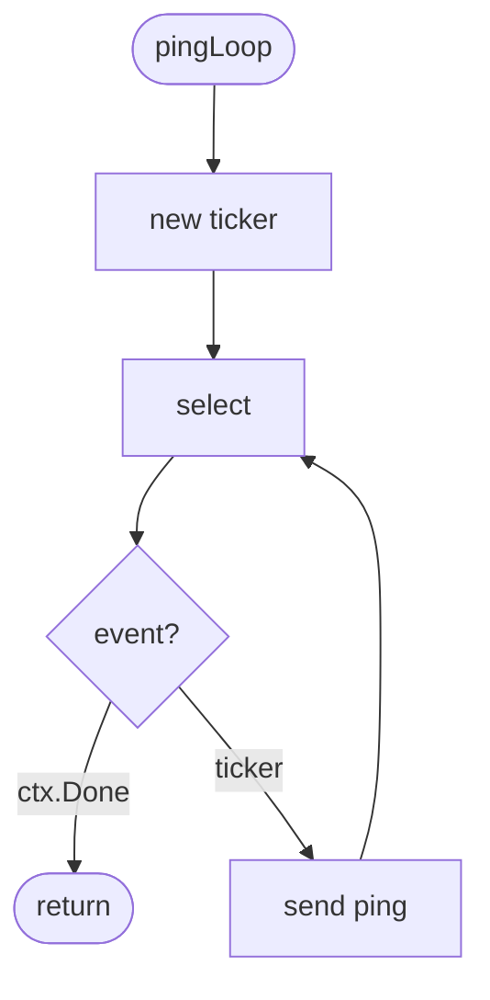
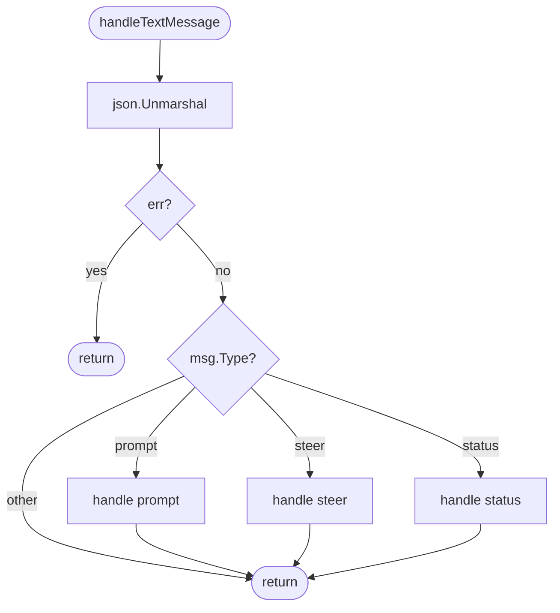
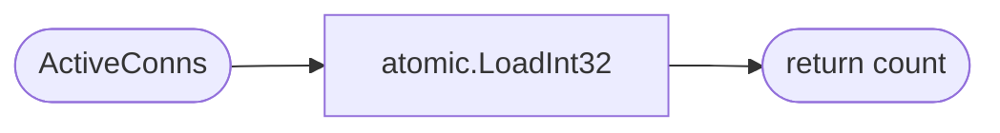

# Handler

WebSocket connection handler with origin validation, connection limiting, and message routing.

## Constants

| Constant | Type | Value | Description |
|----------|------|-------|-------------|
| `defaultBufferSize` | `int` | `8192` | 8KB read/write buffer per connection |
| `MaxMessageSize` | `int` | `65536` | 64KB max message size |
| `readTimeout` | `time.Duration` | `60s` | Read deadline timeout |
| `writeTimeout` | `time.Duration` | `10s` | Write deadline timeout |
| `pingInterval` | `time.Duration` | `30s` | Ping frame interval |

## Variables

| Variable | Type | Description |
|----------|------|-------------|
| `upgrader` | `websocket.Upgrader` | Package-level upgrader with 8KB buffers |
| `wsMsgPool` | `sync.Pool` | Pool for wsMessage structs |

## Structs

### Handler

| Struct | Field | Type | Description |
|--------|-------|------|-------------|
| `Handler` | `logger` | `zerolog.Logger` | Structured logger |
| | `upgrader` | `websocket.Upgrader` | HTTP to WebSocket upgrader |
| | `connSem` | `chan struct{}` | Semaphore for connection limiting |
| | `maxConns` | `int` | Maximum connections (0 = unlimited) |
| | `activeConns` | `int32` | Active connection count (atomic) |
| | `agentManager` | `*AgentManager` | Agent lifecycle manager |

### wsMessage

| Struct | Field | Type | Description |
|--------|-------|------|-------------|
| `wsMessage` | `messageType` | `int` | WebSocket message type (text/binary/ping) |
| | `data` | `[]byte` | Message payload |

### wsEvent

| Struct | Field | Type | Description |
|--------|-------|------|-------------|
| `wsEvent` | `Type` | `string` | Event type (connected, agent_start, etc.) |
| | `AgentID` | `string` | Agent identifier (optional) |
| | `Data` | `any` | Event payload |

## marshalEvent

Private function that converts an event struct to JSON bytes.

## NewHandler

Creates a new WebSocket handler with connection limiting and origin validation.

## checkOrigin

Private function that validates the Origin header against allowed origins list.

## HandleWebSocket

Main WebSocket connection handler with message routing.

## writer

Private method - single-writer goroutine for WebSocket writes with sync.Pool.

## pingLoop

Private method - sends periodic ping frames to keep connections alive.

## handleTextMessage

Private method - routes text messages to appropriate handlers based on type.

### Message Types

| Type | Description |
|------|-------------|
| `prompt` | Submits task to agent via `agentManager.GetAgent` |
| `steer` | Stops agent via `agentManager.GetExistingAgent.Stop()` |
| `status` | Gets agent status via `agentManager.GetOrCreateAgentForUser` |

## ActiveConns

Returns current number of active WebSocket connections.

## Dependencies and Location

| Package | Purpose |
|---------|---------|
| `github.com/gorilla/websocket` | WebSocket protocol |
| `github.com/google/uuid` | UUID generation |
| `github.com/rs/zerolog` | Structured logging |
| `internal/agent` | Agent Task struct |
| `internal/ctx` | Context utilities |

**File Location:** [`internal/websocket/handler.go`](../../internal/websocket/handler.go)
