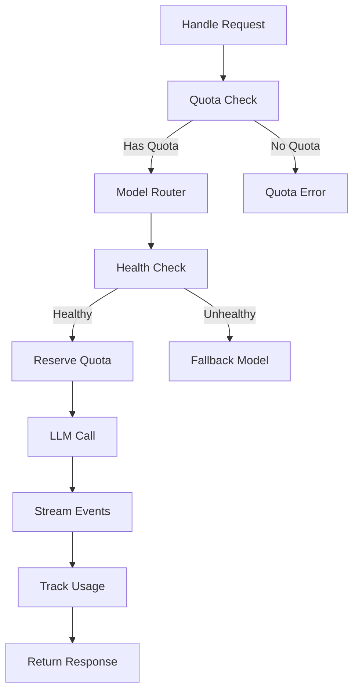
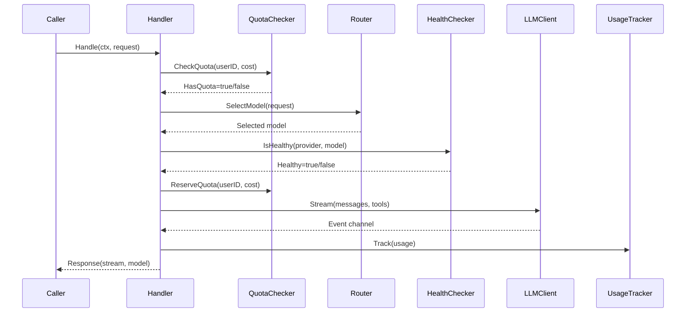

# LLM Proxy Package

Intelligent LLM proxy with routing, quota management, health monitoring, and usage tracking.

## Overview



## Purpose

The llm-proxy package acts as an intermediary between agent requests and LLM providers, providing:

- Intelligent model selection based on query and quota
- Quota enforcement with plan and addon credit support
- Provider health monitoring with circuit breaker
- Usage tracking for billing and analytics
- Fallback to alternative models/providers

## Types

### UserContext

```go
type UserContext struct {
    UserID                string
    PlanTier              string
    QuotaRemaining        float64
    QuotaRemainingPercent int
    HasAddonCredits       bool
    AddonRemaining        float64
    DaysUntilReset        int
    IsUsingAddon          bool
}
```

| Field | Type | Description |
|-------|------|-------------|
| `UserID` | string | User identifier |
| `PlanTier` | string | Subscription tier |
| `QuotaRemaining` | float64 | Remaining plan quota |
| `QuotaRemainingPercent` | int | Remaining quota percentage |
| `HasAddonCredits` | bool | Has addon credits |
| `AddonRemaining` | float64 | Addon credits remaining |
| `DaysUntilReset` | int | Days until monthly reset |
| `IsUsingAddon` | bool | Currently using addon |

### UsageEvent

```go
type UsageEvent struct {
    UserID        string
    SessionID     string
    Model         string
    Provider      string
    TokensInput   int
    TokensOutput  int
    CostTotal     float64
    ChargedFrom   string
    Timestamp     int64
}
```

| Field | Type | Description |
|-------|------|-------------|
| `UserID` | string | User identifier |
| `SessionID` | string | Session identifier |
| `Model` | string | Model used |
| `Provider` | string | Provider name |
| `TokensInput` | int | Input tokens |
| `TokensOutput` | int | Output tokens |
| `CostTotal` | float64 | Total cost |
| `ChargedFrom` | string | "plan" or "addon" |
| `Timestamp` | int64 | Unix timestamp |

### ProxyRequest

```go
type ProxyRequest struct {
    Messages    []agent.AgentMessage
    Tools       []agent.Tool
    UserContext UserContext
}
```

### ProxyResponse

```go
type ProxyResponse struct {
    Stream          <-chan agent.AgentEvent
    Model           string
    UsingAddon      bool
    AddonRemaining  float64
}
```

## Request Flow

1. **Quota Check** - Verify user has sufficient credits (plan first, then addon)
2. **Router** - Select appropriate model based on query and quota
3. **Health Check** - Verify selected provider/model is healthy
4. **Reserve Quota** - Deduct estimated cost from quota
5. **LLM Call** - Stream from provider
6. **Track Usage** - Record token usage and cost

## Sub-packages

| Package | Description |
|---------|-------------|
| [models.md](models.md) | Model registry and cost calculation |
| [router.md](router.md) | LLM-based model selection |
| [quota.md](quota.md) | Quota management with Redis |
| [health.md](health.md) | Circuit breaker and health monitoring |
| [usage.md](usage.md) | Usage tracking with Redis fallback |

## Interfaces

### LLMClient

```go
type LLMClient interface {
    Stream(ctx context.Context, messages []agent.AgentMessage, tools []agent.Tool) (<-chan agent.AgentEvent, error)
}
```

### QuotaChecker

```go
type QuotaChecker interface {
    CheckQuota(ctx context.Context, userID string, estimatedCost float64) (*QuotaCheckResult, error)
    ReserveQuota(ctx context.Context, userID string, cost float64, chargedFrom string) error
}
```

### HealthChecker

```go
type HealthChecker interface {
    IsHealthy(ctx context.Context, provider, model string) bool
    RecordSuccess(ctx context.Context, provider, model string)
    RecordFailure(ctx context.Context, provider, model string, err error)
}
```

### Router

```go
type Router interface {
    SelectModel(ctx context.Context, req RouterRequest) (*RouterResponse, error)
}
```

### UsageTracker

```go
type UsageTracker interface {
    Track(ctx context.Context, event UsageEvent) error
}
```

## Flow

### Proxy Handler Flow



## File Locations

- [`internal/llm-proxy/handler.go`](../internal/llm-proxy/handler.go) - Main handler
- [`internal/llm-proxy/types.go`](../internal/llm-proxy/types.go) - Types
- [`internal/llm-proxy/client.go`](../internal/llm-proxy/client.go) - Agent LLMClient adapter
- [`internal/llm-proxy/middleware.go`](../internal/llm-proxy/middleware.go) - HTTP middleware
- [`tests/unit/llm-proxy/`](../tests/unit/llm-proxy/) - Tests
