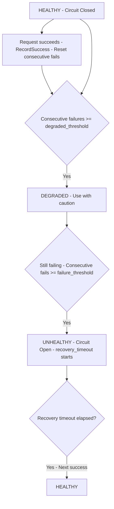
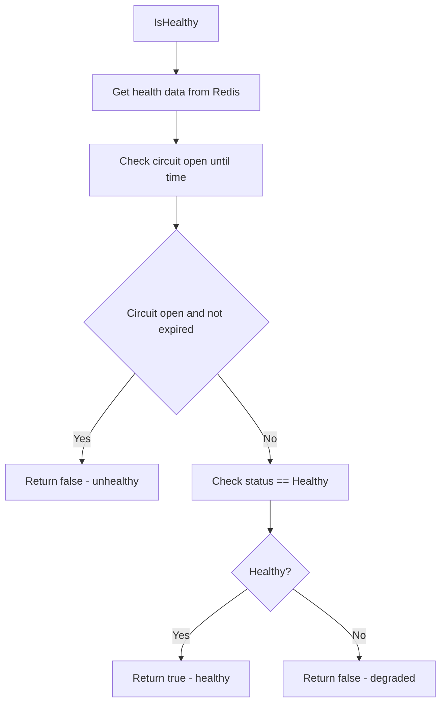

# internal/llm-proxy/health

Circuit breaker and health monitoring for LLM providers.

## Description

The health package implements circuit breaker pattern for LLM provider health monitoring. It tracks failures, opens circuits after thresholds, and supports automatic recovery.

## Circuit Breaker Flow

## Health Check Flow

## Types and Functions

| Name | Kind | Location | Description |
|------|------|----------|-------------|
| HealthStatus | type | [types.go#L5](../internal/llm-proxy/health/types.go#L5) | Health status values (enum) |
| ProviderHealth | struct | [types.go#L14](../internal/llm-proxy/health/types.go#L14) | Provider health data |
| CircuitBreakerConfig | struct | [types.go#L25](../internal/llm-proxy/health/types.go#L25) | Circuit breaker configuration |
| DefaultCircuitBreakerConfig | func | [types.go#L34](../internal/llm-proxy/health/types.go#L34) | Default configuration values |
| Store | struct | [store.go#L12](../internal/llm-proxy/health/store.go#L12) | Redis persistence store |
| NewStore | func | [store.go#L20](../internal/llm-proxy/health/store.go#L20) | Creates new store |
| Store.Get | func | [store.go#L35](../internal/llm-proxy/health/store.go#L35) | Retrieves health data |
| Store.Save | func | [store.go#L67](../internal/llm-proxy/health/store.go#L67) | Stores health data |
| Store.GetAll | func | [store.go#L85](../internal/llm-proxy/health/store.go#L85) | Retrieves all health data |
| Service | struct | [circuit.go#L11](../internal/llm-proxy/health/circuit.go#L11) | Health service |
| NewService | func | [circuit.go#L15](../internal/llm-proxy/health/circuit.go#L15) | Creates health service |
| GetAllHealth | func | [circuit.go#L22](../internal/llm-proxy/health/circuit.go#L22) | Gets all provider health |
| RecordSuccess | func | [circuit.go#L108](../internal/llm-proxy/health/circuit.go#L108) | Updates health on success |
| RecordFailure | func | [circuit.go#L134](../internal/llm-proxy/health/circuit.go#L134) | Records failure |
| IsHealthy | func | [circuit.go#L171](../internal/llm-proxy/health/circuit.go#L171) | Checks if provider is healthy |
| ResetHealth | func | [circuit.go#L28](../internal/llm-proxy/health/circuit.go#L28) | Resets health to healthy |
| GetUnhealthyModels | func | [circuit.go#L45](../internal/llm-proxy/health/circuit.go#L45) | Returns unhealthy models |
| GetDegradedModels | func | [circuit.go#L64](../internal/llm-proxy/health/circuit.go#L64) | Returns degraded models |
| ShouldRateLimit | func | [circuit.go#L83](../internal/llm-proxy/health/circuit.go#L83) | Check if should rate limit |

## Health Status

| Status | Description |
|--------|-------------|
| `StatusHealthy` | Provider is healthy |
| `StatusDegraded` | Some failures, use with caution |
| `StatusUnhealthy` | Circuit is open, avoid using |

## Circuit Breaker Config

| Field | Default | Description |
|-------|---------|-------------|
| `FailureThreshold` | 3 | Failures to trip circuit |
| `RecoveryTimeout` | 60s | Time before recovery attempt |
| `SuccessThreshold` | 2 | Successes to close circuit |
| `DegradedThreshold` | 2 | Failures to mark degraded |

## Redis Keys

Format: `health:{provider}:{model}`
