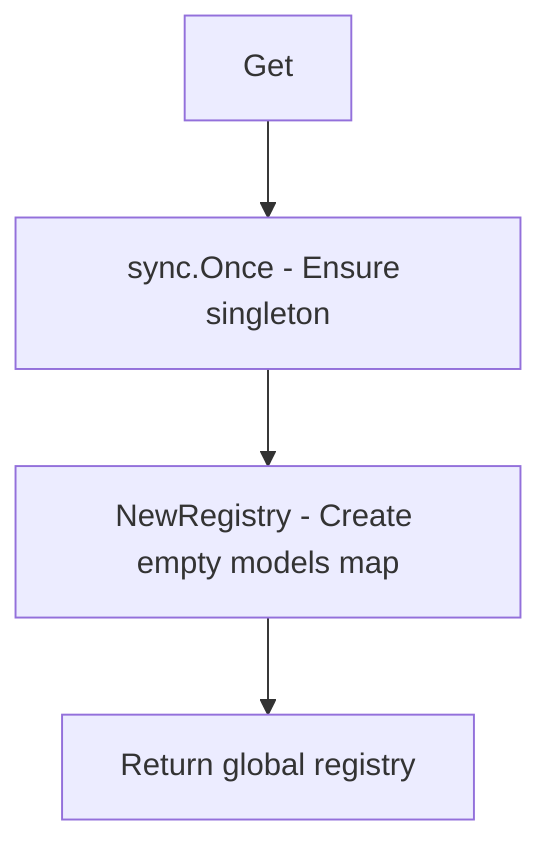
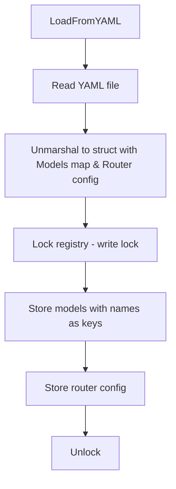
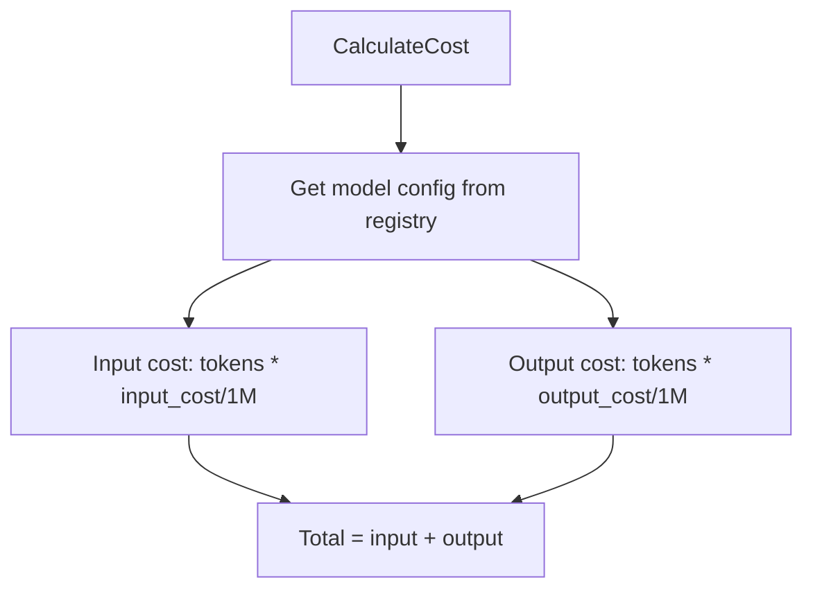

# internal/llm-proxy/models

Model registry and cost calculation.

## Description

The models package manages model configuration registry with pricing information and provides cost calculation utilities.

## Registry Initialization



## YAML Loading Flow



## Cost Calculation



## Types and Functions

| Name | Kind | Location | Description |
|------|------|----------|-------------|
| ModelTier | type | [types.go#L3](../internal/llm-proxy/models/types.go#L3) | Model tier levels (enum) |
| ModelConfig | struct | [types.go#L12](../internal/llm-proxy/models/types.go#L12) | Model configuration |
| Registry | struct | [registry.go#L11](../internal/llm-proxy/models/registry.go#L11) | Model registry |
| RouterConfig | struct | [registry.go#L17](../internal/llm-proxy/models/registry.go#L17) | Router configuration |
| NewRegistry | func | [registry.go#L28](../internal/llm-proxy/models/registry.go#L28) | Creates new registry |
| Get | func | [registry.go#L35](../internal/llm-proxy/models/registry.go#L35) | Returns singleton registry |
| LoadFromYAML | func | [registry.go#L43](../internal/llm-proxy/models/registry.go#L43) | Loads config from YAML |
| GetModel | func | [registry.go#L74](../internal/llm-proxy/models/registry.go#L74) | Gets model by name |
| GetRouterModel | func | [registry.go#L83](../internal/llm-proxy/models/registry.go#L83) | Returns router model |
| GetAllModels | func | [registry.go#L91](../internal/llm-proxy/models/registry.go#L91) | Returns all model names |
| GetModelsByProvider | func | [registry.go#L103](../internal/llm-proxy/models/registry.go#L103) | Filters by provider |
| GetModelsByTier | func | [registry.go#L117](../internal/llm-proxy/models/registry.go#L117) | Filters by tier |
| CalculateCost | func | [costs.go#L7](../internal/llm-proxy/models/costs.go#L7) | Calculates cost for usage |
| EstimateCost | func | [costs.go#L14](../internal/llm-proxy/models/costs.go#L14) | Estimates from token estimates |

## Model Tiers

| Tier | Description |
|------|-------------|
| `TierEconomy` | Low-cost models for simple queries |
| `TierPremium` | Balanced quality and cost |
| `TierUltra` | Highest quality models |

## Model Config Fields

| Field | Type | Description |
|-------|------|-------------|
| `Name` | string | Model name |
| `Provider` | string | LLM provider |
| `InputCostPerMillion` | float64 | Input cost per million tokens |
| `OutputCostPerMillion` | float64 | Output cost per million tokens |
| `MaxTokens` | int | Maximum tokens |
| `Tier` | ModelTier | Quality tier |

## Cost Calculation

```
cost = (inputTokens * inputCostPerMillion / 1,000,000) +
       (outputTokens * outputCostPerMillion / 1,000,000)
```
