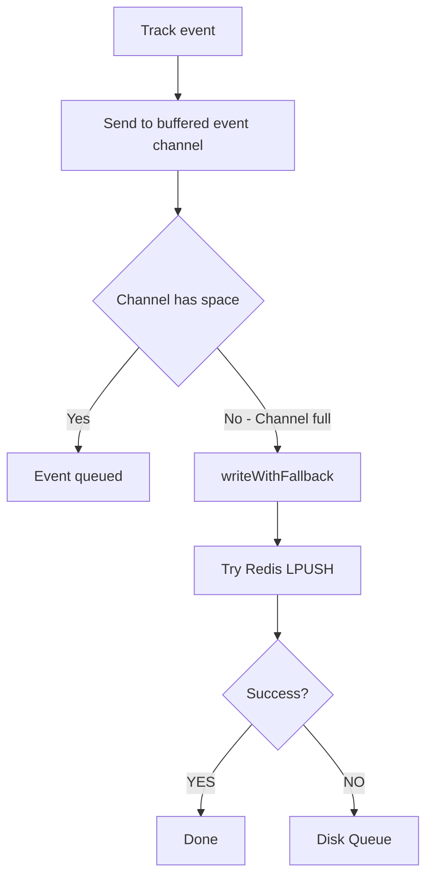

# internal/llm-proxy/usage

Usage tracking with multi-layer fallback.

## Description

The usage package tracks LLM token usage with a three-tier fallback system: primary database insert, Redis queue fallback, and disk queue as last resort.

## Fallback Flow



## Buffered Write Flow


## Types and Functions

| Name | Kind | Location | Description |
|------|------|----------|-------------|
| UsageWriter | struct | [writer.go#L25](../internal/llm-proxy/usage/writer.go#L25) | Buffered usage writer |
| NewUsageWriter | func | [writer.go#L38](../internal/llm-proxy/usage/writer.go#L38) | Creates usage writer |
| Track | func | [writer.go#L52](../internal/llm-proxy/usage/writer.go#L52) | Queues usage event |
| writeWithFallback | func | [writer.go#L63](../internal/llm-proxy/usage/writer.go#L63) | Writes with tiered fallback |
| pushToRedis | func | [writer.go#L82](../internal/llm-proxy/usage/writer.go#L82) | LPUSH operation |
| flush | func | [writer.go#L112](../internal/llm-proxy/usage/writer.go#L112) | Writes buffer to DB |
| dbInsert | func | [writer.go#L141](../internal/llm-proxy/usage/writer.go#L141) | Batch insert |
| Start | func | [writer.go#L203](../internal/llm-proxy/usage/writer.go#L203) | Starts processing loop |
| DiskQueue | struct | [disk_queue.go#L15](../internal/llm-proxy/usage/disk_queue.go#L15) | Disk fallback queue |
| NewDiskQueue | func | [disk_queue.go#L22](../internal/llm-proxy/usage/disk_queue.go#L22) | Creates disk queue |
| Push | func | [disk_queue.go#L37](../internal/llm-proxy/usage/disk_queue.go#L37) | Appends event |
| Pop | func | [disk_queue.go#L67](../internal/llm-proxy/usage/disk_queue.go#L67) | Retrieves next event |
| UsageError | struct | [writer.go#L247](../internal/llm-proxy/usage/writer.go#L247) | Usage error type |
| FallbackError | struct | [writer.go#L264](../internal/llm-proxy/usage/writer.go#L264) | Fallback error type |

## UsageEvent Fields

| Field | Type | Description |
|-------|------|-------------|
| `UserID` | string | User identifier |
| `SessionID` | string | Session identifier |
| `Model` | string | Model used |
| `Provider` | string | LLM provider |
| `TokensInput` | int | Input tokens used |
| `TokensOutput` | int | Output tokens used |
| `CostTotal` | float64 | Total cost |
| `ChargedFrom` | string | "plan" or "addon" |
| `Timestamp` | int64 | Unix timestamp |

## Fallback Tiers

1. **Database** - PostgreSQL batch insert (primary)
2. **Redis** - LPUSH to `usage:{userID}` key (fallback)
3. **Disk** - JSONL file append (last resort)

## Configuration

| Constant | Value | Description |
|----------|-------|-------------|
| `defaultBatchSize` | 1000 | Events per batch |
| `defaultFlushInterval` | 30s | Time between flushes |
| `defaultMaxBufferSize` | 10000 | Max buffered events |

## Database Schema

```sql
INSERT INTO usage_events (
    user_id, session_id, model, provider,
    tokens_input, tokens_output, cost_total,
    charged_from, timestamp
) VALUES ($1, $2, $3, $4, $5, $6, $7, $8, $9)
```
