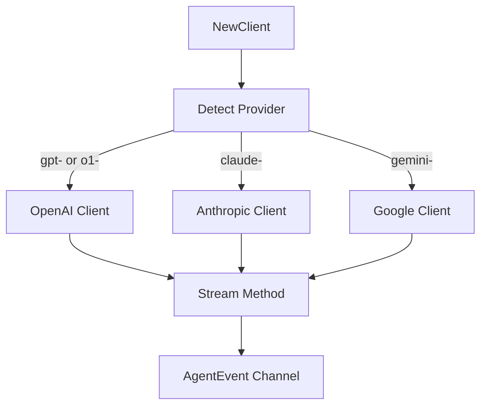
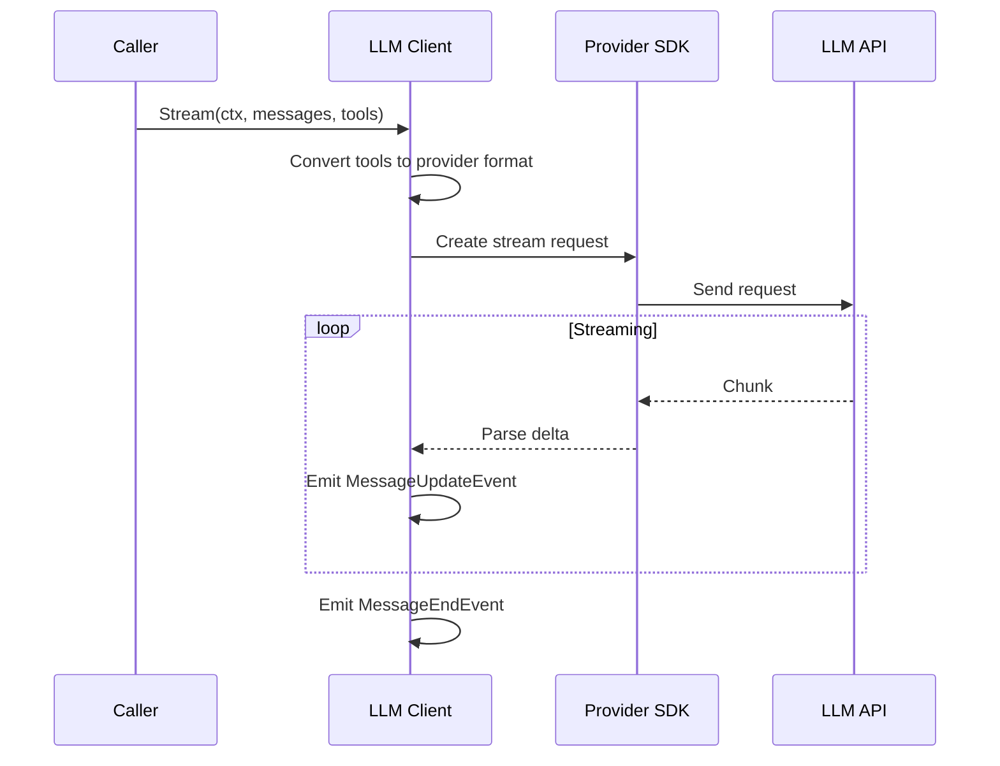

# LLM Package

Unified LLM client factory supporting multiple providers with auto-detection, streaming, and tool calling.

## Overview



## Purpose

The llm package provides:

- Unified client interface for multiple LLM providers
- Provider auto-detection from model names
- Streaming responses with event emission
- Tool calling support
- Official SDK integration

## Types

### Provider

```go
type Provider int
```

| Constant | Value | Description |
|----------|-------|-------------|
| `ProviderOpenAI` | 0 | OpenAI provider |
| `ProviderAnthropic` | 1 | Anthropic provider |
| `ProviderGoogle` | 2 | Google provider |

### Config

```go
type Config struct {
    OpenAIAPIKey      string
    AnthropicAPIKey   string
    GoogleAPIKey      string
    OpenAIBaseURL     string
    AnthropicBaseURL  string
    GoogleBaseURL     string
    Timeout           time.Duration
}
```

| Field | Type | Description |
|-------|------|-------------|
| `OpenAIAPIKey` | string | OpenAI API key |
| `AnthropicAPIKey` | string | Anthropic API key |
| `GoogleAPIKey` | string | Google API key |
| `OpenAIBaseURL` | string | Custom OpenAI base URL |
| `AnthropicBaseURL` | string | Custom Anthropic base URL |
| `GoogleBaseURL` | string | Custom Google base URL |
| `Timeout` | time.Duration | Request timeout (default: 120s) |

### Client

```go
type Client struct {
    provider Provider
    openai   *openaiClient
    anthropic *anthropicClient
    google   *googleClient
    model    agent.Model
}
```

## Functions

| Function | Description |
|----------|-------------|
| `NewClient(config Config, model agent.Model) (*Client, error)` | Creates LLM client with provider detection |
| `ProviderFromString(s string) (Provider, error)` | Parses provider from string |
| `DetectProviderFromModel(model string) (Provider, error)` | Auto-detects provider from model name |
| `Stream(ctx context.Context, messages []agent.AgentMessage, tools []agent.Tool) (<-chan agent.AgentEvent, error)` | Streams LLM response |

## Provider Detection

| Model Prefix | Provider |
|--------------|----------|
| `gpt-`, `o1-` | OpenAI |
| `claude-` | Anthropic |
| `gemini-` | Google |

## Tool Format Conversion

| Function | Description |
|----------|-------------|
| `ToOpenAITool(tool agent.Tool) openai.Tool` | Converts agent tool to OpenAI format |
| `ToAnthropicTool(tool agent.Tool) anthropic.Tool` | Converts agent tool to Anthropic format |
| `ToGoogleTool(tool agent.Tool) google.Tool` | Converts agent tool to Google format |

## Supported Models

| Provider | Models |
|----------|--------|
| OpenAI | GPT-4, GPT-4o, GPT-4o-mini, GPT-3.5-turbo, o1, o1-mini |
| Anthropic | Claude 3.5 Sonnet, Claude 3.5 Haiku, Claude 3 Opus |
| Google | Gemini 2.0 Flash, Gemini 1.5 Pro, Gemini 1.5 Flash |

## Configuration

| Environment Variable | Description | Required |
|---------------------|-------------|----------|
| `OPENAI_API_KEY` | OpenAI API key | For OpenAI models |
| `ANTHROPIC_API_KEY` | Anthropic API key | For Claude models |
| `GOOGLE_API_KEY` | Google API key | For Gemini models |

## Flow

### Stream Flow



## Errors

| Error | When Returned |
|--------|--------------|
| `ErrMissingAPIKey` | Required API key not provided |
| `ErrUnknownProvider` | Unknown provider string |
| `ErrUnknownModel` | Cannot detect provider from model name |

## File Locations

- [`internal/llm/factory.go`](../internal/llm/factory.go) - Client factory
- [`internal/llm/types.go`](../internal/llm/types.go) - Types and constants
- [`internal/llm/openai.go`](../internal/llm/openai.go) - OpenAI client
- [`internal/llm/anthropic.go`](../internal/llm/anthropic.go) - Anthropic client
- [`internal/llm/google.go`](../internal/llm/google.go) - Google client
- [`internal/llm/tools.go`](../internal/llm/tools.go) - Tool format conversion
- [`tests/unit/llm/`](../tests/unit/llm/) - Tests
