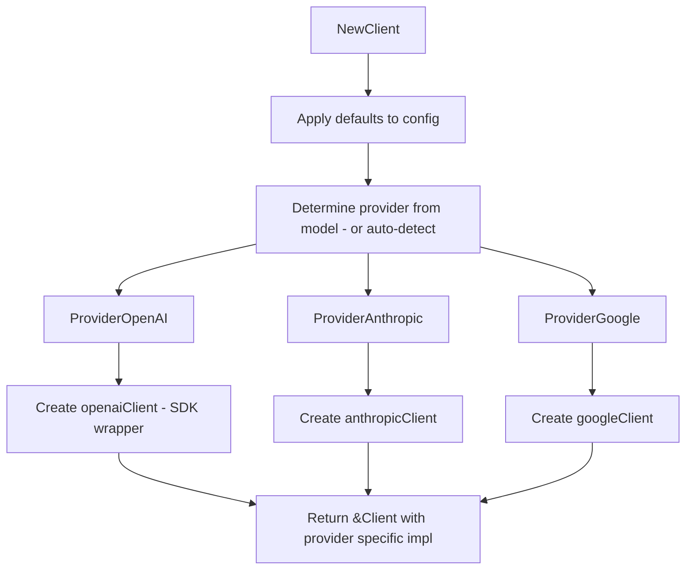
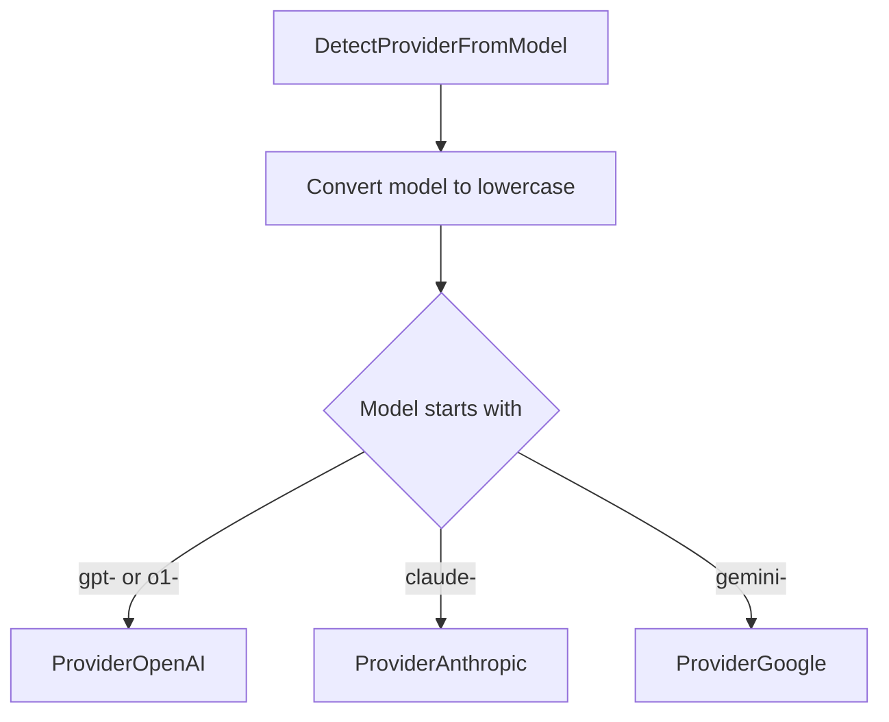
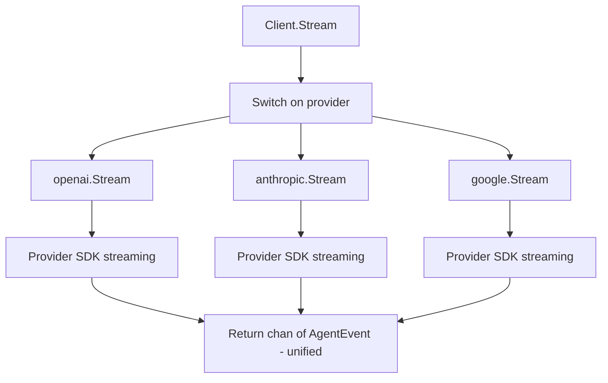

# internal/llm

Multi-provider LLM client with auto-detection.

## Description

The llm package provides a unified interface for multiple LLM providers. It auto-detects the provider from model names and supports streaming responses with tool calling.

## Client Factory Flow

## Provider Detection

## Stream Flow

## Types and Functions

| Name | Kind | Location | Description |
|------|------|----------|-------------|
| ProviderFromString | func | [factory.go#L26](../internal/llm/factory.go#L26) | Parses provider from string |
| DetectProviderFromModel | func | [factory.go#L40](../internal/llm/factory.go#L40) | Auto-detects provider |
| Client | struct | [factory.go#L58](../internal/llm/factory.go#L58) | Unified client interface |
| NewClient | func | [factory.go#L67](../internal/llm/factory.go#L67) | Creates client with provider detection |
| Stream | func | [factory.go#L115](../internal/llm/factory.go#L115) | Sends messages to LLM |
| Provider | type | [types.go#L6](../internal/llm/types.go#L6) | Provider constants (enum) |
| Config | struct | [types.go#L26](../internal/llm/types.go#L26) | Configuration for all providers |
| ModelProviderMapping | const | [types.go#L54](../internal/llm/types.go#L54) | Model to provider mapping |
| OpenAITool | type | [tools.go#L8](../internal/llm/tools.go#L8) | OpenAI tool format |
| AnthropicTool | type | [tools.go#L22](../internal/llm/tools.go#L22) | Anthropic tool format |
| GoogleTool | type | [tools.go#L29](../internal/llm/tools.go#L29) | Google tool format |
| ToOpenAITool | func | [tools.go#L67](../internal/llm/tools.go#L67) | Converts agent Tool to OpenAI |
| ToAnthropicTool | func | [tools.go#L88](../internal/llm/tools.go#L88) | Converts agent Tool to Anthropic |
| ToGoogleTool | func | [tools.go#L106](../internal/llm/tools.go#L106) | Converts agent Tool to Google |
| OpenAIClient | struct | [openai.go#L23](../internal/llm/openai.go#L23) | OpenAI implementation |
| Stream (OpenAI) | func | [openai.go#L35](../internal/llm/openai.go#L35) | Streams from OpenAI API |
| AnthropicClient | struct | [anthropic.go#L27](../internal/llm/anthropic.go#L27) | Anthropic implementation |
| Stream (Anthropic) | func | [anthropic.go#L61](../internal/llm/anthropic.go#L61) | Streams from Anthropic API |
| GoogleClient | struct | [google.go#L23](../internal/llm/google.go#L23) | Google implementation |
| Stream (Google) | func | [google.go#L68](../internal/llm/google.go#L68) | Streams from Google API |

## Providers

| Provider | Prefix | Models |
|----------|--------|--------|
| `ProviderOpenAI` | `gpt-`, `o1-` | GPT-4, GPT-4o, GPT-3.5, o1 |
| `ProviderAnthropic` | `claude-` | Claude 3 Opus, Sonnet, Haiku |
| `ProviderGoogle` | `gemini-` | Gemini Pro, Flash |

## Configuration

| Field | Type | Description |
|-------|------|-------------|
| `OpenAIAPIKey` | string | OpenAI API key |
| `AnthropicAPIKey` | string | Anthropic API key |
| `GoogleAPIKey` | string | Google API key |
| `OpenAIBaseURL` | string | Custom OpenAI base URL |
| `AnthropicBaseURL` | string | Custom Anthropic base URL |
| `GoogleBaseURL` | string | Custom Google base URL |
| `Timeout` | time.Duration | Request timeout (default 120s) |
