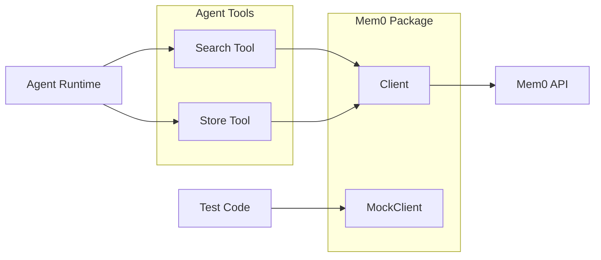

# Mem0

Mem0 API client for long-term memory storage and retrieval. Supports session-based memory operations with mock implementation for testing.

## Overview



## Types

```go
// Client interface for Mem0 API operations
type Client interface {
    // Memory operations
    AddMemory(ctx context.Context, userID, sessionID, content string, metadata map[string]string) (string, error)
    GetMemories(ctx context.Context, userID, sessionID string, limit int) ([]Memory, error)
    SearchMemories(ctx context.Context, userID, sessionID, query string, limit int) ([]Memory, error)
    DeleteMemory(ctx context.Context, memoryID string) error
    DeleteAllMemories(ctx context.Context, userID, sessionID string) error

    // Session operations
    CreateSession(ctx context.Context, userID string) (string, error)
    GetSession(ctx context.Context, sessionID string) (*SessionInfo, error)
    DeleteSession(ctx context.Context, sessionID string) error

    // Health check
    Ping(ctx context.Context) error
}

// Memory represents a stored memory entry
type Memory struct {
    ID        string                 `json:"id"`
    UserID    string                 `json:"user_id"`
    SessionID string                 `json:"session_id"`
    Content   string                 `json:"content"`
    Metadata  map[string]string      `json:"metadata,omitempty"`
    CreatedAt int64                  `json:"created_at"`
    Score     float64                `json:"score,omitempty"` // Relevance score for search results
}

// SessionInfo represents a Mem0 session
type SessionInfo struct {
    ID        string `json:"id"`
    UserID    string `json:"user_id"`
    CreatedAt int64  `json:"created_at"`
}
```

## Functions

| Function | Description |
|----------|-------------|
| `NewClient(apiURL, apiKey string)` | Create Mem0 client |
| `NewMockClient()` | Create in-memory mock for testing |
| `(c *client) AddMemory(ctx, userID, sessionID, content, metadata)` | Store memory |
| `(c *client) GetMemories(ctx, userID, sessionID, limit)` | Retrieve memories |
| `(c *client) SearchMemories(ctx, userID, sessionID, query, limit)` | Semantic search |
| `(c *client) DeleteMemory(ctx, memoryID)` | Delete single memory |
| `(c *client) DeleteAllMemories(ctx, userID, sessionID)` | Delete all memories |
| `(c *client) CreateSession(ctx, userID)` | Create session |
| `(c *client) GetSession(ctx, sessionID)` | Get session info |
| `(c *client) DeleteSession(ctx, sessionID)` | Delete session |
| `(c *client) Ping(ctx)` | Health check |

## Configuration

| Env Var | Description | Default |
|---------|-------------|---------|
| `MEM0_API_URL` | Mem0 API base URL | `https://api.mem0.ai` |
| `MEM0_API_KEY` | Mem0 API key | Required |

## Agent Tools

The [`internal/agent/tools/mem0.go`](../internal/agent/tools/mem0.go) package provides two tools:

| Tool | Description |
|------|-------------|
| `Mem0SearchTool` | Search stored memories with semantic query |
| `Mem0StoreTool` | Store information in long-term memory |

### Tool Definitions

```go
// Mem0SearchTool searches memories
var Mem0SearchTool = Tool{
    Name: "mem0_search",
    Description: "Search long-term memory for relevant information",
    Execute: func(ctx, args) -> ToolResult,
}

// Mem0StoreTool stores memories
var Mem0StoreTool = Tool{
    Name: "mem0_store",
    Description: "Store information in long-term memory",
    Execute: func(ctx, args) -> ToolResult,
}
```

### Tool Arguments

**mem0_search:**
```json
{
  "query": "what did we discuss about the project deadline?",
  "limit": 5
}
```

**mem0_store:**
```json
{
  "content": "User prefers to be contacted via email, not Slack",
  "metadata": {
    "category": "communication_preference"
  }
}
```

## Mock Client

For testing, use `NewMockClient()` which provides:
- In-memory storage
- Thread-safe operations
- Session support
- Reset via `Reset()` method

```go
mock := NewMockClient()
id, _ := mock.AddMemory(ctx, "user-123", "session-456", "test", nil)
memories, _ := mock.GetMemories(ctx, "user-123", "session-456", 10)
mock.Reset() // Clear all data
```

## File Locations

- [`internal/mem0/client.go`](../internal/mem0/client.go) - Mem0 client implementation
- [`internal/agent/tools/mem0.go`](../internal/agent/tools/mem0.go) - Agent tools
- [`tests/unit/mem0/client_test.go`](../../tests/unit/mem0/client_test.go) - Client tests
- [`tests/unit/agent/tools/mem0_test.go`](../../tests/unit/agent/tools/mem0_test.go) - Tool tests

## Related

- [Agent Runtime](../agent/README.md) - Uses Mem0 tools for memory
- [Agent Tools](../agent/tools.md) - All available tools
- [Storage](../storage/README.md) - Workspace storage (complementary to memory)
