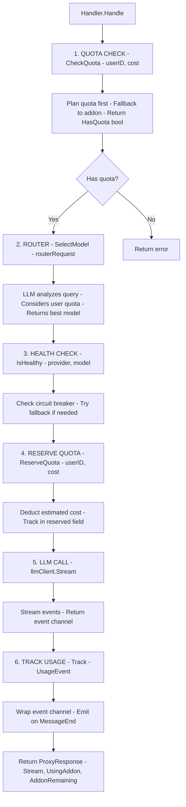

# internal/proxy

Intelligent LLM proxy with routing, quota management, and usage tracking.

## Description

The proxy package provides a complete LLM proxy implementation with intelligent routing, quota enforcement, health monitoring, and usage tracking.

## Proxy Handler Flow

## Sub-packages

| Package | Description |
|---------|-------------|
| [config.md](config.md) | Configuration and plan definitions |
| [health.md](health.md) | Circuit breaker and health monitoring |
| [models.md](models.md) | Model registry and cost calculation |
| [quota.md](quota.md) | Quota management with Redis |
| [router.md](router.md) | LLM-based model selection |
| [usage.md](usage.md) | Usage tracking with fallback |

## Key Types and Functions

| Name | Kind | Location | Description |
|------|------|----------|-------------|
| LLMClient | interface | [handler.go#L14](../internal/proxy/handler.go#L14) | LLM client interface |
| QuotaChecker | interface | [handler.go#L18](../internal/proxy/handler.go#L18) | Quota checker interface |
| QuotaCheckResult | struct | [handler.go#L25](../internal/proxy/handler.go#L25) | Quota check result |
| HealthChecker | interface | [handler.go#L36](../internal/proxy/handler.go#L36) | Health checker interface |
| Router | interface | [handler.go#L43](../internal/proxy/handler.go#L43) | Router interface |
| RouterResponse | struct | [handler.go#L55](../internal/proxy/handler.go#L55) | Router response |
| UsageTracker | interface | [handler.go#L63](../internal/proxy/handler.go#L63) | Usage tracker interface |
| HandlerOptions | struct | [handler.go#L68](../internal/proxy/handler.go#L68) | Handler configuration |
| Handler | struct | [handler.go#L77](../internal/proxy/handler.go#L77) | Main proxy handler |
| NewHandler | func | [handler.go#L86](../internal/proxy/handler.go#L86) | Creates handler |
| ProxyRequest | struct | [handler.go#L97](../internal/proxy/handler.go#L97) | Proxy request data |
| ProxyResponse | struct | [handler.go#L106](../internal/proxy/handler.go#L106) | Proxy response data |
| Handle | func | [handler.go#L138](../internal/proxy/handler.go#L138) | Processes full proxy flow |
| trackUsage | func | [handler.go#L226](../internal/proxy/handler.go#L226) | Wraps channel for usage tracking |
| Middleware | func | [middleware.go#L28](../internal/proxy/middleware.go#L28) | HTTP middleware |
| PauseCheck | func | [middleware.go#L60](../internal/proxy/middleware.go#L60) | Pause check middleware |
| Client | struct | [client.go#L12](../internal/proxy/client.go#L12) | Implements agent.LLMClient |
| UsageEvent | type | [types.go#L5](../internal/proxy/types.go#L5) | Usage event type |
| UserContext | type | [types.go#L27](../internal/proxy/types.go#L27) | User context type |
| ProxyError | struct | [handler.go#L120](../internal/proxy/handler.go#L120) | Proxy error type |

## Request Flow Summary

1. **Quota Check** - Verify user has sufficient credits
2. **Router** - Select appropriate model
3. **Health Check** - Verify selected model is healthy
4. **Reserve Quota** - Deduct estimated cost
5. **LLM Call** - Stream from provider
6. **Track Usage** - Record token usage and cost
