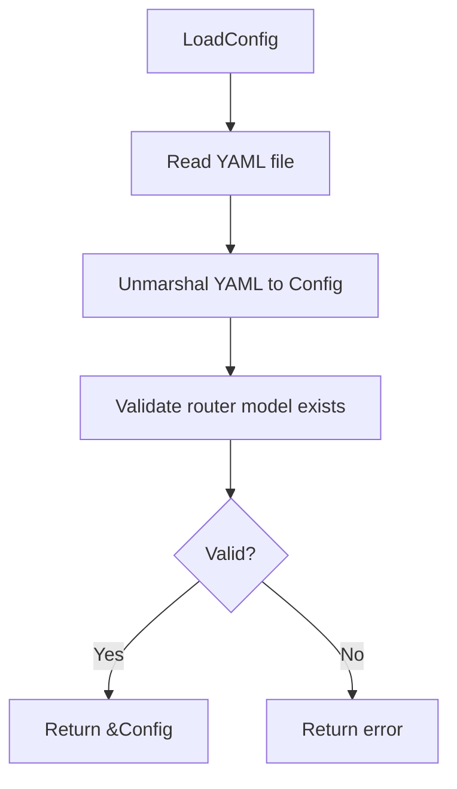
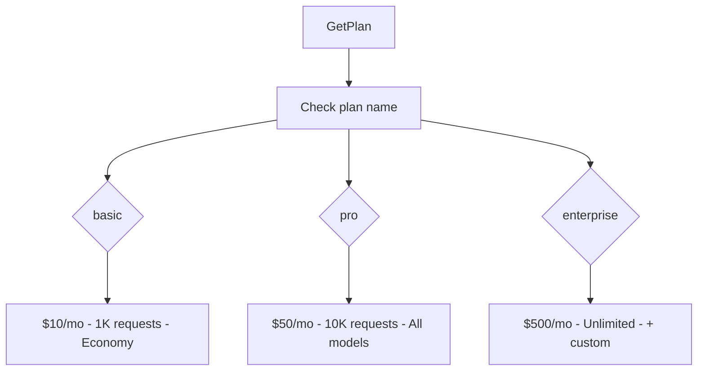

# internal/proxy/config

Configuration and plan definitions.

## Description

The config package loads model and router configuration from YAML files. It also defines subscription plans with LLM credit allowances.

## Config Loading Flow

## Plan Lookup Flow

## Types and Functions

| Name | Kind | Location | Description |
|------|------|----------|-------------|
| Config | struct | [config.go#L11](../internal/proxy/config/config.go#L11) | Main configuration struct |
| ModelConfig | struct | [config.go#L17](../internal/proxy/config/config.go#L17) | Model configuration |
| RouterConfig | struct | [config.go#L26](../internal/proxy/config/config.go#L26) | Router configuration |
| LoadConfig | func | [config.go#L33](../internal/proxy/config/config.go#L33) | Loads config from YAML |
| GetModel | func | [config.go#L55](../internal/proxy/config/config.go#L55) | Gets model by name |
| GetAllModels | func | [config.go#L61](../internal/proxy/config/config.go#L61) | Returns all model names |
| GetModelsByProvider | func | [config.go#L70](../internal/proxy/config/config.go#L70) | Filters models by provider |
| GetModelsByTier | func | [config.go#L81](../internal/proxy/config/config.go#L81) | Filters models by tier |
| Plan | struct | [plans.go#L5](../internal/proxy/config/plans.go#L5) | Subscription plan |
| GetPlan | func | [plans.go#L39](../internal/proxy/config/plans.go#L39) | Gets plan by name |
| GetAllPlans | func | [plans.go#L44](../internal/proxy/config/plans.go#L44) | Returns all plans |
| GetPlanNames | func | [plans.go#L53](../internal/proxy/config/plans.go#L53) | Returns plan names |
| HasFeature | func | [plans.go#L62](../internal/proxy/config/plans.go#L62) | Checks plan feature |

## Plans

| Plan | Monthly Credits | Max Requests | Features |
|------|-----------------|--------------|----------|
| `basic` | $10.00 | 1,000 | economy_models, basic_routing |
| `pro` | $50.00 | 10,000 | all_models, smart_routing, priority_queue |
| `enterprise` | $500.00 | Unlimited | All features + custom_models, dedicated_support |

## Model Config Fields

| Field | Type | Description |
|-------|------|-------------|
| `provider` | string | LLM provider name |
| `input_cost_per_million` | float64 | Input token cost per million |
| `output_cost_per_million` | float64 | Output token cost per million |
| `max_tokens` | int | Maximum tokens for model |
| `tier` | string | Model tier (economy, premium, ultra) |
