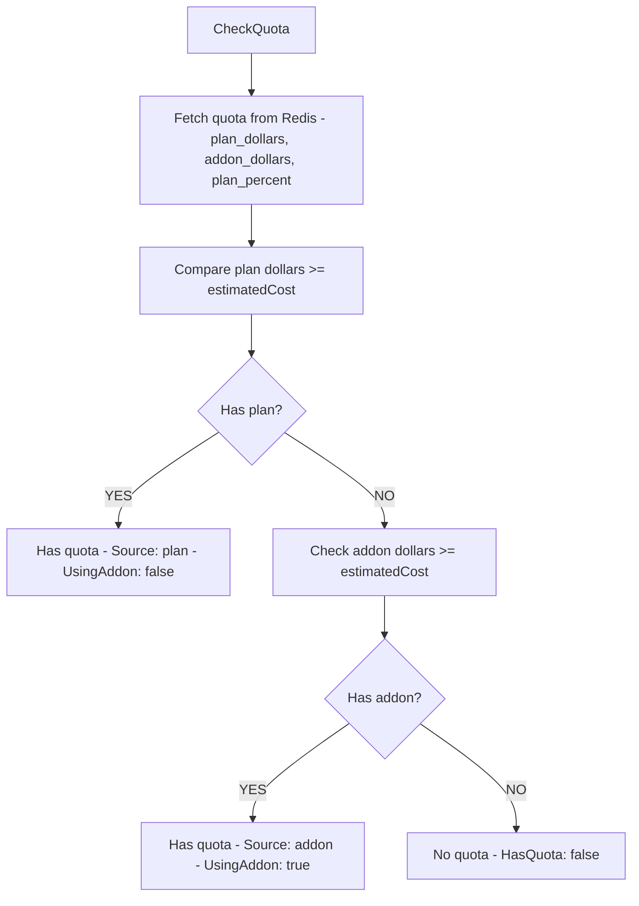
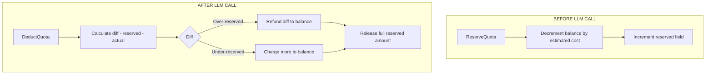

# internal/proxy/quota

Quota management with Redis backend.

## Description

The quota package manages user quota checking, reservation, and deduction with Redis backend. It supports plan quota with addon credit fallback.

## Quota Check Flow

## Reserve and Deduct Flow

## Types and Functions

| Name | Kind | Location | Description |
|------|------|----------|-------------|
| CheckResult | struct | [quota.go#L11](../internal/proxy/quota/quota.go#L11) | Quota check result |
| UserQuotaInfo | struct | [quota.go#L22](../internal/proxy/quota/quota.go#L22) | User quota information |
| CheckQuota | func | [quota.go#L32](../internal/proxy/quota/quota.go#L32) | Verifies sufficient quota |
| ReserveQuota | func | [quota.go#L92](../internal/proxy/quota/quota.go#L92) | Reserves quota before LLM call |
| DeductQuota | func | [quota.go#L116](../internal/proxy/quota/quota.go#L116) | Adjusts quota after call |
| GetUserQuotaInfo | func | [quota.go#L147](../internal/proxy/quota/quota.go#L147) | Retrieves quota info |
| InitializeUserQuota | func | [quota.go#L196](../internal/proxy/quota/quota.go#L196) | Sets up user quota |
| quotaKey | func | [quota.go#L215](../internal/proxy/quota/quota.go#L215) | Generates Redis key |
| Service | struct | [redis.go#L11](../internal/proxy/quota/redis.go#L11) | Redis backend service |
| Check | func | [redis.go#L22](../internal/proxy/quota/redis.go#L22) | Performs quota check |
| Reserve | func | [redis.go#L27](../internal/proxy/quota/redis.go#L27) | Reserves quota |
| Deduct | func | [redis.go#L32](../internal/proxy/quota/redis.go#L32) | Adjusts quota |
| GetInfo | func | [redis.go#L37](../internal/proxy/quota/redis.go#L37) | Retrieves info |
| Initialize | func | [redis.go#L42](../internal/proxy/quota/redis.go#L42) | Sets up user |
| AddCredits | func | [redis.go#L47](../internal/proxy/quota/redis.go#L47) | Adds addon credits |
| SetPlanQuota | func | [redis.go#L58](../internal/proxy/quota/redis.go#L58) | Updates plan quota |
| AddonPurchase | struct | [addon.go#L11](../internal/proxy/quota/addon.go#L11) | Addon purchase data |
| AddonBalance | struct | [addon.go#L21](../internal/proxy/quota/addon.go#L21) | Addon balance data |
| AddCredits | func | [addon.go#L29](../internal/proxy/quota/addon.go#L29) | Adds credits with fee |
| GetAddonBalance | func | [addon.go#L53](../internal/proxy/quota/addon.go#L53) | Retrieves addon balance |
| DeductFromAddon | func | [addon.go#L91](../internal/proxy/quota/addon.go#L91) | Deducts from addon |

## Redis Keys

Format: `quota:{userID}:{field}`

Fields:
- `plan_percent` - Plan quota percentage
- `plan_dollars` - Plan dollars remaining (in cents/1000)
- `addon_dollars` - Addon dollars remaining
- `reserved` - Currently reserved amount
- `days_until_reset` - Days until quota reset

## CheckResult Fields

| Field | Type | Description |
|-------|------|-------------|
| `HasQuota` | bool | Whether user has quota |
| `Source` | string | "plan" or "addon" |
| `PlanPercent` | int | Plan percentage remaining |
| `PlanDollars` | float64 | Plan dollars remaining |
| `AddonDollars` | float64 | Addon dollars remaining |
| `UsingAddon` | bool | Whether using addon credits |
| `EstimatedCost` | float64 | Estimated request cost |

## Quota Flow

1. Check plan quota first
2. Fall back to addon if plan insufficient
3. Reserve estimated cost before LLM call
4. Deduct actual cost after streaming completes
5. Refund difference if over-reserved
