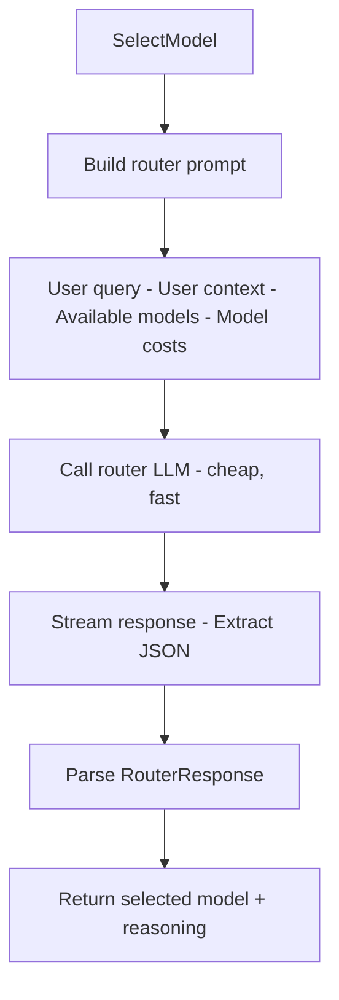
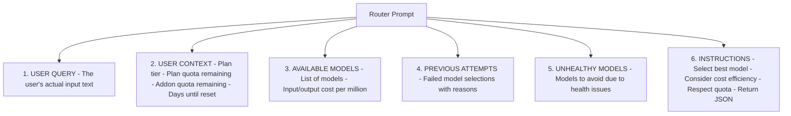

# internal/proxy/router

LLM-based intelligent model selection.

## Description

The router package uses an LLM to intelligently select the best model for each request based on query complexity, user quota, and costs.

## Router Selection Flow

## Prompt Structure

## Types and Functions

| Name | Kind | Location | Description |
|------|------|----------|-------------|
| RouterRequest | interface | [types.go#L17](../internal/proxy/router/types.go#L17) | Router request data |
| RouterResponse | struct | [types.go#L28](../internal/proxy/router/types.go#L28) | Router response data |
| RouterAttempt | struct | [types.go#L38](../internal/proxy/router/types.go#L38) | Failed attempt tracking |
| SelectModel | func | [router.go#L17](../internal/proxy/router/router.go#L17) | Calls router LLM |
| BuildRouterPrompt | func | [prompt.go#L9](../internal/proxy/router/prompt.go#L9) | Creates router prompt |
| LLMClient | interface | [router.go#L12](../internal/proxy/router/router.go#L12) | LLM client interface |

## RouterRequest Fields

| Field | Type | Description |
|-------|------|-------------|
| `UserQuery` | string | The user's query text |
| `AvailableModels` | []string | Models user can access |
| `UserContext` | UserContext | Quota and plan info |
| `ModelCosts` | map[string]CostInfo | Pricing for each model |
| `PreviousAttempts` | []RouterAttempt | Failed attempts |
| `UnhealthyModels` | []string | Models to avoid |

## RouterResponse Fields

| Field | Type | Description |
|-------|------|-------------|
| `SelectedModel` | string | Chosen model |
| `Reasoning` | string | Explanation of choice |
| `Confidence` | string | high/medium/low |
| `FallbackOptions` | []string | Alternative models |
| `EstimatedTokens` | TokenEstimate | Input/output tokens |
| `EstimatedCost` | CostEstimate | Input/output/total cost |

## Selection Criteria

- Query complexity (simple -> economy, complex -> premium)
- User's plan tier and remaining quota
- Cost efficiency
- Model health status
- Previous failures
