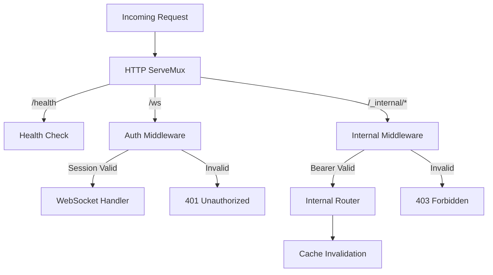
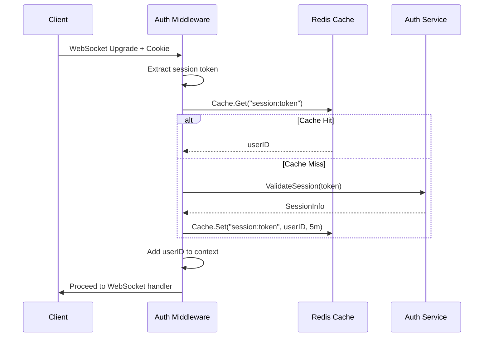
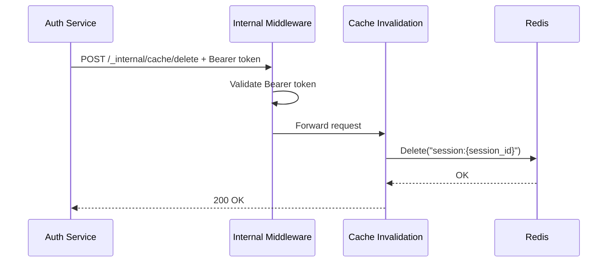

# Server Package

HTTP server management with authentication middleware, WebSocket handling, internal router, and graceful shutdown support.

## Overview



## Purpose

The server package provides:

- HTTP server with graceful shutdown
- Authentication middleware for session validation
- Internal router for service-to-service endpoints
- Redis-backed session caching
- WebSocket handler integration

## Types

### Server

```go
type Server struct {
    httpServer     *http.Server
    logger         zerolog.Logger
    wsHandler      *websocket.Handler
    authMW         *AuthMiddleware
    internalRouter http.Handler
    shutdownCh     chan struct{}
}
```

| Field | Type | Description |
|-------|------|-------------|
| `httpServer` | *http.Server | Go HTTP server instance |
| `logger` | zerolog.Logger | Structured logger |
| `wsHandler` | *websocket.Handler | WebSocket handler |
| `authMW` | *AuthMiddleware | Session authentication middleware |
| `internalRouter` | http.Handler | Internal endpoint router |
| `shutdownCh` | chan struct{} | Shutdown signal channel |

### AuthMiddleware

```go
type AuthMiddleware struct {
    authClient *auth.Client
    cache      Cache
    cacheTTL   time.Duration
}
```

| Field | Type | Description |
|-------|------|-------------|
| `authClient` | *auth.Client | Auth service client |
| `cache` | Cache | Session cache (optional) |
| `cacheTTL` | time.Duration | Cache TTL |

### InternalMiddleware

```go
type InternalMiddleware struct {
    secret string
}
```

| Field | Type | Description |
|-------|------|-------------|
| `secret` | string | Bearer token secret |

### Cache Interface

```go
type Cache interface {
    Get(ctx context.Context, key string) (string, error)
    Set(ctx context.Context, key string, value string, ttl time.Duration) error
    Delete(ctx context.Context, key string) error
}
```

### RedisCache

```go
type RedisCache struct {
    client *redis.Client
}
```

## Functions

### Server

| Function | Description |
|----------|-------------|
| `New(addr string, logger zerolog.Logger, wsHandler *websocket.Handler, authMW *AuthMiddleware, internalRouter http.Handler) *Server` | Creates new server |
| `Start() error` | Starts server with signal handling |
| `Shutdown(ctx context.Context) error` | Graceful shutdown |

### Auth Middleware

| Function | Description |
|----------|-------------|
| `NewAuthMiddleware(authURL, secret string, cache Cache, cacheTTL time.Duration) *AuthMiddleware` | Creates auth middleware |
| `Authenticate(next http.Handler) http.Handler` | Middleware function |
| `WithUserID(ctx context.Context, userID string) context.Context` | Adds user ID to context |
| `GetUserIDFromContext(ctx context.Context) string` | Gets user ID from context |

### Internal Router

| Function | Description |
|----------|-------------|
| `NewInternalRouter(secret string, cache Cache) *mux.Router` | Creates internal router |
| `NewInternalMiddleware(secret string) *InternalMiddleware` | Creates internal middleware |

### Cache

| Function | Description |
|----------|-------------|
| `NewRedisCache(client *redis.Client) *RedisCache` | Creates Redis cache |
| `Get(ctx context.Context, key string) (string, error)` | Gets value from cache |
| `Set(ctx context.Context, key string, value string, ttl time.Duration) error` | Sets value with TTL |
| `Delete(ctx context.Context, key string) error` | Deletes value |

## Errors

| Error | When Returned |
|--------|--------------|
| `ErrSessionInvalid` | Session validation failed |
| `ErrSessionExpired` | Session has expired |
| `ErrAuthUnavailable` | Auth service unavailable |
| `ErrInvalidResponse` | Invalid response format |
| `ErrContextCanceled` | Request context canceled |
| `ErrSecretRequired` | Internal secret required |
| `ErrInvalidFormat` | Invalid request format |
| `ErrCacheUnavailable` | Cache operation failed |

## Configuration

Uses the following environment variables (via config package):

| Env Var | Description | Default |
|---------|-------------|---------|
| `AUTH_SERVICE_URL` | Auth service URL | `http://localhost:8081` |
| `AUTH_TIMEOUT` | Auth request timeout | `2s` |
| `INTERNAL_SECRET` | Gateway internal secret | (required in prod) |
| `REDIS_ADDR` | Redis address | (optional) |
| `REDIS_PASSWORD` | Redis password | (optional) |

## Flow

### Authentication Flow



### Cache Invalidation Flow



## Endpoints

### Public Endpoints

| Path | Method | Description |
|------|--------|-------------|
| `/health` | GET, HEAD | Health check (returns "OK") |

### Protected Endpoints

| Path | Method | Auth | Description |
|------|--------|------|-------------|
| `/ws` | GET | Session cookie | WebSocket upgrade |
| `/_internal/cache/delete` | POST | Bearer token | Invalidate session cache |

## Timeouts

| Timeout | Duration | Description |
|---------|----------|-------------|
| Read Timeout | 15s | Maximum time to read request |
| Write Timeout | 15s | Maximum time to write response |
| Idle Timeout | 60s | Maximum time to keep idle connection |
| Shutdown Timeout | 30s | Maximum time to wait for graceful shutdown |
| Auth Timeout | 2s | Maximum time for auth service request |
| Cache TTL | 5m | Session cache time-to-live |

## File Locations

- [`internal/server/server.go`](../internal/server/server.go) - Server implementation
- [`internal/server/middleware.go`](../internal/server/middleware.go) - Auth middleware
- [`internal/server/internal.go`](../internal/server/internal.go) - Internal router
- [`internal/server/redis_cache.go`](../internal/server/redis_cache.go) - Redis cache adapter
- [`tests/unit/server_test.go`](../tests/unit/server_test.go) - Tests
- [`tests/unit/middleware_test.go`](../tests/unit/middleware_test.go) - Middleware tests
