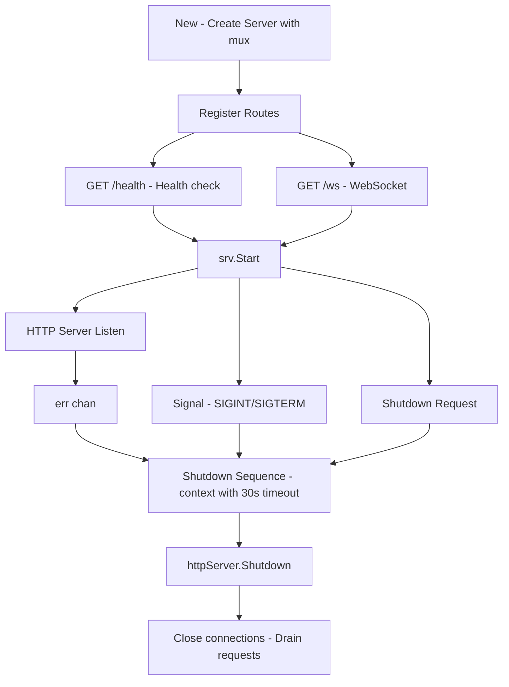
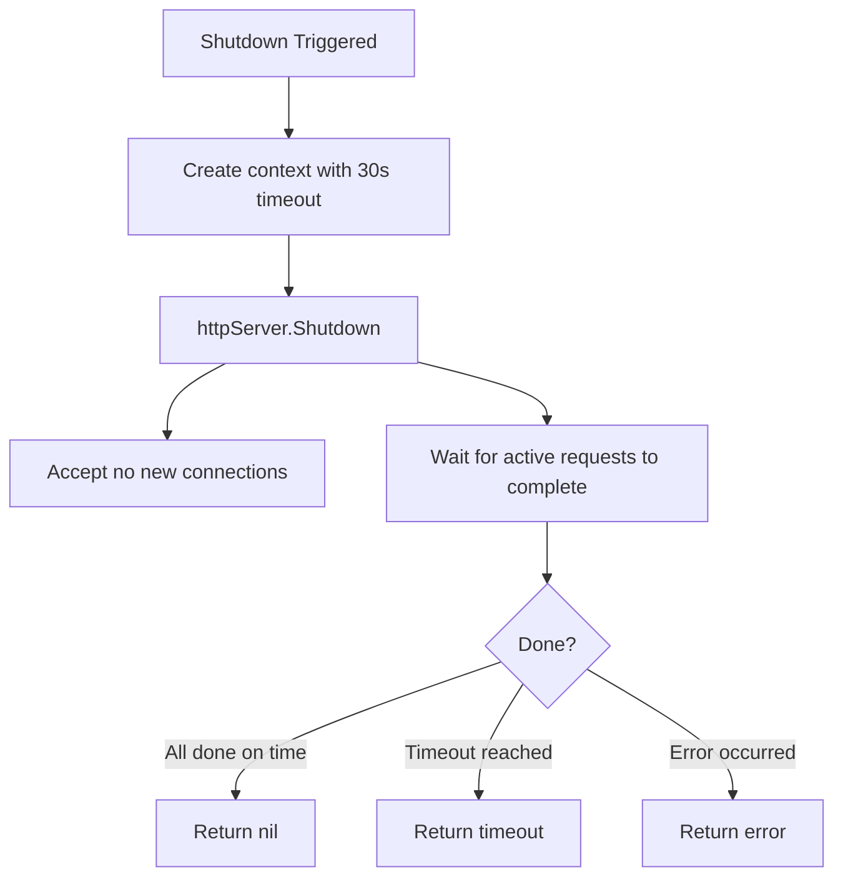

# internal/server

HTTP server with graceful shutdown.

## Description

The server package wraps the Go HTTP server with graceful shutdown support. It handles signal interrupts and provides a clean shutdown mechanism with a configurable timeout.

## Server Lifecycle

## Shutdown Flow

## Types and Functions

| Name | Kind | Location | Description |
|------|------|----------|-------------|
| Server | struct | [server.go#L18](../internal/server/server.go#L18) | http.Server wrapper |
| New | func | [server.go#L26](../internal/server/server.go#L26) | Creates configured server |
| Start | func | [server.go#L59](../internal/server/server.go#L59) | Starts with signal handling |
| Shutdown | func | [server.go#L102](../internal/server/server.go#L102) | Graceful shutdown with 30s timeout |

## Endpoints

| Path | Method | Description |
|------|--------|-------------|
| `/health` | GET, HEAD | Health check endpoint |
| `/ws` | GET | WebSocket upgrade |

## Timeouts

| Timeout | Duration | Description |
|---------|----------|-------------|
| Read Timeout | 15s | Maximum time to read request |
| Write Timeout | 15s | Maximum time to write response |
| Idle Timeout | 60s | Maximum time to keep idle connection |
| Shutdown Timeout | 30s | Maximum time to wait for graceful shutdown |
