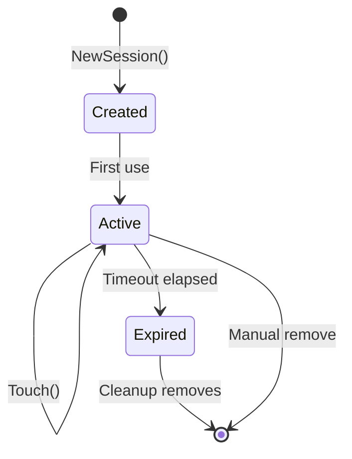

# Session

Session management with timeout, reconnection support, and automatic cleanup of stale sessions.

## Overview

```mermaid
flowchart TB
    subgraph Session["Session Package"]
        Session[Session]
        Manager[Session Manager]
    end

    WS[WebSocket Handler] -->|Create| Manager
    Manager --> Session
    Session -->|Timeout| Manager
    Manager -->|Cleanup| Manager

    Client[Client Reconnect] -->|Resume Session| Manager
    Manager -->|Restore| Session
```

## Types

```go
// Session represents a user session with timeout tracking
type Session struct {
    mu          sync.RWMutex
    id          string
    userID      string
    agentID     string
    createdAt   time.Time
    lastActive  time.Time
    timeout     time.Duration
    data        map[string]string
    ctx         context.Context
    cancel      context.CancelFunc
}

// SessionManager manages multiple sessions with automatic cleanup
type SessionManager struct {
    mu          sync.RWMutex
    sessions    map[string]*Session
    byUserAgent map[string]*Session  // Composite key: userID:agentID
    timeout     time.Duration
    cleanupInt  time.Duration
    logger      zerolog.Logger
    stopCh      chan struct{}
}
```

| Type | Description |
|------|-------------|
| `Session` | Single session with timeout and data storage |
| `SessionManager` | Multi-session manager with cleanup goroutine |

## Functions

### Session

| Function | Description |
|----------|-------------|
| `NewSession(id, userID, agentID string, timeout time.Duration)` | Create new session |
| `(s *Session) ID() string` | Get session ID |
| `(s *Session) UserID() string` | Get user ID |
| `(s *Session) AgentID() string` | Get agent ID |
| `(s *Session) CreatedAt() time.Time` | Get creation time |
| `(s *Session) LastActive() time.Time` | Get last activity timestamp |
| `(s *Session) Touch()` | Update last active time |
| `(s *Session) IsExpired() bool` | Check if session timed out |
| `(s *Session) Set(key, value string)` | Store session data |
| `(s *Session) Get(key string) string` | Retrieve session data |
| `(s *Session) Context() context.Context` | Get session context (cancelled on timeout) |

### SessionManager

| Function | Description |
|----------|-------------|
| `NewSessionManager(timeout, cleanupInterval time.Duration, logger)` | Create manager |
| `(m *SessionManager) Create(userID, agentID string) *Session` | Create new session |
| `(m *SessionManager) Get(id string) *Session` | Get session by ID |
| `(m *SessionManager) GetByUserAgent(userID, agentID string) *Session` | Get by composite key |
| `(m *SessionManager) Remove(id string)` | Remove session |
| `(m *SessionManager) Touch(id string)` | Update session activity |
| `(m *SessionManager) Count() int` | Get active session count |
| `(m *SessionManager) StartCleanup(ctx)` | Start cleanup goroutine |
| `(m *SessionManager) Shutdown(ctx)` | Stop cleanup goroutine |

## Configuration

| Config | Description | Default |
|--------|-------------|---------|
| `timeout` | Session inactivity timeout | 30 minutes |
| `cleanupInterval` | How often to check for expired sessions | 5 minutes |

## Lifecycle



## Composite Key Lookup

Sessions are indexed by both:
1. Session ID (UUID) - for direct lookup
2. Composite key `userID:agentID` - for reconnection

This allows clients to resume their session by providing userID and agentID after reconnecting.

## File Locations

- [`internal/session/session.go`](../internal/session/session.go) - Session type
- [`internal/session/manager.go`](../internal/session/manager.go) - Session manager
- [`tests/unit/session/session_test.go`](../../tests/unit/session/session_test.go) - Session tests
- [`tests/unit/session/manager_test.go`](../../tests/unit/session/manager_test.go) - Manager tests

## Related

- [WebSocket](../websocket.md) - Uses sessions for connection tracking
- [Agent Manager](../websocket.md#agent-manager) - Integrates with session for agent lookup
- [Context](../ctx.md) - Context utilities for userID/agentID propagation
