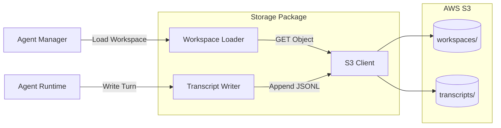

# Storage

S3-based storage layer for agent workspaces and transcripts. Implements OpenClaw-style workspace persistence with JSONL transcript logging.

## Overview



## Types

```go
// S3Client wraps AWS SDK v2 S3 client
type S3Client struct {
    client *s3.Client
    bucket string
}

// Workspace represents an agent's workspace state
type Workspace struct {
    UserID       string
    AgentID      string
    SystemPrompt string
    Messages     []AgentMessage
    Tools        []Tool
    CreatedAt    int64
    UpdatedAt    int64
}

// Turn represents a single conversation turn for transcript logging
type Turn struct {
    Timestamp   int64             `json:"timestamp"`
    UserMessage string            `json:"user_message"`
    AgentID     string            `json:"agent_id"`
    Response    string            `json:"response"`
    ToolCalls   []ToolCallSummary `json:"tool_calls,omitempty"`
    Metadata    map[string]string `json:"metadata,omitempty"`
}
```

| Type | Description |
|------|-------------|
| `S3Client` | AWS S3 client wrapper with mock for testing |
| `Workspace` | Agent workspace state (system prompt, messages, tools) |
| `Turn` | Single conversation turn for transcript logging |
| `TranscriptWriter` | JSONL append-only writer for conversation logs |

## Functions

| Function | Description |
|----------|-------------|
| `NewS3Client(region, bucket, key, secret string)` | Create S3 client (or mock if key is "mock") |
| `WorkspacePath(userID, agentID string)` | Generate S3 key for workspace blob |
| `TranscriptPath(userID, agentID string)` | Generate S3 key for transcript file |
| `LoadWorkspace(ctx, s3Client, userID, agentID)` | Load workspace from S3 |
| `SaveWorkspace(ctx, s3Client, workspace)` | Save workspace to S3 |
| `NewTranscriptWriter(s3Client, userID, agentID)` | Create transcript writer |
| `(w *TranscriptWriter) WriteTurn(ctx, turn)` | Append turn to transcript (JSONL) |
| `(w *TranscriptWriter) Close()` | Flush and close writer |
| `TurnToJSONL(turn)` | Serialize turn to JSONL bytes |

## Configuration

| Env Var | Description | Default |
|---------|-------------|---------|
| `AWS_REGION` | AWS region for S3 | `us-east-1` |
| `S3_BUCKET` | S3 bucket name | Required |
| `AWS_ACCESS_KEY_ID` | AWS access key | (from env/chain) |
| `AWS_SECRET_ACCESS_KEY` | AWS secret key | (from env/chain) |
| `S3_ENDPOINT` | Custom S3 endpoint (for testing) | (AWS default) |

## S3 Path Structure

```
s3://{bucket}/
├── workspaces/
│   └── {user_id}/
│       └── {agent_id}.json         # Workspace state
└── transcripts/
    └── {user_id}/
        └── {agent_id}.jsonl        # Conversation log (append-only)
```

## Transcript Format

Transcripts are JSONL (newline-delimited JSON) for append-only efficiency:

```jsonl
{"timestamp":1234567890,"user_message":"hello","agent_id":"agent-123","response":"Hi there!","tool_calls":[],"metadata":{}}
{"timestamp":1234567891,"user_message":"what's the weather?","agent_id":"agent-123","response":"Let me check.","tool_calls":[{"name":"weather","args":{"location":"NYC"}}],"metadata":{}}
```

## Mock S3 Client

For testing, create a mock client by passing `"mock"` as the access key:

```go
client := NewS3Client("us-east-1", "test-bucket", "mock", "")
// Returns *MockS3Client which implements S3ClientInterface
```

The mock stores data in-memory and supports:
- `GetObject`, `PutObject`, `HeadObject` operations
- Concurrent access with mutex protection
- Reset via `ResetMock()`

## File Locations

- [`internal/storage/s3.go`](../internal/storage/s3.go) - S3 client and path utilities
- [`internal/storage/workspace.go`](../internal/storage/workspace.go) - Workspace loader
- [`internal/storage/transcript.go`](../internal/storage/transcript.go) - Transcript writer
- [`tests/unit/storage/s3_test.go`](../../tests/unit/storage/s3_test.go) - S3 client tests
- [`tests/unit/storage/workspace_test.go`](../../tests/unit/storage/workspace_test.go) - Workspace tests
- [`tests/unit/storage/transcript_test.go`](../../tests/unit/storage/transcript_test.go) - Transcript tests

## Related

- [Agent](../agent/README.md) - Agent runtime that uses workspaces
- [WebSocket](../websocket.md) - Handler that integrates with workspace loading
- [Mem0](../mem0/README.md) - Memory storage complementary to workspace
