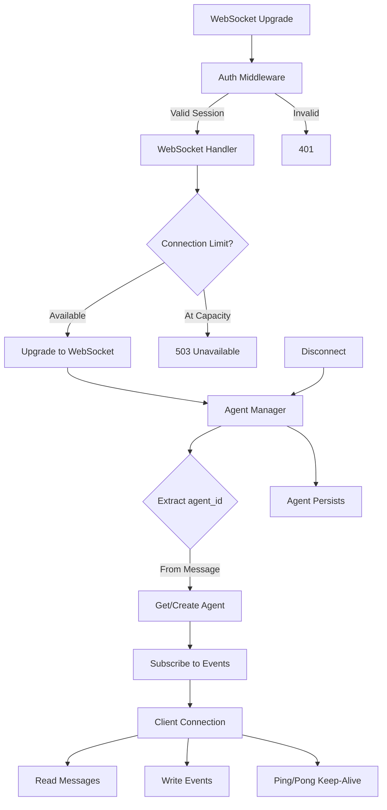
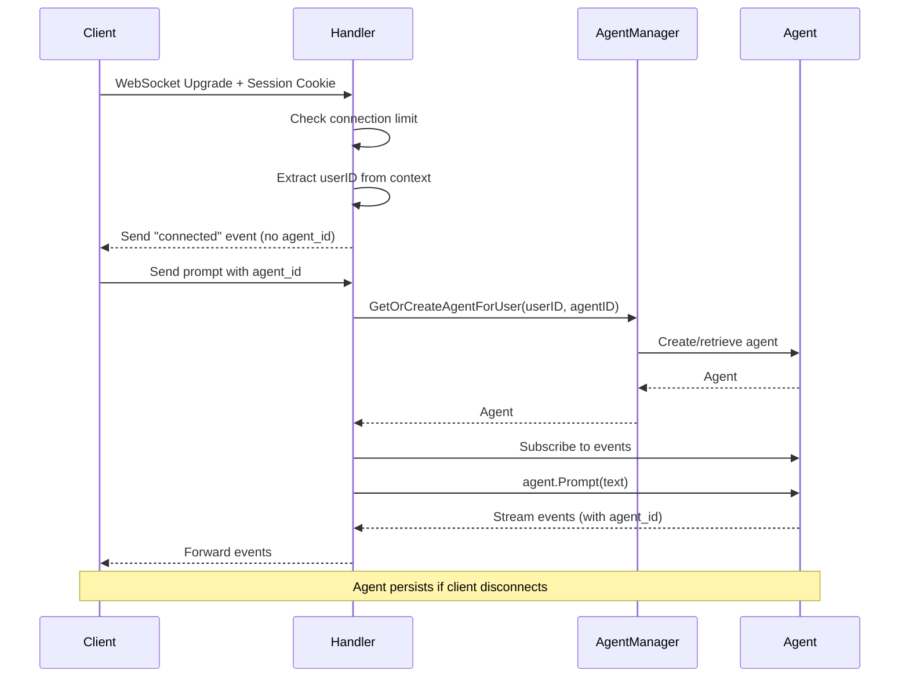

# WebSocket Package

WebSocket connection management with authentication integration, connection limiting, multi-agent routing, and agent event streaming.

## Overview



## Purpose

The websocket package handles:

- WebSocket connection lifecycle (upgrade, message handling, cleanup)
- Connection limiting via semaphore pattern
- **Multi-agent routing via agent_id in every message**
- Agent per-user management (single agent per agent_id)
- Event streaming from agent to client
- Single-writer pattern for thread-safe writes
- Keep-alive via ping/pong frames
- **Agent persistence beyond WebSocket connections**

## Multi-Agent Architecture

- **Single WebSocket connection** per user
- **Multiple agents** per user, identified by `agent_id` in messages
- **Agents persist** beyond WebSocket connections
- **Composite key routing**: `(userID, agentID)` for agent isolation
- **No agent cleanup** on disconnect (state preserved)

## Types

### Handler

```go
type Handler struct {
    logger        zerolog.Logger
    upgrader      websocket.Upgrader
    connSem       chan struct{}
    maxConns      int
    activeConns   int32
    agentManager  *AgentManager
}
```

| Field | Type | Description |
|-------|------|-------------|
| `logger` | zerolog.Logger | Structured logger |
| `upgrader` | websocket.Upgrader | WebSocket upgrader with origin check |
| `connSem` | chan struct{} | Connection semaphore (for limiting) |
| `maxConns` | int | Maximum concurrent connections |
| `activeConns` | int32 | Active connection counter (atomic) |
| `agentManager` | *AgentManager | Agent instance manager |

### wsEvent

```go
type wsEvent struct {
    Type    string
    AgentID string  // Included in all agent events
    Data    any
}
```

| Field | Type | Description |
|-------|------|-------------|
| `Type` | string | Event type (connected, agent_start, etc.) |
| `AgentID` | string | Agent identifier (for agent events) |
| `Data` | any | Event data |

### AgentManager

```go
type AgentManager struct {
    mu      sync.RWMutex
    agents  map[AgentKey]*agent.Agent
}

// AgentKey is composite key for agent lookup
type AgentKey struct {
    UserID  string
    AgentID string
}
```

| Field | Type | Description |
|-------|------|-------------|
| `mu` | sync.RWMutex | Agents map mutex |
| `agents` | map[AgentKey]*agent.Agent | Composite key to agent mapping |

## Functions

| Function | Description |
|----------|-------------|
| `NewHandler(logger, allowedOrigins, maxConns) *Handler` | Creates WebSocket handler |
| `HandleWebSocket(w, r)` | Handles WebSocket connection upgrade |

### AgentManager

| Function | Description |
|----------|-------------|
| `GetOrCreateAgentForUser(userID, agentID string) *agent.Agent` | Gets or creates agent by composite key |
| `RemoveAgentForUser(userID, agentID string)` | Removes agent by composite key |
| `ActiveConns() int` | Returns active connection count |

## Configuration

| Constant | Value | Description |
|----------|-------|-------------|
| `MaxMessageSize` | 65536 (64KB) | Maximum message size |
| `readTimeout` | 60s | Read deadline before pong required |
| `writeTimeout` | 10s | Write deadline for each message |
| `pingInterval` | 30s | Ping frame interval |

## WebSocket Protocol

### Client to Server

**IMPORTANT**: All messages must include `agent_id` field.

```json
{
  "type": "prompt",
  "agent_id": "agent-uuid",
  "text": "user message here"
}
```

| Field | Required | Description |
|-------|----------|-------------|
| `type` | Yes | Message type (e.g., "prompt") |
| `agent_id` | Yes | Target agent identifier |
| `text` | Sometimes | Message text (for prompts) |

### Server to Client Events

All agent events include `agent_id`:

| Event Type | Description | Includes agent_id |
|------------|-------------|-------------------|
| `connected` | Connection established | No |
| `agent_start` | Agent started processing | Yes |
| `agent_end` | Agent finished processing | Yes |
| `turn_start` | Conversation turn started | Yes |
| `turn_end` | Conversation turn ended | Yes |
| `message_start` | Message streaming started | Yes |
| `message_update` | Message content updated | Yes |
| `message_end` | Message completed | Yes |
| `tool_start` | Tool execution started | Yes |
| `tool_update` | Tool execution updated | Yes |
| `tool_end` | Tool execution completed | Yes |

### Connected Event

```json
{
  "type": "connected",
  "data": {
    "session_id": "...",
    "conn_id": "..."
  }
}
```

**Note**: `agent_id` is NOT included in connected event since connection is multi-agent.

### Agent Event Example

```json
{
  "type": "agent_start",
  "agent_id": "agent-123",
  "data": {
    "timestamp": 1234567890
  }
}
```

## Flow

### Connection Flow



### Message Routing

1. Client connects (single WebSocket connection)
2. Server sends `connected` event
3. Client sends message with `agent_id` field
4. Handler routes to agent via composite key `(userID, agentID)`
5. Agent processes and emits events (all include `agent_id`)
6. Handler forwards events to client
7. Client can interleave messages for different agents

### Connection Lifecycle

1. **Authentication**: Auth middleware validates session, adds userID to context
2. **Connection Limit Check**: Semaphore ensures maxConns not exceeded
3. **Upgrade**: HTTP connection upgraded to WebSocket
4. **Connected Event**: Sent to client (no agent assigned yet)
5. **Message Loop**: Read messages from client, route by agent_id, write events
6. **Disconnect**: Agents persist (no cleanup)
7. **Reconnect**: Client resumes with existing agents via agent_id

## File Locations

- [`internal/websocket/handler.go`](../internal/websocket/handler.go) - Main handler with agent_id routing
- [`internal/websocket/agent_manager.go`](../internal/websocket/agent_manager.go) - Agent manager with composite key
- [`tests/unit/websocket/handler_test.go`](../tests/unit/websocket/handler_test.go) - Tests
- [`tests/unit/websocket/agent_manager_test.go`](../tests/unit/websocket/agent_manager_test.go) - Agent manager tests

## Related

- [Agent](../agent/README.md) - Agent runtime
- [Server](../server.md) - HTTP server and middleware
- [Context](../ctx.md) - User ID and agent ID context utilities
