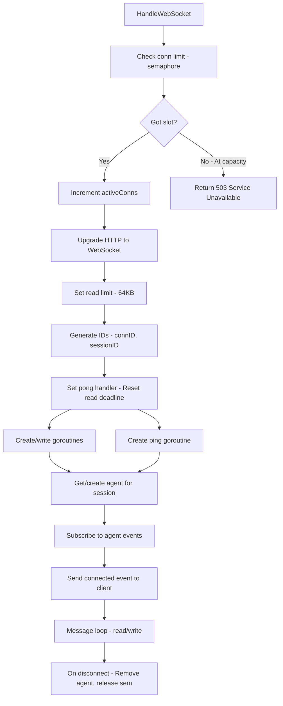
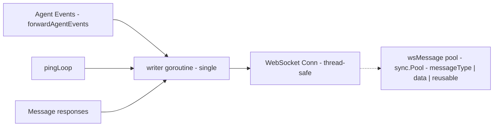

# internal/websocket

WebSocket connection management with single-writer pattern and connection limiting.

## Description

The websocket package handles WebSocket connections with connection limiting via semaphore pattern, single-writer goroutine for thread-safe writes, and automatic keep-alive via ping/pong frames.

## WebSocket Connection Flow

## Single-Writer Pattern

## Types and Functions

| Name | Kind | Location | Description |
|------|------|----------|-------------|
| Handler | struct | [handler.go#L36](../internal/websocket/handler.go#L36) | Connection limiting handler |
| NewHandler | func | [handler.go#L70](../internal/websocket/handler.go#L70) | Creates configured handler |
| HandleWebSocket | func | [handler.go#L111](../internal/websocket/handler.go#L111) | Upgrade and lifecycle |
| writer | func | [handler.go#L312](../internal/websocket/handler.go#L312) | Single-writer pattern goroutine |
| pingLoop | func | [handler.go#L351](../internal/websocket/handler.go#L351) | Keep-alive ping goroutine |
| handleTextMessage | func | [handler.go#L437](../internal/websocket/handler.go#L437) | Processes prompt messages |
| AgentManager | struct | [agent_manager.go#L17](../internal/websocket/agent_manager.go#L17) | Per-connection agents |
| GetOrCreateAgent | func | [agent_manager.go#L40](../internal/websocket/agent_manager.go#L40) | Gets or creates agent with LLM proxy client |
| RemoveAgent | func | [agent_manager.go#L83](../internal/websocket/agent_manager.go#L83) | Cleanup agent |

## Configuration

| Constant | Value | Description |
|----------|-------|-------------|
| `defaultBufferSize` | 8192 (8KB) | Read/write buffer size |
| `maxMessageSize` | 65536 (64KB) | Maximum message size |
| `readTimeout` | 60s | Read deadline before pong required |
| `writeTimeout` | 10s | Write deadline for each message |
| `pingInterval` | 30s | Ping frame interval |

## Event Mapping

| Agent Event | WebSocket Event Type |
|-------------|---------------------|
| `AgentStartEvent` | `agent_start` |
| `AgentEndEvent` | `agent_end` |
| `TurnStartEvent` | `turn_start` |
| `TurnEndEvent` | `turn_end` |
| `MessageStartEvent` | `message_start` |
| `MessageUpdateEvent` | `message_update` |
| `MessageEndEvent` | `message_end` |
| `ToolExecutionStartEvent` | `tool_start` |
| `ToolExecutionUpdateEvent` | `tool_update` |
| `ToolExecutionEndEvent` | `tool_end` |
