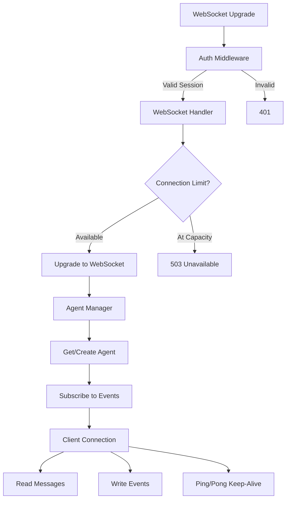
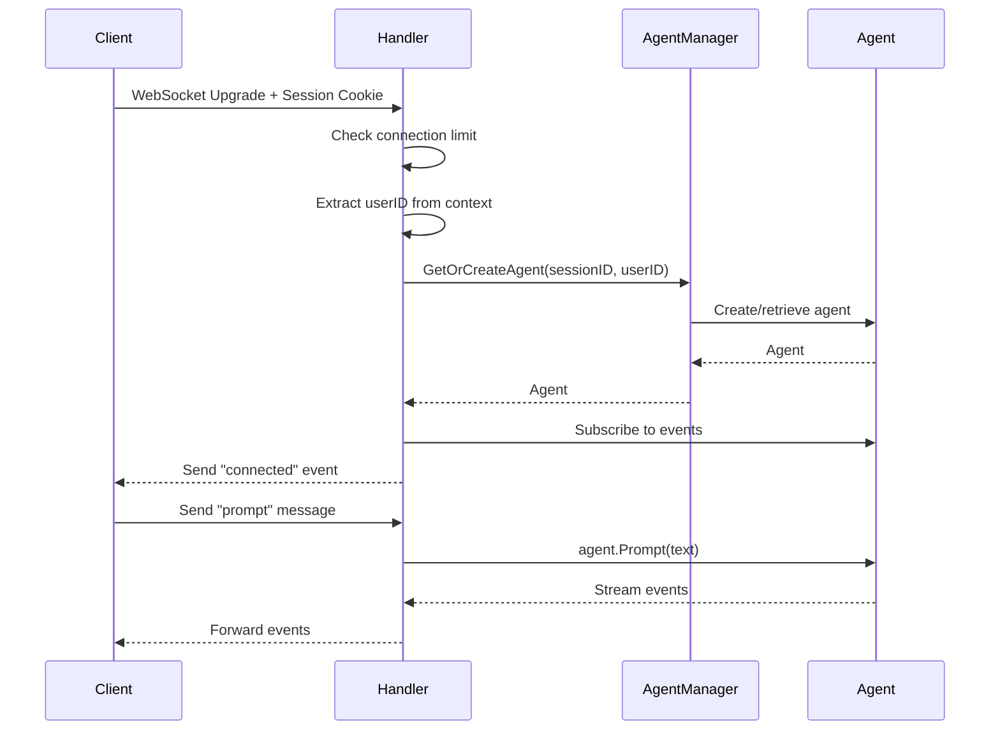

# WebSocket Package

WebSocket connection management with authentication integration, connection limiting, and agent event streaming.

## Overview



## Purpose

The websocket package handles:

- WebSocket connection lifecycle (upgrade, message handling, cleanup)
- Connection limiting via semaphore pattern
- Agent per-connection management
- Event streaming from agent to client
- Single-writer pattern for thread-safe writes
- Keep-alive via ping/pong frames

## Types

### Handler

```go
type Handler struct {
    logger        zerolog.Logger
    upgrader      websocket.Upgrader
    connSem       chan struct{}
    maxConns      int
    activeConns   int32
    agentManager  *AgentManager
}
```

| Field | Type | Description |
|-------|------|-------------|
| `logger` | zerolog.Logger | Structured logger |
| `upgrader` | websocket.Upgrader | WebSocket upgrader with origin check |
| `connSem` | chan struct{} | Connection semaphore (for limiting) |
| `maxConns` | int | Maximum concurrent connections |
| `activeConns` | int32 | Active connection counter (atomic) |
| `agentManager` | *AgentManager | Agent instance manager |

### wsEvent

```go
type wsEvent struct {
    Type string
    Data any
}
```

| Field | Type | Description |
|-------|------|-------------|
| `Type` | string | Event type (connected, agent_start, etc.) |
| `Data` | any | Event data |

### AgentManager

```go
type AgentManager struct {
    mu      sync.RWMutex
    agents  map[string]*agent.Agent
}
```

| Field | Type | Description |
|-------|------|-------------|
| `mu` | sync.RWMutex | Agents map mutex |
| `agents` | map[string]*agent.Agent | Session ID to agent mapping |

## Functions

| Function | Description |
|----------|-------------|
| `NewHandler(logger zerolog.Logger, allowedOrigins []string, maxConns int) *Handler` | Creates WebSocket handler |
| `HandleWebSocket(w http.ResponseWriter, r *http.Request)` | Handles WebSocket connection upgrade |

### AgentManager

| Function | Description |
|----------|-------------|
| `GetOrCreateAgent(sessionID, userID string, llmClient llm.Client) *agent.Agent` | Gets or creates agent for session |
| `RemoveAgent(sessionID string)` | Removes agent from manager |

## Configuration

| Constant | Value | Description |
|----------|-------|-------------|
| `MaxMessageSize` | 65536 (64KB) | Maximum message size |
| `readTimeout` | 60s | Read deadline before pong required |
| `writeTimeout` | 10s | Write deadline for each message |
| `pingInterval` | 30s | Ping frame interval |

## WebSocket Protocol

### Client to Server

```json
{
  "type": "prompt",
  "text": "user message here"
}
```

### Server to Client Events

| Event Type | Description |
|------------|-------------|
| `connected` | Connection established with session info |
| `agent_start` | Agent started processing |
| `agent_end` | Agent finished processing |
| `turn_start` | Conversation turn started |
| `turn_end` | Conversation turn ended |
| `message_start` | Message streaming started |
| `message_update` | Message content updated |
| `message_end` | Message completed |
| `tool_start` | Tool execution started |
| `tool_update` | Tool execution updated |
| `tool_end` | Tool execution completed |

### Connected Event

```json
{
  "type": "connected",
  "data": {
    "session_id": "...",
    "agent_id": "...",
    "conn_id": "..."
  }
}
```

## Flow

### Connection Flow



### Connection Lifecycle

1. **Authentication**: Auth middleware validates session, adds userID to context
2. **Connection Limit Check**: Semaphore ensures maxConns not exceeded
3. **Upgrade**: HTTP connection upgraded to WebSocket
4. **Agent Creation**: Agent retrieved/created for session
5. **Event Subscription**: Handler subscribes to agent events
6. **Connected Event**: Sent to client with connection info
7. **Message Loop**: Read messages from client, write events to client
8. **Cleanup**: On disconnect, agent reference removed, semaphore released

## File Locations

- [`internal/websocket/handler.go`](../internal/websocket/handler.go) - Main handler
- [`internal/websocket/agent_manager.go`](../internal/websocket/agent_manager.go) - Agent manager
- [`tests/unit/websocket/handler_test.go`](../tests/unit/websocket/handler_test.go) - Tests
- [`tests/unit/websocket/handler_bench_test.go`](../tests/unit/websocket/handler_bench_test.go) - Benchmarks
